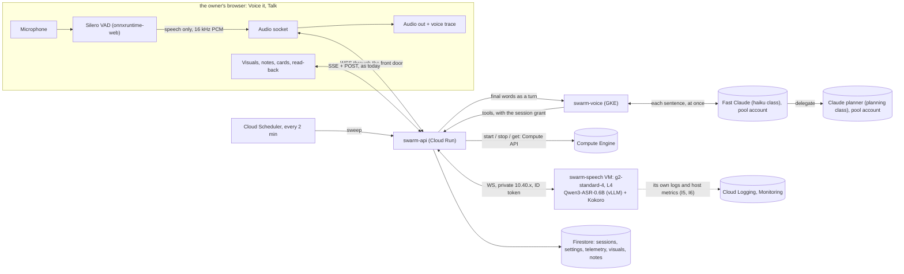

# Voice it's own speech: an engine on our own L4 beside GPT-Live

**Status:** design only, nothing built. Written 2026-11-05 (UTC) against `main` at `b24d496`, part
of the Day One install program. It extends [voice-it.md](voice-it.md); everything that design settles (the planner, the
session grant, the card catalogue, the ledger, the safety table) stands unless this file says
otherwise. The owner answered its four open questions at 02:49 UTC the same day (§17); every section
below says what they decided.

**The owner's ask (the owner, 2026-11-05, 02:01 to 02:24 UTC).** A second engine for Voice it:
speech-to-text and text-to-speech on a GPU machine SwarmCloud runs itself, chosen in a new Settings
section beside GPT-Live, measured in a new Telemetry section, with a read-back before any
destructive spoken command, and a Talk page that presents visuals to discuss and annotate.

---

## 1. Decision record

The owner's picks; they are settled and this design builds to them.

| # | The owner picked | Where it lands |
|---|---|---|
| 1 | Speech-to-text on **our own machine**: one `g2-standard-4` (4 vCPU, 16 GB, one NVIDIA L4), **on-demand**, kept **stopped, not deleted**, between sessions. Qwen3-ASR-0.6B (vLLM's own Qwen3-ASR model, streaming through vLLM), Silero voice detection. Starts on Start, stops on Stop or after 5 minutes without speech or tool activity. About $0.71 an hour while running; chosen over Cloud Run with an L4 (about $1.05 an hour plus up to 15 idle minutes) and over a hosted service | §3, §4, §5 |
| 2 | Voice it **speaks** its replies: Kokoro (82M) on the same L4. The Presence layout's voice trace stays | §3.3, §9 |
| 3 | A spoken command that **cancels, merges, deploys, deletes or approves is read back first**; everything else acts as heard. Autonomy otherwise unchanged | §7 |
| 4 | **GPT-Live stays** as a second engine. Settings choose the engine and hold the OpenAI key's status; the key is set only through the existing one-time link, which moves from Admin › Accounts into Voice it's Settings. Default engine: our own speech. Text mode stays the fallback | §10 |
| 5 | A **Settings** section: engine, key status, machine type, speech-to-text model, text-to-speech model and voice, idle timeout, zone (shown, not chosen, since Q1 fixed one machine in one zone). Picked **by name** from a catalogue served by swarm-api, each machine with its price per hour. Applies at the next machine start. Platform admins only | §11 |
| 6 | A **Telemetry** section for the models we run: model performance and machine load, live and per session and per day, with machine minutes and their cost | §12 |
| 7 | Start uses exactly the engine in Settings. The Talk page carries **no prose**: only what is proposed and what is transcribed. **Every action works by voice**, confirmations included. The page **presents visuals** (mock-ups, diagrams, specs, code, debugging aids) to discuss and annotate with notes that become work | §7, §8, §9 |

The planner stays a Claude account from the pool, acting as the signed-in person through the session
grant (voice-it.md §3.6). On this engine a **small, fast Claude model from the same pool sits in
front of it**: it answers each spoken sentence at once and hands planning and actions to the planner
(§3.3, §14 L12; Q3). Nothing on this engine reaches OpenAI.

## 2. What exists today, and what each fact forces

| Fact (read 2026-11-05) | Forces |
|---|---|
| swarm-api is Cloud Run with **Direct VPC egress**, `ALL_TRAFFIC`, on `module.network`'s subnet (`terraform/modules/cloud_run/main.tf:49-70`, `terraform/infra/main.tf:394`). It already reaches swarm-voice at a reserved **internal** address on that subnet (`google_compute_address.voice`, `terraform/infra/voice.tf:194`) | swarm-api reaches a machine's private address on swarm-vpc with **no new connector**: only a reserved address, a firewall rule and the machine (§3.2) |
| swarm-vpc is `${name_prefix}-vpc`, subnet `${name_prefix}-subnet-${region}` at `10.40.0.0/20`; pods `10.44.0.0/14`; Cloud NAT covers that subnet only (`terraform/modules/network/`). `allow_internal` admits every internal range | The machine sits on that subnet with no public IP and leaves through the existing NAT. Because `allow_internal` also admits GKE pods and tenant jobs, the speech port gets its own allow and deny rules **and** an identity check (§3.2) |
| No `google_compute_instance` exists in `terraform/` | The machine lane writes the first one; labels from `local.labels` (`managed-by=swarm-terraform`) |
| Sessions: `pick_mode` gives `live` or `text` from the broker's `NO_LIVE_ACCOUNT` (`apps/swarm-api/swarm_api/voice/sessions.py:404`); text turns go `POST /v1/voice/sessions/{id}/turns` → swarm-voice `/turn` → `TurnAnswer.reply` (`sessions.py:396`) | Own speech **reuses text mode's shape** (a session with no SDP, turns posted as text, cards on the SSE stream) but not its conversation: `/turn` on a `speech` session is answered by the fast Claude front, never by `textchat.py`'s ChatGPT plan (§3.3, Q3) |
| One live session per person, by the `voice_live` marker in one transaction (`sessions.py:634-689`) | A second Start is already refused; the machine adds one lease document so two people cannot share it (§4.6) |
| The planner's tools are read and `draw_<kind>` only today (`apps/swarm-voice/swarm_voice/tools_read.py`, `planner.py`); act tools are voice-it.md §10 phase 3 (`tools_act.py`, not yet written) | The read-back gate is built into the act path as it lands, enforced in swarm-api's grant check, not in the prompt (§7) |
| The OpenAI key is a quota-broker pool account of provider `openai-api` (`apps/swarm-api/swarm_api/schemas.py:821`, `apps/quota-broker/quota_broker/openai_api_key.py`), set through the `voice-api-key` one-time link (`apps/swarm-api/swarm_api/setup_links.py:49`) minted from `Accounts.tsx:3159` | The link kind and the broker's store do not change; only the button moves (§10.3) |
| Ledger caps `SESSION_CAP_USD = 100.0`, `DAY_CAP_USD = 300.0` (`apps/swarm-api/swarm_api/voice/ledger.py:77-78`), computed, never counted | Machine minutes become one more computed line (§13) |
| L4 quota `NVIDIA_L4_GPUS` in us-central1: 16, 0 used (the owner, 02:01 UTC) | Quota is not the risk; zone stock is (§4.7) |
| The project's other two networks (the other team's VPC and the default network) are on `SHARED_DENY_LIST` (`scripts/lib/common.sh`) | Nothing in this design or its lanes may reference either; the machine is on swarm-vpc only |

## 3. Architecture

### 3.1 The picture



**Audio reaches only our machine, and words reach only Claude.** On this engine no audio leaves
SwarmCloud: the browser sends speech to swarm-api, swarm-api to the VM on swarm-vpc. The transcribed
**words** go to the fast Claude front in swarm-voice (`claudefront.py`, §14 L12), which answers at
once and delegates planning and actions to the Claude planner. **Nothing goes to OpenAI on this
engine**: no ChatGPT plan, no GPT-Live, no OpenAI key is read (Q3). Text mode, which does use the
ChatGPT plan, is only the fallback when this engine cannot start (§4.1).

### 3.2 How swarm-api reaches the machine

* **Address.** A reserved internal address `${name_prefix}-speech` on the existing subnet
  (`google_compute_address`, as `voice.tf` reserves swarm-voice's), so `SWARM_SPEECH_ADDR` in
  swarm-api's env (`terraform/infra/locals.tf`, `local.service_env["swarm-api"]`) never moves. The
  VM has **no external IP**; it pulls its image and model weights through the subnet's Cloud NAT.
* **Path.** swarm-api already egresses all traffic into the subnet, so a socket to
  `ws://<address>:8080/v1/stream` routes with no connector and no new egress setting.
* **Firewall** (in `terraform/infra/voice_speech.tf`, not in the shared network module):
  `allow_speech_from_subnet`, priority 940, TCP 8080 from `10.40.0.0/20` to target tag
  `swarm-speech`; `deny_speech_other`, priority 950, all ingress to `swarm-speech`. That shuts out
  pod ranges, which `allow_internal` (priority 1000) would otherwise admit.
* **Identity, the real gate.** Tenant Cloud Run Jobs on Direct VPC egress (`tenant_job_vpc.tf`) also
  take addresses in `10.40.0.0/20`, so the source range proves nothing. Every socket swarm-api opens
  carries a Google ID token minted from the metadata server for audience `swarm-speech`; the speech
  server verifies it (Google's certificates, through NAT) and accepts only swarm-api's service
  account email, passed to it as instance metadata. No secret is involved, so none can reach Terraform.

### 3.3 The path of audio and text

1. **The browser detects speech.** Silero VAD v5 runs in an AudioWorklet through onnxruntime-web
   (the model file bundled with the console, no CDN). Only frames inside speech, plus 300 ms of
   pre-roll, leave the browser: 16 kHz, mono, 16-bit little-endian PCM in 20 ms binary frames (640
   bytes; 32 KB/s while speaking, nothing while silent).
2. **The audio socket.** `GET /v1/voice/sessions/{id}/audio` upgrades to a WebSocket on swarm-api
   behind the existing front door (same sign-in, same IAP; the route checks the caller is the
   session's person, as the SSE route does). Browser → server: binary PCM frames; JSON
   `{"t":"utt.start","seq":n}`, `{"t":"utt.end","seq":n}`, `{"t":"barge"}` (stop speaking),
   `{"t":"ping"}` every 15 s, `{"t":"point","visual":id,"anchor":{...}}` (§8.3). Server → browser:
   `{"t":"partial","seq":n,"text":...}`, `{"t":"final","seq":n,"text":...}`,
   `{"t":"status","state":...}` (§4.3), `{"t":"say.start","id":...,"text":...,"point_at":...}`,
   binary 24 kHz 16-bit PCM audio, `{"t":"say.end","id":...}`, `{"t":"rotate"}`.
3. **swarm-api relays** each utterance to the VM over one socket per session,
   `ws://<address>:8080/v1/stream`, with the ID token. The server feeds frames into Qwen3-ASR's
   streaming vLLM path, returns partials as they form, and a final on `utt.end`.
4. **Finals go to the fast Claude front.** swarm-api first runs the read-back matcher (§7.3); if
   the words are not an answer to a pending read-back, it calls `VoiceSessions.turn(session_id,
   text)` → swarm-voice `/turn`, which on a `speech` session is `claudefront.FrontSessions.turn`,
   not `textchat.py`. The front (a haiku-class Claude on a pool account held for the session, §14
   L12) answers in one or two sentences **at once**. When the sentence asks for a plan, a card, a
   visual or an action, the front calls `delegate`, says so ("Looking at that now."), and the
   planner (planning class, a pool account leased per delegation, as today) runs in the background
   with the session's person and grant. A read-only question ("how many agents are running", what
   state a workflow is in) the front answers itself in the same turn with the read tools
   (tools_read.py, GET only, run in swarm-voice on `Planner.read` with the session's grant): two
   planning-model rounds behind a delegation were too slow for a count, and a read changes nothing,
   so it needs no planner (the owner's pick on #3954, 12 November 2026). Partials are only shown,
   never sent.
5. **The reply is spoken.** `TurnAnswer.reply`, the front's own sentence, goes to the VM's
   `/v1/speak` on the same socket (`{"t":"speak","id","text","voice"}`); Kokoro streams 24 kHz PCM
   sentence by sentence, swarm-api forwards it, the page plays it through an `AudioWorklet` and draws
   the trace from an `AnalyserNode` on that output (voice-it.md §3.10 keeps its trace). A delegated
   answer carries `delegation_id`; swarm-api's relay waits on swarm-voice's `GET /delegations/{id}`
   (at most `planner.TURN_SECONDS`, 240 s) and speaks the planner's two sentences at the next
   silence, its cards streaming on SSE as today. A newer utterance never waits for it.
6. **Barge-in.** New speech while the agent talks: the browser stops playback at once and sends
   `barge`; swarm-api sends `cancel` to the VM's synthesis. A planner turn in flight is not
   cancelled (voice-it.md §3.9).
7. **Echo.** The microphone is opened with `echoCancellation: true`; the page plays Kokoro's audio
   through a `MediaStreamAudioDestinationNode` into an `<audio>` element so the browser's canceller
   sees it as remote audio. Not verified that Chrome's canceller covers that path (§14, M6);
   headphones remain the fallback.

**Captions** are the partials and finals for the owner's side and `say.start`'s text for the agent's,
drawn as they arrive and stored as text mode's are (redacted by swarm-voice before storage,
voice-it.md §3.9).

**The 660 s request limit.** swarm-api's requests end at 660 s, so the audio socket, like the SSE
stream, rotates: at 540 s the server sends `rotate`; the browser opens a new socket at the next
silence (or at once if none comes in 60 s) and closes the old one when the new one says `status:
ready`. The VM-side socket is per swarm-api socket; utterances are independent, so a rotation drops
nothing. **Load on swarm-api:** one session is 32 KB/s in and about 48 KB/s out while speaking,
forwarded by an async handler; the gateway lane measures CPU during a 10-minute session (M7) because
lease renewals share that CPU (voice-it.md §3.4).

## 4. The lifecycle

### 4.1 Start

1. Talk's **Start** posts `POST /v1/voice/sessions` with no mode and no engine (pick 7). swarm-api
   reads `voice_settings/platform.engine`.
2. **Engine `own`:** the session opens as today (marker, project, session document, grant) with
   `mode: "speech"`, then swarm-api takes the machine lease (§4.6) and starts the instance (§4.2).
   swarm-voice's `speech` start (no SDP) leases the front's pool account and starts its Claude Code
   child (§14 L12), so the front, the planner and the grant are ready before the machine.
3. **Engine `gpt-live`:** today's flow, `mode: "live"`; no machine.
4. **Fallback to text** (`mode: "text"`, browser speech, today's code) when the chosen engine cannot
   start: for `own`, no free L4 (§4.7), the machine not ready in 4 minutes (not counting `updating
   speech server` and `fetching model`, which have 10 minutes of their own), or no Claude account
   free for the front (a refusal, never a wait); for `gpt-live`, no OpenAI key. Text mode runs on
   the ChatGPT plan, but it is not this engine: no `speech` session reaches OpenAI (Q3). The session
   is not re-opened; its document gets `mode: "text"` and `fallback: {from, reason}`, and the page
   draws one line (§9.2).

### 4.2 Starting the machine

swarm-api's lifecycle (`swarm_api/voice/speech_machine.py`) with the `google-cloud-compute` client:

1. Find the machine: `instances.get` of its one name, `<name_prefix>-speech-machine`, in each zone
   of `voice_speech.zones`. Two found (a crash between a move's delete and its create) are made one:
   the running one is kept, else the first in zone order, and the other is deleted.
2. **A stopped machine:** if settings changed since the last start (§11.4), `setMachineType` and
   `setMetadata`; then `instances.start` in its own zone. **No machine:** ONE
   `regionInstances.bulkInsert` of one machine from the regional template, its location policy
   allowing every zone of `voice_speech.zones`, with Settings' machine type and metadata in the
   create: Google picks the zone (§4.7). Then poll `instances.get` every 2 s until `RUNNING`.
   Status `starting machine`. The four minutes are the budget of the whole Start, the create and
   boot included.
3. Open the socket to the VM's `/v1/stream`, retrying every 2 s; the server answers
   `{"t":"boot","phase":...}` while its systemd unit pulls a changed image (`updating speech
   server`), fetches a model not yet on disk (`fetching model <name>`) and loads models (`loading
   models`).
4. **Readiness:** `/v1/health` reports both models loaded, then the server runs one warm-up
   transcription (a bundled 3 s clip; its text must match) and one warm-up synthesis (one sentence,
   non-empty audio). Then `ready`, and the page's status clears.
5. Each phase's start and end time goes into the session's telemetry (§12): `start.boot` (start call
   to `RUNNING`), `start.server` (`RUNNING` to the socket answering), `start.fetch`, `start.load`,
   `start.warmup`.

### 4.3 Status on the page

`starting machine` → (`updating speech server`) → (`fetching model`) → `loading models` → `ready`
(cleared). During a session: `listening`, `hearing` (partials arriving), `thinking` (a turn in
flight), `speaking`, `reconnecting`, `engine down` (§4.8). Each is one word or two beside the voice
trace, nothing more (§9).

### 4.4 Heartbeat and activity

* The browser `ping`s every 15 s; swarm-api writes `heartbeat_at` on the machine lease every 30 s
  while a browser socket is open.
* **Activity** (resets the idle clock, written as `activity_at`): an utterance received; a planner
  turn in flight; a tool call by the planner (swarm-api sees each on the grant); speech being
  played; a tap on a card, a note, a visual. Partials alone do not count beyond their utterance;
  pings do not count.
* **Idle stop:** `now - activity_at >= idle_minutes` (default 5) ends the session with `cause: idle`
  and stops the machine. One spoken sentence is not first asked: silence for five minutes is the
  signal (pick 1).

### 4.5 Stop, a closed tab, a crash, a restart

* **Stop** (button, Escape, or a spoken "stop the session"): end the session (`END_BY_PERSON`),
  `instances.stop`, release the lease, record the minutes.
* **A closed tab:** the socket drops; swarm-api waits 60 s for a reconnect (a reload, a rotation),
  then ends with `cause: tab_closed` and stops.
* **A crash of the speech server:** the container runs with `restart: always`; swarm-api sees the VM
  socket drop, shows `reconnecting`, retries for 3 minutes. Recovered: `ready`, and the crash is
  counted (§12). Not recovered: `engine down`, the session falls back to text, the machine stops.
* **swarm-api restarts mid-session.** Three independent stops, so nothing can run with no session:
  1. **The sweep:** Cloud Scheduler, every 2 minutes, `POST /v1/internal/voice/speech/sweep` (OIDC
     from the scheduler's service account, as `doctor.tf`'s hourly job). If the instance is not
     `TERMINATED` and the lease has no session whose `heartbeat_at` is under 2 minutes old, it stops
     the instance and closes the lease. A rotating browser re-attaches through any swarm-api instance and refreshes
     the heartbeat, so a live session survives a swarm-api restart.
  2. **The machine's own watchdog:** a systemd timer on the VM powers it off (`shutdown -h now`,
     which ends GPU billing as `TERMINATED`) after 10 minutes with no open authenticated socket,
     counted from boot or the last disconnect.
  3. **The ledger's cap:** at the session or day cap the session ends and the machine stops with it
     (§13).

### 4.6 One session at a time

A Firestore document `voice_speech/machine` is the lease: `{session_id, person, generation, state,
started_at, heartbeat_at, activity_at, zone}`. Start takes it in a transaction that also checks the
person's `voice_live` marker; a live lease for another session refuses with "the speech machine is
in use" (the owner only for now, so this is a guard, not a queue). Each take bumps `generation`; every
stop and every telemetry write carries it, and a holder with a stale generation stops writing
without touching the machine, the same rule as invariant 5's fencing.

### 4.7 No free L4

`instances.start` fails with `ZONE_RESOURCE_POOL_EXHAUSTED` (or `..._WITH_DETAILS`) when the zone
has no L4 free; the bulk insert fails with it when no zone it lists has one.

**Revised again by the owner, 2026-11-09:** "let Google pick the zone. Create the speech machine
through ONE regional bulk insert whose location policy lists the configured zones (a, b, c)". It
replaces the zone-by-zone creates below: swarm-api no longer walks the zones itself, and the
machine has one name in every zone, since the zone is not known until Google places it.

**Revised by the owner, 2026-11-09:** "deploys in a if capacity available, if not checks B and then
C", applied both when the machine is created and every time it is started. It replaces the
2026-11-05 answer (Q1: one zone, one machine, a stockout falls back to text), after dev's release
met a stockout in its one zone: the release's instance create failed, and with it the whole held
apply. Now, under the Start's lease, one machine at a time:

* **No machine:** one regional bulk insert of one machine from the template, its location policy
  allowing every zone of `voice_speech.zones`; Google places it in one with an L4 free, and the
  operation says which.
* **A stopped machine:** start it in its own zone. On a stockout, delete it (the delete is waited
  for, so there are never two) and create it through the same one bulk insert.
* **A refused bulk insert** (no listed zone had an L4): swarm-api ends the lease, the session falls
  back to text exactly as before, and the page says one line, "No L4 free in <zones>.", with a
  [Text] control (already in text mode, the control only dismisses). The next Start asks again.
* **The four minutes** (§4.1) cover the whole Start. The insert is not asked once they are spent:
  the session falls back as `not_ready`, and the reason names the zones tried and those not tried.
  A machine an insert placed after the budget ran out is stopped in whichever listed zone it is.

Every stockout is recorded with its zone (a `voice_speech_zone_stockout` row in `voice_audit`, one
per listed zone for a refused bulk insert, and on the lease's `stockouts`), the lease's `zone` is
the zone the start used, and a Start refused in every zone is counted once (`voice_speech_no_l4`), per day in Telemetry, so a region that keeps
running out shows.

### 4.8 What ends the session

Causes `ended_by_person`, `idle`, `tab_closed`, `budget_cap`, `swept` (`engine_down` and `no_l4`
fall back instead), each in `voice_audit` with the machine minutes.

## 5. The machine

### 5.1 Shape

| Field | Value | Why |
|---|---|---|
| Name | `${name_prefix}-speech-machine`, e.g. `swarm-speech-machine` | One name in every zone: Google picks the zone at the bulk insert (§4.7); swarm-api keeps one machine |
| Type | `g2-standard-4` (Settings may pick another single-L4 g2) | Pick 1 |
| GPU | 1 × `nvidia-l4`, attached by the g2 type | |
| Scheduling | `provisioning_model = "STANDARD"`, `on_host_maintenance = "TERMINATE"`, `automatic_restart = false` | Invariant 6: Spot is off platform-wide. GPU VMs cannot live-migrate; `automatic_restart = false` so a host event leaves it stopped, never running with no session |
| Boot disk | 150 GB `pd-balanced`, kept | Image (about 50 GB with the driver), the server image (about 20 GB), weights (0.6B about 2 GB, 1.7B about 5 GB, Kokoro under 1 GB), with room for one old image during an update |
| Image | Deep Learning VM, Ubuntu 22.04 with NVIDIA driver **580 or later** and the container toolkit, pinned to one image name in tfvars | Drivers stay on the disk; nothing compiles at boot. vLLM 0.31 and later are built on CUDA 13, which needs a 580 driver on the host; the driver is the `-nvidia-<driver>` suffix of the image's family, the installer pins nothing older, and its tfvars rendering refuses an older recorded image |
| Ops Agent | Google's Ops Agent, installed by the first boot's startup script from Google's package repository through NAT and kept on the disk; its config (`/etc/google-cloud-ops-agent/config.yaml`) is written by L2's unit: the `swarm-speech` container and units' journal, host metrics and the NVML GPU receiver, nothing else | Q2: logs and host metrics without a session (I5, I6) |
| Network | swarm-vpc subnet, reserved internal address, **no external IP**, tag `swarm-speech` | §3.2 |
| Shielded VM | secure boot off (the NVIDIA module is unsigned on that image), vTPM and integrity monitoring on | Measured by the machine lane (M1) |
| Labels | `local.labels` + `component = "voice-speech"` | `managed-by=swarm-terraform` so `make destroy` handles it |
| Metadata | `swarm-speech-image` (digest), `swarm-speech-models` (JSON of model names and revisions), `swarm-speech-caller` (swarm-api's service account email), `swarm-speech-idle-minutes` | The template's carries the caller and the idle minutes; swarm-api writes the image and models into the create, and rewrites them at each start of a stopped machine (§11.4) |
| Who makes it | A regional instance template (`google_compute_region_instance_template`) in Terraform; the machine itself is created by swarm-api from it, in a zone of `voice_speech.zones` (§4.7) | Since 2026-11-09 a release never creates a GPU machine, so a stockout can never fail a release |

Terraform: `terraform/infra/voice_speech.tf`, gated by a variable `voice_speech` (object:
`enabled` default `false`, `zones` default `[]`, read as the region's `-a`, `-b` and `-c` (an
ordered list of the region's L4 zones, every one in `var.region`; owner, 2026-11-09), `image` the
pinned Deep Learning VM image, `disk_gb` default 150), and enabled only when `voice_it` is `"on"`.
The old one-zone `zone` is read as a one-zone list for one release, its validation message pointing
to `zones`. Terraform makes the template, the address, the firewall pair, the sweep and the speech
account's grants, never the machine: the instance a release made before 2026-11-09 left Terraform's
state through a `removed` block with `destroy = false`, so no plan deletes it, and swarm-api finds
it by its name. `voice_speech.template` (default `true`) set to `false` holds the template back
for a deployment whose bootstrap apply has not yet let the release identity make it, since that
release's apply would otherwise stop on the 403 and leave every service update in the same plan
unapplied; `SWARM_SPEECH_TEMPLATE` is then empty and own speech falls back as `speech_not_deployed`.
Every default is explained next to it in `variables.tf`.

### 5.2 The speech server container

`apps/swarm-speech/` (new): a Python 3.11 server (`uv`) with vLLM's own Qwen3-ASR model for Qwen3-ASR's
streaming path, `kokoro` for synthesis, and `websockets`/FastAPI for `/v1/stream`, `/v1/health`,
`/v1/metrics`. One container, one process, one GPU; `--gpus all`. The image `swarm-speech` is built
by the release into the platform's Artifact Registry repository and pinned by digest. **Weights are
not in the image** (they change per setting): the systemd unit fetches each model in
`swarm-speech-models` from Hugging Face by pinned revision into
`/var/lib/swarm-speech/models/<name>@<rev>`, checks the catalogue's SHA-256 list, and skips what is
present. Public weights need no credential.

### 5.3 How a new speech server version reaches the stopped machine

The release writes the new digest into swarm-api's env (`SWARM_SPEECH_IMAGE`, like every service
image). At the next start swarm-api compares it with the instance's `swarm-speech-image` metadata
and, if different, sets it while the machine is stopped. On boot the unit pulls that digest (status
`updating speech server`), runs it, and removes images other than the running one and the previous
one. The machine is never started just to update it: an update costs its pull once, at the next
session.

### 5.4 Zones

**Google picks among the zones, one machine** (owner, 2026-11-09, revising Q1's one zone, one
stopped machine of 2026-11-05, then the same day's zones in order): `voice_speech.zones` lists the
region's L4 zones the bulk insert's location policy allows (§4.7). The installer writes the
region's zones that offer the L4, in letter order. There is still only one machine, and so one
$15-a-month disk: a move deletes the stopped machine before the bulk insert creates the next. Settings **show** the zone (pick 5); the zone the machine is in is the lease's.

swarm-api looks for the machine only in the listed zones. Dropping a zone from `voice_speech.zones`
while the machine sits in it orphans that machine: no Start finds it, and every create then fails on
the reserved address (an error that is not a stockout, so the session falls back as not ready rather
than moving). Before taking a zone out of the list, delete the machine in it (it is stopped between
sessions, and the next Start's bulk insert creates it in a listed zone with a free L4).

Every Compute operation a Start makes (a start, a delete, a create) is waited on for no longer than
what is left of the four minutes, and the lease's heartbeat is refreshed between operations and
between each operation's wait pieces, so a chain of slow stockouts ends in the text fallback inside
the budget, naming the zones tried and not tried, and never reads to the sweep as an abandoned lease.

## 6. IAM, as rows for the owner to approve

| # | Principal | Role | On | Why |
|---|---|---|---|---|
| I1 | swarm-api's service account (`google_service_account.platform["swarm-api"]`) | custom role `swarmSpeechOperator`: `compute.instances.get`, `.start`, `.stop`, `.setMachineType`, `.setMetadata`, `.getSerialPortOutput`, and since 2026-11-09 `compute.instances.create`, `.delete`, `.setLabels`, `.setTags`, `.setServiceAccount`, `compute.disks.create`, `.delete`, `.setLabels`, `compute.instanceTemplates.get`, `.useReadOnly`, `compute.subnetworks.use`, `compute.addresses.useInternal` | **the project, conditioned** (`terraform/bootstrap/speech_operator_grant.tf`, revised 2026-11-09 from an instance-level grant): an instance or disk named `<name_prefix>-speech-*` in a zone of `var.region` (the deployer's linted `extract()` form), the template, the reserved address and the subnet | Create from the template, start, stop, read, delete and apply settings to the speech machine in any listed zone, and to no other VM. Granted by bootstrap, which the owner applies, so it never sits on CI's grantable list |
| I2 | swarm-api's service account | `iam.serviceAccountUser` | the machine's service account only | A create from the template attaches that account, and `setMetadata` on a machine that runs as it, both need actAs: the row stays |
| I3 | `swarm-speech` (new, created in `terraform/bootstrap/platform_service_accounts.tf` as the others are) | `roles/artifactregistry.reader` | the platform's Artifact Registry repository only | Pull its own image |
| I4 | the Cloud Scheduler job's service account (the existing scheduler invoker) | `run.invoker` on swarm-api (already held for `doctor.tf`'s job) | swarm-api | The sweep; no new grant if the doctor's account is reused |
| I5 | `swarm-speech` | `roles/logging.logWriter` | the project (the role has no narrower resource) | **Its own logs** (the owner, Q2): the Ops Agent ships the speech server container's stdout and stderr, and the systemd units' journal (image pull, model fetch, watchdog power-off) to Cloud Logging, under `logName` `swarm-speech`. So a machine that fails before swarm-api's socket opens, or powers itself off, leaves its reason in Logging, where it outlives the boot, not only in serial output. The server logs counts, phases and errors, never audio, words or the ID token |
| I6 | `swarm-speech` | `roles/monitoring.metricWriter` | the project | The Ops Agent's host and GPU metrics (its NVML receiver), at its 60 s default, for operators when no session holds a socket (§12.1). Write only: neither role reads anything |

No secret is created, read or written by any of this; nothing goes into Terraform but names. The
speech server verifies swarm-api's ID token with public certificates. `swarm-speech` holds no
storage, Secret Manager, Firestore or Compute role: it can pull its image and write its own logs and
metrics, and nothing else.

## 7. The read-back gate

### 7.1 Which tools

Every act tool whose verb is **cancel, merge, deploy, delete or approve**, named in one tuple,
`READBACK_VERBS`, in `apps/swarm-api/swarm_api/voice/readback.py`, and every act route is classed
there by its (method, route template): cancelling an agent, workflow, run or schedule; merging a
pull request (the merge step of a run whose policy leaves it to a person); starting a release or
deploy; deleting a schedule, a project, a note or a card's subject; approving a plan, an inbox item
or a run's step. Filing, starting, answering, scheduling and drawing act as heard (pick 3). A test
holds every act route on the grant's allowlist to one class, so a new act route cannot land
unclassed.

### 7.2 How it holds

The gate is enforced by swarm-api, not by the prompt:

1. The planner calls a gated tool. swarm-voice's act path sends the request as usual; swarm-api's
   grant check (`grant.py: check_route`) sees a gated route with no confirmed read-back and **does
   not run it**. It stores a read-back `{id, session_id, heard, action, target_name, method, route,
   body_hash, state: "pending", expires_at}` and answers `202 {readback_id}`. `heard` is the final
   utterance that led to the turn, verbatim after redaction; `target_name` is resolved by swarm-api
   from the route (the pull request's number and title, the agent's or workflow's name, the
   schedule's name), never taken from the model.
2. swarm-api writes a `readback` card (a new kind in `cards.py`): "Heard: <heard> / Will <action>:
   <target_name> / [Go] [Not that]", and the voice says only "Will <action> <target_name>. Go?".
3. **Go** (spoken, or a tap on `POST /v1/voice/sessions/{id}/readbacks/{rid}/go`) marks it
   `confirmed`; swarm-api posts `{readback_id}` to swarm-voice's internal `/readback` (beside its
   `/start`, `/turn`, `/end`), where `swarm_voice/readback.py` holds each 202'd call by id, and the
   act path re-sends that same request with `X-Swarm-Voice-Readback: <id>`. swarm-api runs it only
   if the id is confirmed, unused, of this session and its `method`, `route` and `body_hash` match;
   it is then marked `used`. A swarm-voice restart loses the held call: the card says `expired` and
   nothing runs.
4. **Not that** marks it `refused`; the planner's next turn is told so.
5. One read-back is pending at a time; a newer gated call supersedes the older (`superseded`).

### 7.3 How "go" is recognised

Deterministically, before the planner, in `readback.py`, for both engines: own speech's finals
arrive at swarm-api directly; GPT-Live's user transcripts reach swarm-voice on the sideband, which
posts each final to a new grant write route `POST /v1/voice/sessions/{id}/readbacks/answer`.

* Normalise: lower case, strip punctuation and fillers ("uh", "um", "okay").
* **Go** if the whole utterance is one of: `go`, `go ahead`, `yes go`, `do it`, `confirm`, `yes do
  it`.
* **Refuse** if it is one of: `not that`, `no`, `stop`, `cancel`, `don't`, `wait`.
* Anything else is not an answer: the read-back stays pending, the words go to the planner as a turn
  (which may change its request, superseding).
* A bare "yes" is **not** Go: it is too often an answer to something else.
* On GPT-Live the voice hears the answer too; its instructions say a read-back answer needs no
  delegation, but the gate's result never depends on that.

### 7.4 Silence

A pending read-back expires 45 s after the voice finishes asking: `expired`, nothing runs, the card
greys and stays for the record. It is activity while pending (the idle clock does not run).

## 8. Visuals and notes (pick 7)

### 8.1 How a visual reaches the page

A **visual** is a card of a visual kind, shown large in the centre of the Presence layout. Kinds and
the planner tool that makes each:

| Kind | Tool | Source |
|---|---|---|
| `mockup` | `draw_mockup` (exists) | HTML frames, sandboxed as voice-it.md §4 |
| `diagram` | `draw_diagram` (exists) | Mermaid text checked by `mermaid.parse()`, or architecture JSON drawn with `vis-network` |
| `spec` | `draw_spec` (new draw kind) | Markdown, rendered by the console's existing safe renderer, headings addressable |
| `code` | `show_file`, `show_diff` (new read tools) | A file slice or a pull request's diff, read by swarm-api from the tenant's repository with the GitHub App installation token, scoped by the person's repository grants |
| `log` | `show_log` (new read tool) | A failed step's log tail through the existing agent events and run routes |

The read tools return the visual's id to the planner; swarm-api stores the body and emits
`visual.upsert` on the session's SSE stream. Bodies are read by the page as text, never served as
HTML.

### 8.2 Shapes and storage

```text
voice_projects/{p}/visuals/{v}:
  {id, kind, title, version, source: {repo, ref, path, from, to} | {task_id, step} | null,
   parts: [{id, label}],         # addressable parts: frame/element, node, heading, line
   body_ref: "gs://.../tenants/<t>/voice/<p>/visuals/<v>/<version>",
   created_by: "planner"|"person", created_at, session_id}
voice_projects/{p}/visuals/{v}/notes/{n}:
  {id, visual_version, anchor, text, by, via: "voice"|"typed"|"tap",
   state: "open"|"resolved"|"work", work: {kind, ref} | null, created_at}
anchor: {type: "point", x, y} | {type: "region", x, y, w, h}   # 0-1 of the frame
      | {type: "part", part_id} | {type: "lines", from, to}
```

Bodies live under the tenant's prefix (`tenants/<t>/voice/<p>/`, the grant `voice.tf` already
conditions); documents under the project, so deleting a project deletes them (invariant 9).

### 8.3 How a note attaches to a place

* **Typed or tapped:** the page draws a transparent layer over the visual (over the sandboxed frame,
  so the frame needs no script) and records the click or drag as a `point` or `region`, or the line
  or node under it.
* **Spoken:** the page sends `point` with the pointer's current anchor whenever the pointer rests on
  a visual for 300 ms; swarm-api attaches the latest anchor (under 5 s old) to the utterance. The
  planner's `add_note` draw tool takes that anchor, or names a part ("the header", "line 42", "the
  swarm-api node") from the visual's `parts`; with neither, the note is pinned to the whole visual.
* Routes: `GET /v1/voice/projects/{p}/visuals`, `GET .../visuals/{v}` (body as text), `POST
  /v1/voice/sessions/{s}/visuals` (grant write), `POST /v1/voice/projects/{p}/visuals/{v}/notes`
  (person, and the grant for spoken notes), `PATCH .../notes/{n}`, `POST .../notes/work`.

### 8.4 How notes become work

The planner's `notes_to_work` tool (or the page's selection and a spoken "make that an issue") turns
open notes into one of: a **follow-up** (an item on the project's open list in its brief), an
**issue** (filed through the act path, acting as heard), or a **lane brief** (a Plan card whose lane
lists the visual's source files as its territory). Each note becomes `state: "work"` with the
reference; the card shows the link.

### 8.5 While the agent talks over a visual

`speak` takes an optional `point_at: {visual_id, anchor}`; it rides on `say.start` (own speech) or
on a `focus` SSE event (GPT-Live). While that speech plays the page brings the visual forward, rings
the anchor (a part's outline, a region's box, a line band), and shows the agent's caption under the
voice trace. When the speech ends, the ring fades; notes stay as pins.

## 9. The Talk page (UI: listed for the mock-ups, not drawn here)

### 9.1 What is on it

Only: the voice trace, the status word or two, both sides' captions, the visual in focus with its
note pins, the proposal and read-back cards, the budget meter's line, Start/Stop, mute and
push-to-talk. **No prose**: no explanations, tips or first-use notes (the owner, pick 7).

### 9.2 Screens and states for the mock-ups

Two directions each, drawn in the real console before any build (the owner's mock-up practice,
`docs/web-ui/mockups/PICKS.md`): (1) at rest; (2) starting: `starting machine`, `updating speech
server`, `fetching model`, `loading models`; (3) listening, hearing (partials), thinking, speaking
with the trace; (4) a visual in focus (mock-up, diagram, code slice, log) with pins; (5) the agent
pointing at a part while speaking; (6) adding a note: tapped point, dragged region, spoken note; (7)
a read-back pending, confirmed, refused, expired; (8) fallbacks: "No L4 free in us-central1-a." with
[Text], `engine down`, `reconnecting`; (9) budget at 80% and at the cap; (10) the same on GPT-Live,
without machine states.

## 10. Two engines, one page, one lifecycle

### 10.1 What they share

The session record, the grant, the planner, the cards, visuals and notes, the read-back gate (§7.3
covers both), the ledger and its caps, the SSE stream, Stop and the idle rule. What differs:

| | Own speech (`mode: "speech"`) | GPT-Live (`mode: "live"`) |
|---|---|---|
| Ears | Silero in the browser → Qwen3-ASR on the VM | GPT-Live |
| Conversation | the fast Claude front (haiku class, `claudefront.py`), delegating | GPT-Live, delegating |
| Planner | Claude, planning class, leased per delegation | the same |
| Pool accounts | one Claude account held for the session (the front) plus one per delegation | one OpenAI key for the session plus one Claude account per delegation |
| OpenAI | **none**: no plan, no key, no Realtime call (Q3) | the key, for GPT-Live |
| Mouth | Kokoro, voice from Settings | GPT-Live's own voice |
| Machine | starts and stops with the session | none |
| Ledger line | machine minutes, and the front's turns on the planner line | talk seconds at $0.05 a minute |
| Fallback | text mode on no L4, not ready, or no Claude account for the front | text mode on no key |

**Text mode** (`textchat.py` on the ChatGPT plan) is no engine Settings choose: it is what a session
becomes when its engine cannot start (§4.1).

### 10.2 What of GPT-Live's code changes, by file

* `apps/swarm-api/swarm_api/voice/sessions.py`: `MODE_SPEECH = "speech"`; `pick_mode` becomes
  `pick_engine(settings, pool, person)`: Settings' engine, then `text` when it cannot start
  (`NO_LIVE_ACCOUNT` for `gpt-live`; the machine's failure for `own`). `start` accepts `MODE_SPEECH`
  and sends no offer.
* `apps/swarm-api/swarm_api/routes/voice.py`: `POST /sessions` takes no engine; the new
  `/sessions/{id}/audio` socket; readback answer and go routes.
* `apps/swarm-voice/swarm_voice/main.py`: a `speech` start has no SDP, like a text start, but its
  conversation is `claudefront.FrontSessions` (L12), never `textchat.py`'s; `/turn` routes by the
  session's mode, and L12's `/delegations/{id}` router is mounted beside `/readback`. `live.py` gains
  only the post of each final user transcript to the readback answer route. GPT-Live's delegations reach the
  same planner, so its move to the planning class (L12) applies to both engines.
* `apps/swarm-ui/src/voice/rtc.ts`: unchanged for GPT-Live; the start no longer sends a mode; the
  speech engine's socket is a new file (§14).
* `apps/swarm-ui/src/Accounts.tsx`: the `VOICE_KEY_BUTTON` block (line 3159) is removed; it moves to
  `voice/Settings.tsx`.

### 10.3 The OpenAI key

The key is GPT-Live's only; the own-speech engine never reads it (Q3). It stays a quota-broker account of provider `openai-api`, written by the broker only, through
the `voice-api-key` one-time link (ten minutes, single use). Settings show `{set, by, at}`, never
the key; the button "Add an OpenAI API key for Voice it" (or "Replace…" when set) mints the same
link kind through `POST /v1/admin/setup/links`. The broker itself records who added the key and
when, as `key_added_by` and `key_added_at` on the key account's document (the owner's pick,
5 November 2026): swarm-api sends the verified email of the platform admin who redeemed the link as
`added_by`, the broker refuses a key without it, a replacement overwrites both, and `GET
/v1/voice/pool` answers them beside the account. Settings read `by` and `at` from there, and fall
back to the last redeemed link's person only for a key stored before the broker kept them.

## 11. Settings

### 11.1 Store

One document, `voice_settings/platform` (one machine serves the deployment): `{engine:
"own"|"gpt-live", machine, stt_model, tts_model, tts_voice, idle, version, updated_by,
updated_at, applied: {machine, stt_model, tts_model, image, at}}`. Missing document = the
catalogue's defaults. `version` is a counter for optimistic writes.

### 11.2 The catalogue

In code, `apps/swarm-api/swarm_api/voice/speech_catalogue.py`, served by `GET
/v1/voice/settings/catalogue`. Entries are picked by `name` only:

```text
machines:   [{name: "g2-standard-4",  vcpu: 4,  memory_gb: 16, gpu: "nvidia-l4", gpus: 1,
              usd_per_hour: 0.71, price_read_at: "2026-11-05"},       # default (pick 1)
             {name: "g2-standard-8",  vcpu: 8,  memory_gb: 32, gpus: 1, usd_per_hour: <read>},
             {name: "g2-standard-12", vcpu: 12, memory_gb: 48, gpus: 1, usd_per_hour: <read>},
             {name: "g2-standard-16", vcpu: 16, memory_gb: 64, gpus: 1, usd_per_hour: <read>}]
stt_models: [{name: "qwen3-asr-0.6b", hf: "Qwen/Qwen3-ASR-0.6B", revision: <pinned>,
              sha256: [...], disk_gb: 2, gpu_memory_gb: <measured, M2>}]     # default
tts_models: [{name: "kokoro-82m", hf: "hexgrad/Kokoro-82M", revision: <pinned>,
              voices: ["af_heart", "am_michael", "bf_emma", "bm_george"]}]   # default af_heart
idle:       [{name: "2m", seconds: 120}, {name: "5m", seconds: 300},        # default 5m
             {name: "10m", seconds: 600}, {name: "15m", seconds: 900}]
zone:       voice_speech.zones, read only: shown, never written (Q1, revised 2026-11-09)
```

The settings lane reads every other machine's on-demand us-central1 price (machine plus L4) from the
Cloud Billing Catalog API and writes it with its date; only g2-standard-4's $0.71 is the owner's figure.
Qwen3-ASR-1.7B and other models are added later as entries, never as free text.

### 11.3 Routes and who may write

* `GET /v1/voice/settings`: the document, `applied`, `pending` (fields that differ from `applied`),
  and `openai_key: {set, by, at}`. Any allowed Voice it person.
* `PATCH /v1/voice/settings` with `{version, <field>: <name>}`: **platform admins only** (the role
  swarm-api already checks for Admin routes). Refused, `422`, with the field named: a name not in
  the catalogue, `zone` (read only, Q1), any field the catalogue does not define (a machine type,
  image, command, URL or model path as free text is never accepted: invariant 10's rule, applied
  here). `409` on a stale `version`. Each write goes to `voice_audit`.

### 11.4 How a change reaches the machine

At the next start (§4.2, step 1), with the machine `TERMINATED`: a new `machine` → `setMachineType`;
new models or voice → `setMetadata` (`swarm-speech-models`). There is one machine, so no change
picks another (Q1). The boot fetches a model not on disk (`fetching model <name>`, its own status and its
own telemetry timing), then `applied` is written. A change made during a session shows as pending
and does not touch the running machine.

## 12. Telemetry

### 12.1 How it is collected, and why

**The speech server reports over the socket swarm-api already holds**, and swarm-api stores it.
Every 5 s the server sends `{"t":"metrics", ...}` (its own counters plus NVML's GPU readings and
`/proc` for CPU, memory and disk); per utterance and per synthesis it sends one timing record.
swarm-api adds what only it sees (the Compute API start phases, socket latency).

**Two paths, each for its reader** (Q2: the machine's account writes its own logs, beside
`monitoring.metricWriter` for telemetry). **The console's Telemetry reads the socket path only**: it
is per session and per utterance, carries the lease's generation (§4.6) and lands in Firestore
beside the session; Monitoring has no session to key on and swarm-api has no Monitoring query route.
vLLM's `/metrics` is read locally by the server, which forwards the few numbers below, and is not
scraped into Monitoring (custom metrics cost per sample and would duplicate it). **Logging and
Monitoring get the machine's own view** through the Ops Agent (I5, I6): its logs, and host and GPU
metrics every 60 s, also when no session holds a socket (a failed boot or model fetch, a watchdog
power-off). The two are never added together.

### 12.2 The metrics

| Metric | Source | Unit | Sampling |
|---|---|---|---|
| STT end of speech → final words | server: `utt.end` received → final sent; plus swarm-api's relay time | ms | per utterance |
| STT time to first partial | server: first frame → first partial | ms | per utterance |
| STT real-time factor | server: processing time / audio duration | ratio | per utterance |
| STT audio seconds processed | server | s | per utterance, summed |
| STT errors | server: failed or empty finals, decoder errors | count | per event |
| TTS time to first audio | server: `speak` received → first chunk | ms | per synthesis |
| TTS real-time factor | server: synthesis time / audio duration | ratio | per synthesis |
| Model load and warm-up | server: per model load time; warm-up STT and TTS times | ms | per start |
| Start phases | swarm-api: `boot`, `server`, `update`, `fetch`, `load`, `warmup` (§4.2) | s | per start |
| GPU utilisation, GPU memory used / total | NVML (`pynvml`) | %, MiB | 5 s |
| CPU, memory, disk used | `/proc/stat`, `/proc/meminfo`, `statvfs` | %, MiB, GB | 5 s |
| vLLM queue and KV cache use | vLLM `/metrics` read locally | count, % | 5 s |
| Machine minutes and cost | swarm-api: `RUNNING` → `TERMINATED`, × the catalogue's price | min, USD | per start |
| Stock-outs, crashes, fallbacks | swarm-api | count | per event |

### 12.3 Storage and retention

* **Live samples:** `voice_speech_sessions/{session}/samples/{seq}`, one per 5 s (720 an hour), with
  `expire_at` 30 days on; a Firestore TTL policy on that field (`google_firestore_field` in
  `voice_speech.tf`) deletes them.
* **Per session:** `voice_speech_sessions/{session}`: start phases, percentiles (p50, p90, max) of
  every per-utterance and per-synthesis metric, totals, peaks of the 5 s readings, minutes and cost,
  the generation. Kept 400 days.
* **Per day:** **computed on read** from the session summaries of that day (the owner's saved time zone),
  never a second counter, the ledger's rule.

### 12.4 Routes, and live versus over time

`GET /v1/voice/telemetry/live` (SSE, the running session's samples and records, resuming by sequence
like the card stream); `GET /v1/voice/telemetry/sessions?from=&to=`, `.../sessions/{id}`, `GET
/v1/voice/telemetry/days?from=&to=`; for platform admins and the Voice it person. The Talk page
shows **none of these numbers** (pick 7); its status word is all. **Telemetry › Live** charts the
running session; **› Sessions** and **› Days** show summaries and trends with minutes and cost.

### 12.5 The Settings and Telemetry sections (UI: for the mock-ups)

Two directions each, drawn in the real console before any build; the design does not draw them.

* **Voice it › Settings:** read-only view for a non-admin; admin view with the engine switch (own
  speech, GPT-Live); the OpenAI key row unset, set ("set by <person>, <date>") and while its
  one-time link is open; machine picker with price per hour; speech-to-text model, text-to-speech
  model and voice, idle timeout, the zone shown read only; a change saved but pending ("at next start"); a change
  applied; a model being fetched at start; a refused value (field named); a version conflict; the
  zone with no free L4 last time.
* **Voice it › Telemetry:** Live with no session; Live while starting (the start's phases filling
  in); Live in a session (latency per utterance, GPU, GPU memory, CPU, memory, disk); Sessions list
  and one session's detail (start phases, percentiles, peaks, minutes, cost, crashes); Days
  (minutes, cost, utterances, p90 latency, stock-outs); empty and error states.

## 13. Cost and budget

* The ledger gains one computed line, **Speech machine**: the minutes from the start call to the
  stop's `TERMINATED` (counted from the call, so the boot is included and the ledger never
  under-counts), times the machine's catalogue price, attributed to the session that held the lease,
  including the idle minutes before an idle stop. It is spent against `SESSION_CAP_USD` and
  `DAY_CAP_USD` like Talk, on the day the session started, so a start the machine's minutes would
  push past a cap is refused. The 150 GB disk (about $15 a month, idle or not)
  is platform cost, said on the Budget card as not counted.
* **The fast front's turns count against Voice it's budget as the planner's do** (Q3). Their
  counts ride on the turn's `usage` as `{"by_model": {<front pin>: …, <planner pin>: …}, "billing":
  "subscription"}`, which `ledger.turn_cost` already prices at `model_prices`: on a subscription
  account the estimate is **reserved** against `SESSION_CAP_USD` and `DAY_CAP_USD`, never spent and
  never $0 (`subscription_turns`); a pin with no price entry is `unpriced_turns`, as for the planner.
  They stay on the **Planner** line.
* Work and follow-up lines are unchanged; GPT-Live's talk line applies only on that engine, and no
  OpenAI cost can arise on this one.
* At the cap the session ends and the machine stops (§4.5).

## 14. The build plan

Each lane pushes its failing tests first. Territories are disjoint; console lanes stay at about
three UI files.

| # | Lane | Files | Tests | Waits on |
|---|---|---|---|---|
| L1 | **The speech machine exists, stopped, on swarm-vpc** | `terraform/infra/voice_speech.tf`, `terraform/infra/variables.tf` (`voice_speech`), `terraform/bootstrap/platform_service_accounts.tf` (`swarm-speech`), `install/manifest.d/voice-speech-machine.yaml`, `terraform/environments/*/*.tfvars` (off) | `tests/unit/terraform/test_voice_speech.py`: on-demand, labels, no external IP, tag, firewall pair, instance-scoped IAM, I5 and I6 on `swarm-speech` and no other role, the Ops Agent's startup script, TTL field, `desired_status`, exactly one instance (`zone` a string); nothing names a deny-listed network | The owner's IAM rows (§6). First measurements M1-M3 |
| L2 | **The speech server streams words and speech** | `apps/swarm-speech/` (server, Dockerfile, systemd unit, watchdog, `pyproject.toml`, `uv.lock`) | `tests/unit/speech/test_server.py` with a fake ASR and TTS: framing, ID-token check, warm-up, `boot` phases, metrics frames, watchdog timing | none; M2, M4, M5 on the machine |
| L3 | **The release builds and pins swarm-speech** | `.github/workflows/release.yml`, `security.yml`, as `workflow-lines.patch` | none in the repository | L2; the owner pushes the patch |
| L4 | **swarm-api relays speech and runs the machine's lifecycle** | `swarm_api/voice/speech_machine.py`, `swarm_api/voice/speech_relay.py`, `swarm_api/routes/voice_speech.py`, `terraform/infra/locals.tf` (`SWARM_SPEECH_*` env) | `tests/unit/voice/test_speech_machine.py`, `test_speech_relay.py`: start, readiness, rotation, lease and generation, idle stop, tab close, crash, stock-out fallback with no second zone tried, sweep, a delegated turn's planner line spoken after the front's | L1's names; L6's `VoiceSessions.delegation` |
| L5 | **The sweep runs every two minutes** | `terraform/infra/voice_speech_sweep.tf` (the job signs as the tick account, which held no `run.invoker` on swarm-api, so row I4 is one new grant, on swarm-api only, while `voice_speech` is on) | `tests/unit/terraform/test_voice_speech_sweep.py` | L4's route |
| L6 | **Start picks the engine from Settings** | `swarm_api/voice/sessions.py`, `swarm_api/routes/voice.py` (and the `include_router` of L4's, L7's, L8's, L9's and L10's routers there), `apps/swarm-voice/swarm_voice/main.py` (the speech start on `claudefront.FrontSessions`, `/turn` routed by mode, and mounting `swarm_voice/readback.py`'s `/readback` and `claudefront.py`'s `/delegations`) | `tests/unit/voice/test_sessions_engine.py` (with `VoiceSessions.delegation`, the client of `/delegations/{id}`), `tests/unit/voice/test_main_speech_start.py`: a `speech` start never builds `textchat.py`'s session; a front refusal is the text fallback | L4, L7, L8, L9, L10, L12 (each tests its own router directly; L6 mounts them) |
| L7 | **Settings: catalogue, store, routes** | `swarm_api/voice/speech_catalogue.py`, `swarm_api/voice/settings.py`, `swarm_api/routes/voice_settings.py`, `apps/quota-broker/quota_broker/openai_api_key.py` (added by, at) | `tests/unit/voice/test_speech_settings.py`: names only, admin only, version conflict, pending vs applied, key status without the key | none |
| L8 | **The read-back gate holds destructive spoken commands** | `swarm_api/voice/readback.py`, `swarm_api/routes/voice_readback.py`, `swarm_api/voice/grant.py` (the gate, and the allowlist entries for §7 and §8.3's grant routes), `swarm_api/voice/cards.py` (kinds `readback` and `spec`), `apps/swarm-voice/swarm_voice/readback.py`, `apps/swarm-voice/swarm_voice/live.py` (post finals) | `tests/unit/voice/test_readback.py`: every act route classed, gated route held, go and refuse phrases, bare yes, expiry, supersede, body-hash mismatch refused | none for the gate; voice-it.md phase 3's act lane routes a 202 into `swarm_voice/readback.py`'s `hold` in `tools_act.py`, which L8 does not edit |
| L9 | **Visuals and notes are stored and served** | `swarm_api/voice/visuals.py`, `swarm_api/routes/voice_visuals.py`, `apps/swarm-voice/swarm_voice/tools_visual.py` (`show_file`, `show_diff`, `show_log`, `add_note`, `notes_to_work`), `planner.py` and `prompts.py` (serving them; `speak`'s `point_at`) | `tests/unit/voice/test_visuals.py`, `test_tools_visual.py`: anchors, tenant prefix, repository grant scope, note to work | L8 (owns `cards.py` and `grant.py`, so `spec` and the grant routes land there) |
| L10 | **Telemetry is stored and served** | `swarm_api/voice/speech_telemetry.py`, `swarm_api/routes/voice_telemetry.py` | `tests/unit/voice/test_speech_telemetry.py`: sample write with generation, summaries, day computed on read, retention field | L4's frames |
| M | **Mock-ups: Talk, Settings, Telemetry** | `docs/web-ui/mockups/voice-own-speech/` | none | this design |
| U1 | **The Talk page speaks through our own speech** | `apps/swarm-ui/src/voice/speechSocket.ts`, `voice/vad.ts`, `voice/Talk.tsx` | `src/__tests__/voiceSpeechSocket.test.ts`, `voiceVad.test.ts` | L4, U2 (Talk.tsx mounts U2's components), the owner's pick on M |
| U2 | **The Talk page shows visuals, notes and read-backs** | `voice/Visual.tsx`, `voice/Notes.tsx`, `voice/cards/ReadbackCard.tsx`, `voice/cards.ts` (its renderer registration; four files, one a one-line entry) | `src/__tests__/voiceVisual.test.tsx`, `voiceReadback.test.tsx` | L8, L9, M |
| U3 | **Voice it › Settings** | `voice/Settings.tsx`, `voice/Section.tsx`, `Accounts.tsx` (remove the key button) | `src/__tests__/voiceSettings.test.tsx`, the Accounts test's key-button case moved | L7, M |
| U4 | **Voice it › Telemetry** | `voice/Telemetry.tsx`, `voice/telemetryCharts.tsx` | `src/__tests__/voiceTelemetry.test.tsx` | L10, M; U3 for `Section.tsx` |
| L11 | **The installer offers own speech** | `apps/swarm-install/swarm_install/tfvars.py`, `steps/infra.py`, `install/manifest.d/voice-speech-install.yaml` | `tests/unit/install/test_voice_speech_tfvars.py` | L1 |
| L12 | **A fast Claude answers each spoken sentence and delegates to the planner** | `apps/swarm-voice/swarm_voice/claudefront.py` (new: `FrontSessions` with `start`, `turn`, `end`, `end_all` and `counts`, the shape of `textchat.TextSessions`, so L6 swaps one for the other by mode; the front's instructions; its one tool, `delegate`; delegations run in the background, one at a time per session, at most two waiting; the `/delegations/{id}` router), `claudeturn.py` (`ClaudeCode.converse`: one session-long child; `MODEL` read from the two pins), `plannerlease.py` (a `holder` argument, `voice-front` beside `voice-planner`), `kubernetes/swarm-system/swarm-voice.yaml` and `terraform/infra/voice.tf` (`VOICE_FRONT_MODEL`, `VOICE_PLANNER_MODEL` from `local.runner_models`) | `tests/unit/voice/test_claude_front.py` with a fake child and broker: the reply comes back before a slow planner ends; `delegate` runs `Planner.delegate` with the session's person and grant; no request reaches an OpenAI host (the HTTP fake refuses `chatgpt.com` and `api.openai.com`); one lease for the session, renewed, released on end, idle and `end_all`; pool full is a refusal; usage `by_model` with both pins; no token in a repr or log. `tests/unit/voice/test_claudeturn_converse.py`: the child's arguments and built environment, HOME removed. `tests/unit/voice/test_front_manifest.py`: the two pins are `runner_models`' `haiku` and `fable` | L6 mounts it; the broker's `/v1/accounts/assign` accepting a voice hold (§14.1) |

**Measurements the machine lane takes first** (nothing here was checked on an L4): **M1** boot of
the stopped g2-standard-4 to `RUNNING` and to the socket answering (assumed 1-2 minutes); secure
boot with the driver. **M2** GPU memory of Qwen3-ASR-0.6B under vLLM with Kokoro beside it on 24 GB,
and vLLM's `gpu_memory_utilization` that leaves Kokoro room. **M3** the exact permissions `start`
and `setMachineType` need (I2). **M4** the streaming route vLLM's own Qwen3-ASR model exposes for the 0.6B
model and its partial cadence. **M5** Kokoro's time to first audio on the L4. **M6** echo
cancellation of the played-back path. **M7** swarm-api CPU during a 10-minute session. **M8** (L12)
the front's first reply, final words to first audio, haiku against sonnet, warm child against one
child per sentence.

### 14.1 The fast Claude front (L12)

* **Model class `haiku`** (`swarm_common.profiles.MODEL_CLASSES`; pin `claude-haiku-5-5` in
  `local.runner_models`), picked by **first-reply latency**: what the person waits for is the STT
  final (M4) plus the front's time to its first sentence plus Kokoro's first audio (M5), and only
  the middle term is the model's. Haiku is the smallest, fastest class, and the front's work (one or
  two sentences, one choice: answer or `delegate`) is a mechanical step, what that class is for;
  `opus` and `fable` would slow every sentence for planning the front never does. M8 checks it.
* **The planner runs the planning class, `fable`** (`claude-fable-5-1`), as Q3 says, on both
  engines, through `VOICE_PLANNER_MODEL` (the owner is asked to confirm its cost in questions.json).
* **One warm child per session.** `claude -p --input-format stream-json --output-format
  stream-json`, started at the session's start with claudeturn.py's rules (built environment, `--tools
  ""`, `--strict-mcp-config` with only `delegate` and the read tools, private HOME, scrubbed output); each final is one
  user message on stdin, so no sentence pays Claude Code's start (M8). It never sees the grant.
* **Leased from the pool for the session**, not per turn: `PlannerAccounts(broker,
  holder="voice-front").lease(person, voice_session_id)` around the session's life, renewed every
  240 s, released on end, idle, tab close and `end_all` (else it lapses on the broker's TTL): a warm
  child keeps its token, so a per-turn release would run a model on an account counted free. It
  counts one agent while the session lives (invariant 3); delegations lease per turn, as today. A refusal at start is the text fallback (§4.1); a refusal or a dead child
  mid-session re-leases once (excluding that account) with the last turns as the prompt, else
  `engine down` (§4.5).
* **Waits on the broker.** `plannerlease.py` sends `holder`, `person` and `voice_session_id` to
  `/v1/accounts/assign`, whose `AccountAssign` forbids extra fields (read 2026-11-05); the planner
  has the same gap. A hold with no task id is served only by an account that serves every class.

## 15. The installer's part (Day One)

A fresh deployment gets own speech through the installer, in **its own lane, L11, "The installer
offers own speech"** (the owner, Q4); no other lane edits the installer for it:

* An **optional choice** in stage 0 beside Voice it: "Voice it's own speech engine (one stopped L4
  machine; about $0.71 an hour while used, $15 a month for its disk)". Yes sets
  `voice_speech.enabled = true` and `voice_speech.zones` in the tfvars; default no while `voice_it`
  is off. The zones are every one of `region`'s zones offering `nvidia-l4`
  (`acceleratorTypes.list`), in letter order, shown in the choice (owner, 2026-11-09; §4.7).
* The `swarm-speech` service account comes from `terraform/bootstrap` with the others; the machine's
  template, firewall, IAM (I1-I6, including logging.logWriter and monitoring.metricWriter for its own logs and
  metrics, Q2), the Ops Agent's startup script, sweep and TTL from `infra.pass-1`. No secret slot:
  the engine reads no OpenAI key (Q3), and the front's and planner's Claude accounts are the pool's.
* `compute`, `logging` and `monitoring.googleapis.com` are already enabled
  (`terraform/infra/main.tf`). Preflight checks `NVIDIA_L4_GPUS` in the region is at least 1 and
  offers the quota page through `steps.open_page` if not. The two model pins are Terraform's
  `runner_models`: nothing to ask.
* The image needs the `swarm-speech` digest in the release (L3).
* Verify: the engine's health is checked by Admin › Setup only when Voice it is on; the installer
  never starts the machine.

## 16. Invariants (CONTRACT.md)

| # | Where this design meets it | How it holds |
|---|---|---|
| 1 | The machine | A platform service, not an agent: no lane, pod or backlog; it runs only while a session holds its lease |
| 2 | Capacity | No pool slot is taken; the machine lease is its own document |
| 3 | Concurrency | The front's account is leased for the session and counted from that lease; the planner's is leased per delegation as today; the machine takes no pool slot |
| 4 | Long waits | No worker waits on the machine; swarm-api polls a start for at most 4 minutes, then falls back |
| 5 | Fencing | The machine lease carries a generation; a stale holder stops writing and never stops a machine another session holds |
| 6 | Spot | `provisioning_model = "STANDARD"`; L1's test holds it |
| 7 | Request = limit | No pod is added; the VM is a fixed machine type |
| 8 | Checkpointing | No agent runs on the machine; the brief is saved after every turn as today |
| 9 | Isolation | Visuals, notes and transcripts live under the tenant's project and prefix; the machine keeps nothing but audio in flight |
| 10 | By name | Settings take catalogue names only, never a machine type, image, command or path as text; `ResourceClass`'s refusal of GPU profiles is untouched, because this machine is not a runner profile |

**No frozen contract change**: `apps/common/swarm_common/` is read for the model class names only
(the pins come from Terraform's `runner_models`), never extended.

## 17. Decided (the owner, 2026-11-05, 02:49 UTC)

The owner answered the design's four open questions; each answer wins over any earlier default.

* **Q1. One zone.** One stopped machine; a stock-out falls back to text mode, and no second machine
  or zone is provisioned (§4.7, §5.1, §5.4, §11). **Revised 2026-11-09** by the owner: "deploys in
  a if capacity available, if not checks B and then C", at the machine's create and at every
  start; still one machine (§4.7, §5.4). **Revised again the same day:** "let Google pick the zone":
the machine is created through one regional bulk insert whose location policy lists the configured
zones (§4.7).
* **Q2. Its own logs.** The machine's account may write its own logs, `logging.logWriter`, beside
  `monitoring.metricWriter` for telemetry (§6 I5, I6; §12.1). The console's Telemetry stays on the
  socket path.
* **Q3. A fast Claude in front.** A small, fast Claude model from the pool (haiku class) answers each
  spoken sentence at once and hands planning and actions to the Claude planner (planning class),
  acting as the signed-in person. **No OpenAI at all on this engine**; GPT-Live remains the separate
  second engine; text mode stays the fallback when the chosen engine cannot start (§1, §3.1, §3.3,
  §4.1, §10, §13, §14 L12).
* **Q4. The installer's part is its own lane**, "The installer offers own speech" (§14 L11, §15).
