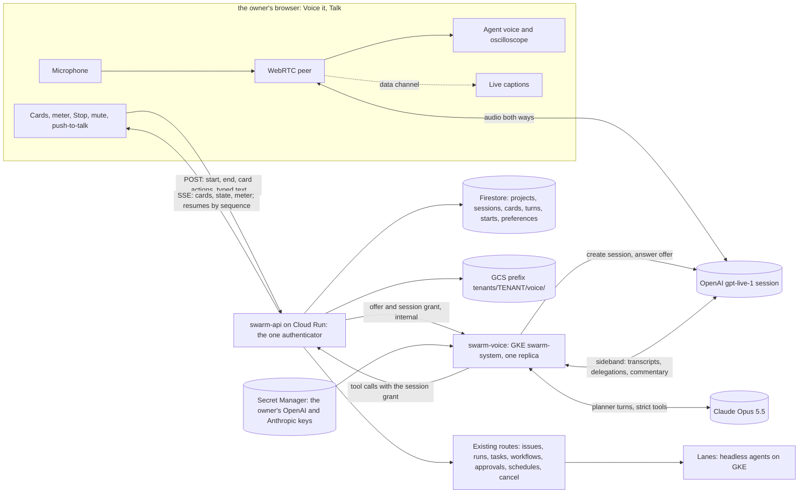

# Voice it: a voice-first planning buddy that turns a conversation into shipped work

**Status:** design only, nothing built. Written 2026-11-01 (UTC) against
`origin/main` at `a9d6ad6b4`. The research behind it (98 sources, read
2026-10-31) was a session scratchpad file; the facts this design rests on are
restated here with their sources (§13), so this file stands alone.

**Status on 2026-11-11 (read on `main` at `217598f`):** "nothing built" is no
longer true. Phases one and two are largely built (the section, swarm-voice's
Live sessions and planner, the session routes, the grant, the card catalogue
and stream, the cards, Projects), and Phase 3's first act tool,
`answer_question`. §3.12 lists what this design says that the code does not do
yet, and the code wins wherever they disagree. §3.13 (the owner's asks of
11 November on projects, many projects in a session, the catch-up and cards
drawn by their content) lists what else the design said that the code does
not do: no project state moves, the planner never writes the brief, and no
person can act on a card.

**A second engine (the owner, 2026-11-05):** speech on our own L4 machine beside GPT-Live, with
Settings, Telemetry, spoken read-backs and visuals on the Talk page, is designed in
[voice-it-own-speech.md](voice-it-own-speech.md).

**The owner's ask (the owner, 2026-10-31):** a console page used mainly to talk by
voice, with live captions of both sides and a voice oscilloscope while the
agent speaks, to an agent that is a product designer, software architect and
development buddy. It plans new apps, backends and projects, features in
existing repositories, and SwarmCloud tasks or workflows that failed or wait
for an approval. Then it files issues, schedules work, starts lanes and ships.
Cards beside the voice show what it filed or scheduled, finished work to
review, design proposals, architecture, flow and user-flow diagrams, UI
mock-ups, and inputs for details and for credentials.

> "like Jarvis from Iron Man, but not so much 3D; sleek, super user friendly,
> extremely versatile."
>
> "build more flexibility into the overall capability so it can take on a
> variety of small or large projects."

---

## 1. Decision record

The owner answered these on 2026-11-01 at about 03:00 UTC (the evening of
2026-10-31, PDT). They are settled; this design builds on them.

| Decision | The owner chose | Claude had recommended | Where it lands here |
|---|---|---|---|
| How far it acts on its own | **Ships end to end within a budget**: starts, merges and deploys. Only IAM, secrets, the other team's project (`example-project`'s shared resources) and cost raises stop it | Acts, but asks at gates | §3.9 safety, §5 shipping path |
| Budget | **$100 a session, $300 a day**, counting voice minutes and every lane, review and deploy it starts. At a cap it stops starting work and a card asks the owner to raise it | (none) | §3.8, §6 |
| Who uses it | **The owner only** in version one: one budget, one key, one history. Per-workspace rework later | All workspaces behind a switch | §3.6, §3.7 |
| Voice engine | **OpenAI GPT-Live (`gpt-live-1`) in front, Claude Opus planning behind it.** OpenAI receives the raw audio | A Claude-led cascade on LiveKit | §3 |
| The OpenAI key | Decided at build time; design for a **personal secret** | (none) | §3.6, open question 1 |
| Memory | **Saved, resumable projects**, plus the owner's **editable preferences** | (none) | §3.7, §3.11 |
| Microphone | **Open mic with barge-in**, plus **mute** and **push-to-talk** | (none) | §3.10 |
| Rescue entry point | A **"Talk it through"** button on failed or parked agents, failed workflows, and inbox items | (none) | §3.14 |
| Credentials | **Never spoken, captioned or seen by the model**: only through the one-time secret form | (none) | §3.9 |
| Above the page (2026-11-11) | The session **follows him across the console** in a floating view; a **working card** between replies; the **agents pulled in** listed; the paid voice **pauses after about 15 s** waiting on delegated work and reopens on the result, his voice or Resume | (none; the pause was picked from options) | §3.12 |
| Projects and cards (2026-11-11) | Projects **keep their state** (in progress, waiting, completed, cancelled, archived) and **resume with a catch-up**; one session **switches between projects**, starts new ones and takes side requests; cards **draw by their content**, in **"Cards and a viewer"**: compact cards in the list and a viewer that opens one full size with its actions | (none; the viewer was picked from two mock-up directions) | §3.13 |
| The core loop (2026-11-12) | **Speak, see the work, hear the result.** Updates interrupt the conversation for four things only: a result is ready, something needs the owner, a milestone, and a check-in about every 45 s while work runs with no milestone; each comes **at a gap**, never over the owner; the voice **pauses after 45 s** of silence (was 15) and speaking or any update wakes it; **cards appear as they happen**, a mock-up's frames one by one, a live Work card per start; a resumed project opens with its cards and mock-ups | (none; picked after three talks on the development deployment looked frozen) | §3.12.0, §3.12.7 |
| Scenarios | All four (a new app from scratch, a failed workflow rescue, a feature in an existing repository, an approvals walk-through) **plus the owner's flexibility point**: one engine whose cards and plan scale from a one-line fix to a multi-lane product | (none) | §5 |
| Layout | **The Jarvis-like presence direction** (2026-11-01, after five directions were drawn as real console frames): the voice as a luminous ring, the card being discussed brought forward, the rest as panels around it, and a heads-up line for budget, running work and what needs the owner | The command deck | §11 |

### Where the research disagreed, recorded and not reopened

* **The research recommended a Claude-led cascade**: Deepgram Flux for speech
  to text, Claude Haiku 5.5 (thinking off) as the voice-facing model, Claude
  Opus 5.5 planning in the background, Cartesia Sonic-3.5 speaking, all run by
  LiveKit Agents workers on GKE. Its case: about **$3.50 an hour** against
  about $5.30 for GPT-Live; **one brain** (Claude decides every word said);
  captions synced word by word to playback; no vendor session limits. Its
  stated weakness was feel: a cascade's turn-taking comes from voice detection
  plus a turn-detector model, about 0.8 to 1.3 s from the end of speech to the
  first audio (a Claude estimate from component figures). Either way Claude is
  the brain behind someone else's ears and mouth: the Claude API has no audio
  input or output [11].
  **Why it was not chosen:** The owner picked the full-duplex model, which the
  research itself rated best on turn-taking (a third-party measurement put
  GPT-Live 205 ms faster at the median than ChatGPT's earlier voice mode, with
  its spread cut from 489 ms to 104 ms [8]), and accepted about $1.80 an hour
  more and OpenAI receiving the audio.
  **What this design keeps from it:** the planner, its tools, the cards and
  the budget do not know which voice is in front. A planner turn takes a
  transcript window and returns cards and a short spoken summary (§3.3), so a
  cascade could replace GPT-Live later without touching anything behind it.
  LiveKit ships a GPT-Live plugin with client delegation [20], so even a later
  move onto LiveKit would keep this shape.
* **The research proposed a confirm card before every action that changes
  something.** The owner chose end-to-end autonomy instead. This design keeps the
  research's other rules (the planner writes the cards; the voice speaks the
  planner's summary and points at the card) and replaces per-action
  confirmation with a short **grace window** on actions that spend, which a
  spoken "stop" or the Stop key cancels (§3.9).
* **The research named React Flow for interactive architecture diagrams.** The
  console already ships `vis-network` 10.1.2 for the repository graph
  (`apps/swarm-ui/src/RepoGraphNetwork.tsx`, `apps/swarm-ui/package.json`), so
  this design uses it and adds no second graph library. React Flow, which has
  no built-in layout and points to dagre or ELK [21], stays the fallback if
  vis-network's layout falls short (§4).

---

## 2. What exists today, and what each fact forces

Read on `origin/main`, 2026-11-01.

| Fact | Where | What it forces |
|---|---|---|
| The console is React 18 and Vite with its own components and the "Open sky" theme | `apps/swarm-ui/` | Cards are the console's own components, not a UI kit |
| A section is a `SECTIONS` entry; the Spine, `paths.ts`, the issue forms' "Where" list and the redesign doc follow it, and tests hold them together | `apps/swarm-ui/src/App.tsx` (`SECTIONS`), `Spine.tsx` (`SpineSection`, `SPINE`, `PANEL_PAGES`), `paths.ts` (`FIXED`), `tests/unit/scripts/test_issue_forms.py`, `tests/unit/control_plane/test_nav_headings_agree.py`, `docs/web-ui/redesign.md` §2 | The first lane touches all of them at once (§10) |
| Polling stops after 15 minutes without a key, pointer, wheel, touch or click | `apps/swarm-ui/src/Shell.tsx` (`IDLE_STOP_MS`, `INPUT_EVENTS`, `useIdleStop`) | A person who is only talking makes no input. Speech must count as input while a session is live (§3.10) |
| The only browser WebSocket is the live browser's: swarm-api authenticates it and proxies it to the `swarm-live` relay, with a one-use ticket as the first message, never in the URL | `apps/swarm-api/swarm_api/routes/live.py`, `docs/design/live-browser.md` ("Why a relay at all") | A precedent for "swarm-api in front, a service in `swarm-system` behind it" (§3.4) |
| swarm-api's Cloud Run request timeout is **660 s**; the module default is 300 s. It runs at least two instances, is not addressable per instance, and every running attempt renews its lease through it | `terraform/infra/main.tf` (the `swarm-api` service), `terraform/modules/cloud_run/variables.tf` (`request_timeout`) | No request may be held for a whole conversation. The card stream resumes; the long-held sockets live elsewhere (§3.5) |
| The console and the API share an origin: the load balancer sends `/v1/*` to swarm-api, and every read rides the same-origin session cookie | `images/swarm-ui/nginx.conf`, `apps/swarm-ui/src/api.ts` | A server-sent event stream needs no ticket; the session document names the tenant, because `EventSource` cannot send `X-Swarm-Tenant` |
| The console sets no Permissions-Policy, so the top-level page may ask for the microphone | `images/swarm-ui/nginx.conf` | No header change for the mic; mock-up frames get no mic (§4) |
| Agents in pods are headless (`claude --print`) and act through spools: child agents, `swarm-state`, `swarm-git` and `questions.json` | `apps/agent-worker/agent_worker/runners/claude_code.py`, `statemcp/`, `gitmcp/`, `questions.py` | There is no running conversation channel into a pod. **The planner is not a pod lane** (§3.4) |
| The frozen contract has no conversation, voice or card type | `apps/common/swarm_common/` | Everything Voice it stores is swarm-api's own (§8) |
| Agents carry free-form `metadata`; `metadata.claude_session` groups "this session's work", and work the platform starts on a tagged item's behalf (an issue run's planner, its workflow, its fix rounds, its merge workflow) copies the tag | frozen `Task.metadata`; `apps/swarm-api/swarm_api/sessiontag.py`; `GET /v1/tasks?claude_session=` | Voice it tags everything with `voice:<project id>`; the ledger and the cards find a project's work, follow-ups included, by that tag |
| A step may carry its own budget (`{usd}` or `{tokens}`), which only lowers the workspace limit; the worker stops it at 100% at a turn boundary and kills it at 120% | `docs/design/agent-budget.md`, frozen `Task.budget` (contract request 120) | Voice it can **reserve** money before work starts and know each step cannot spend past it (§3.8) |
| Issue runs plan, wait for a plan approval or approve themselves, compile a workflow, run fix rounds and merge; their plans carry hard-stop holds (`iam`, `workflows`, `secrets`, `tenancy`, `shared`) that only the hold's approvers lift | `apps/swarm-api/swarm_api/routes/runs.py`, `issueruns.py` (`STOP_IAM` and the rest, `SHARED_DENY_LIST` restated and held to `scripts/lib/common.sh` by a test) | The platform already stops exactly where the owner said Voice it must stop. **Code work ships through issue runs** (§5) |
| swarm-api can create a GitHub issue with the tenant's forge token; there is no route that creates a GitHub repository | `apps/swarm-api/swarm_api/forgewrite.py` (`create_issue`) | Filing an issue is one new route over existing code; a brand-new repository is the owner's step (§5) |
| A workflow step can wait for a person's answer, and the console already draws that card | `apps/swarm-api/swarm_api/routes/await_input.py`, `apps/swarm-ui/src/AwaitInputCard.tsx` | The details card reuses it for lanes' waiting steps |
| A repository's knowledge graph answers search, territory and impact | `apps/swarm-api/swarm_api/routes/repositories.py` (`/search`, `/territory`, `/impact`) | The planner splits large work by territory (§5) |
| A fix workflow can push onto an existing pull request's branch by naming the agent | `apps/swarm-api/swarm_api/continuation.py` (`WorkflowCreate.continues_task`) | The rescue path fixes a red pull request in place |
| A person's preferences live in a document whose id is an HMAC no worker can compute | `apps/swarm-api/swarm_api/preferences.py` | Voice it preferences use the same id scheme (§3.7) |
| Artifacts are served as `text/plain`, and no screen ever builds HTML from artifact bytes; no diagram renderer exists | `apps/swarm-api/swarm_api/routes/tasks.py` (artifact content), `apps/swarm-ui/src/ArtifactViewer.tsx` | Mock-ups need a sandboxed frame; diagrams need a renderer (§4) |
| A workspace secret may name provider `openai`; provider-key links are TypeSafe-only; the account pool holds Claude **subscriptions**, not API keys; the codex runner is disabled, and eng's `swarm-tenant-example-tenant-openai` holds one version OpenAI refused on 2026-09-23 | `workspace_secrets.py` (`PROVIDERS`), `validation.py` (`PROVIDER_KEY_PROVIDERS`), `apps/quota-broker/quota_broker/oauth.py`, `apps/common/swarm_common/profiles.py` (the `codex` entry) | The owner adds a fresh personal OpenAI key through Config › Secrets. The planner runs on a Claude subscription account leased from the pool through Claude Code (§3.6, owner 2026-11-02) |
| swarm-api reads the artifact bucket but may write only under narrow, conditioned, create-only grants, one per purpose | `terraform/modules/iam/bindings.tf` (`api_reader`), `terraform/infra/await_input.tf`, `terraform/infra/git_tools.tf` | Voice it's GCS prefix is one more such grant: an IAM change (§10) |
| `swarm-live` and `swarm-graph` are rolled by named steps in the release and hotfix workflows | `.github/workflows/release.yml`, `.github/workflows/hotfix.yml` | A new service in `swarm-system` needs workflow lines: held for the owner (§10) |

---

## 3. Architecture

### 3.1 The picture



**Audio never touches SwarmCloud.** The browser's WebRTC media goes straight
to OpenAI. Our servers carry only the offer and answer that set the call up,
the transcripts OpenAI sends on the sideband, and text.

**The ephemeral session.** swarm-voice creates each GPT-Live session with
The owner's key and answers the browser's WebRTC offer itself, which OpenAI's Live
guide recommends [4]. The browser never holds a key or a client secret.

The alternative is a short-lived client secret minted by the server, which
the browser uses to connect on its own (the Realtime API's form: 600 s by
default, settable from 10 s to 7,200 s [23]). It would also keep the key and
the audio off our servers. But the client can override the session settings
attached to such a secret [23], so the instructions and tools would still
have to be enforced on the server. Answering the offer on the server keeps
both there, with nothing for the page to override.

### 3.2 The pieces

| Piece | Runs where | Holds | Why there |
|---|---|---|---|
| **Talk pane** | The owner's browser | The WebRTC peer, the mic and the agent's track, captions, the oscilloscope, the card list. From §3.12 the call is held by a session holder above the routed page, and Talk is its main view | Media must be peer to peer with OpenAI to keep audio off our servers and to get the browser's echo cancellation, which covers WebRTC remote audio [14] |
| **GPT-Live session** | OpenAI | The live conversation, its turn-taking and barge-in, the voice | The owner's choice |
| **swarm-voice** (new) | One-replica StatefulSet in `swarm-system` on the GKE cluster | Each live session's sideband WebSocket, the planner loop, the session grant (in memory) | It holds long-lived outbound sockets for the length of a conversation, which no request-shaped service can (§3.4) |
| **Text conversation** (no API key in the pool) | Inside swarm-voice (`swarm_voice/textchat.py`), calling the ChatGPT plan's Codex Responses route | Each text session's turns and its plan lease, in memory | OpenAI serves the plan text but refuses it Live (§3.6, "Both paths"), so the browser sends each spoken turn as text and swarm-voice answers it |
| **Planner** | Inside swarm-voice, calling the Anthropic Messages API | Nothing between turns: every turn reads the project from Firestore through swarm-api. **Not built:** on `main` a turn reads the transcript and the delegation's text only; §3.13.3 adds the session context it reads | Opus always thinks [10], so it stays off the spoken path; the voice speaks while it works |
| **swarm-api** (extended) | Cloud Run, as today | The Voice it routes, the session grant check, the card stream, the ledger, storage | The one authenticator: every action Voice it takes passes the same role floor, holds, refusals and tenant scope as a click |
| **Firestore and GCS** | As today | Projects, sessions, cards, turns, starts, preferences; transcripts and large card bodies | Invariant 9: the tenant's documents and its own prefix |

### 3.3 One turn, step by step

```mermaid
sequenceDiagram
  participant B as the owner's browser
  participant L as GPT-Live
  participant V as swarm-voice
  participant C as Claude Opus
  participant A as swarm-api
  B->>L: speech (WebRTC)
  L-->>B: both sides' captions (data channel)
  L-->>V: transcript deltas, then "delegation created" (sideband)
  L-->>B: a spoken acknowledgement while it waits
  V->>C: turn: project brief, preferences, open cards, transcript window, tools
  C->>V: read tool calls
  V->>A: reads, with the session grant
  A-->>V: results
  C->>V: cards and a spoken summary (strict tool)
  V->>A: write cards; act only after the ledger reserves
  A-->>B: card events on the stream
  V->>L: commentary.append (the summary, spoken)
  L-->>B: speaks it, pointing at the card
```

1. GPT-Live runs the conversation. Its only tools are **`delegate`** (client
   delegation [3]) and **`stop`** (§3.9).
2. A delegation event "contains metadata, not task text" [3]. swarm-voice
   builds the planner's request from the transcript deltas it has collected
   on the sideband [6].
3. The planner (Opus 5.5) runs with strict tool use [10] over three tool
   families: **read** (SwarmCloud state), **draw** (cards, no side effects)
   and **act** (spends or changes something). It ends every turn with one
   structured output: the cards it created or changed, and a spoken summary of
   at most two sentences.
4. swarm-voice writes the cards through swarm-api, which validates each
   against the catalogue (§4) and appends it to the session's event log.
5. swarm-voice hands the summary to GPT-Live with `session.commentary.append`
   (at most 500 tokens [3]). Context the voice should know but not say (a lane
   finished, a card changed) goes in with `session.thinking.append`.
6. **The card is the source of truth.** The voice speaks the planner's
   summary and points at the card ("the plan's on screen: three lanes"). It
   never paraphrases a plan, which is how the two halves of a split-brain
   design drift apart.

GPT-Live's instructions (at most 16,384 tokens) and its voice cannot change
once a session starts [5]. So the persona, the rules and the project brief go
in at session start, and everything that changes later arrives as silent
context. **On `main`** the instructions are swarm-voice's fixed text and carry
no brief, and no planner writes one (§3.13.1); §3.13.3 gives the brief its
writer and reader, and a project switch arrives as silent context (§3.13.5). A Voice it session may span several GPT-Live sessions (a pause's
wake, a rollover, a tier move: §3.12.7); each reopen is the one point where the
instructions are refreshed.

### 3.4 Where the planner runs, and why

| Option | Verdict | Why |
|---|---|---|
| A pod lane per conversation | **Rejected** | Agents are headless and act through spools; there is no channel for the next sentence. A lane holds capacity from `LEASED` (invariants 1 and 3), so an hour of talk would hold a pool slot. Starts take tens of seconds |
| Inside swarm-api | **Rejected** | A conversation needs a sideband socket held for up to an hour. swarm-api's requests end at 660 s, its instances are replaced on every release, and every running attempt's lease renewal goes through it on one CPU (`terraform/infra/main.tf`). A voice session must never be the thing that delays a lease renewal |
| The browser relays delegations, swarm-api plans per request | **Rejected** | No new service, but the browser would relay every delegation and every spoken result, which GPT-Live's `client` field exists to restrict for an untrusted frontend [5]; a backgrounded tab throttles timers; and planner work would die with the tab |
| A Cloud Run service | **Fallback** | Simple to deploy, but outbound sockets that outlive requests need CPU always on, two revisions overlap during a rollout (two processes attaching one session), and Cloud Run caps WebSocket requests at 60 minutes [12] |
| **swarm-voice: one replica in `swarm-system` on GKE** | **Chosen** | Holds the sideband for each live session in one process, as `swarm-live` holds both ends of a live-browser session. A one-replica StatefulSet never runs two copies during a rollout. It holds no data authority: every read and write goes through swarm-api (§3.6) |

**A swarm-voice restart costs the turn in flight, not the conversation.** The
audio session lives at OpenAI, so the browser keeps talking; the new process
asks swarm-api for fresh grants for the sessions still live and re-attaches
each sideband by session id [6]. Not verified: that a sideband may re-attach
after the first attachment dropped (§9).

### 3.5 The card stream, and the timeouts

**Server-sent events from swarm-api, plus ordinary POSTs for everything the
page sends.**

* `GET /v1/voice/sessions/{id}/events` streams `card.upsert`, `card.remove`,
  `session.state` (listening, thinking, speaking, working, ended) and
  `meter.update`. **On `main` today** it also streams `visual.upsert`,
  `note.upsert`, `focus` and, in debug mode, `trace.turn`; `session.state` and
  `meter.update` are declared but have no writer (`stream.py`). §3.12 adds
  `paused` and `waking` to the states and `work.step`, `work.delegation` and
  `roster.update` to the events; §3.13 adds `project.switch` and
  `card.action`, and every event carries the `project_id` it belongs to,
  because one session may hold several projects (§3.13.5). Every event has a sequence number; the stream resumes from
  `Last-Event-ID`, which `EventSource` sends by itself on reconnect.
* **Each stream ends itself after about nine minutes**, under swarm-api's
  660 s timeout, and the browser reconnects. Because every event is stored
  before it is sent, a reconnect loses nothing.
* The handler reads new events by sequence about once a second: one indexed
  query, about 3,600 document reads an hour per open stream. A Firestore
  listener is the optimisation if that ever matters.
* **Firestore is the meeting point**, not a relay. swarm-voice's writes land
  on whichever swarm-api instance takes them; the stream is served by
  whichever instance holds the browser's request. Neither needs the other.
* The URL carries the session id and nothing else. The session document
  names its tenant, and the route checks that the caller is that session's
  person.

**Why not a WebSocket like the live browser's.** Both are cut by the same
timeout, so both must resume. The live browser needs a socket for high-rate
binary frames in both directions; cards are low-rate and one-way, and the
page's own actions are ordinary POSTs that pass the usual checks. SSE gives
resume for free and needs no ticket, no relay and no proxy code.

**Captions take the short path.** Both sides' transcripts arrive in the
browser on the WebRTC data channel and are drawn at once. The stored
transcript is swarm-voice's copy from the sideband, redacted (§3.9). Not
verified: that the browser's data channel carries the transcript events when
the server created the session; if not, captions come through the card stream
at about a second more delay (§9).

### 3.6 Identity, keys, and how swarm-voice acts as the owner

**A session grant.** When the owner starts a session, swarm-api creates a random
256-bit grant, stores only its hash on the session document, and hands the
grant to swarm-voice in the internal start call. swarm-voice presents it on
every call, beside its own Google identity token.

swarm-api accepts a grant only when:

* the caller is swarm-voice's own service account;
* the hash matches a session that is still live;
* the route is on the Voice it allowlist.

It then acts as the owner in that session's workspace, and stamps
`via: voice-it/<session id>` on every audit row and every submission's
metadata. The grant dies with the session. A swarm-voice restart asks for
fresh grants for live sessions, as a worker asks again for a live-browser
tunnel ticket.

**Never on the allowlist:**

* any route with a typed confirmation;
* secret values (add, rotate);
* IAM, admin and platform routes;
* the merge switch to `auto`;
* budget raises;
* approving an item whose hold names an approver list (the IAM, secrets,
  tenancy, shared-project and workflow-file holds);
* destroy and purge.

A test walks swarm-api's route table and fails when a route that takes a
typed confirmation or a secret value is reachable with a grant.

**Why a grant and not swarm-voice's own powers.** swarm-voice gets no
Firestore role and no storage role. Every rule that governs a click governs
Voice it, because it is the same route.

**Keys.**

* **OpenAI:** an **OpenAI developer API key** in the quota broker's **Voice
  it pool** for a Live session (below, "Why a key and not the ChatGPT
  plan"); with no key in the pool, the pool's **ChatGPT plan** for a text
  conversation (below, "Both paths"). No person's own OpenAI secret is read
  any more, and a ChatGPT plan is never leased for a Live session.
* **Anthropic: the planner runs on a pool lease** (below, "The planner's
  Claude account"). No person's Anthropic secret is read and swarm-voice
  holds no accessor grant for one.
* swarm-voice never writes a credential, logs one, or sends one to the
  browser.

**How a session reaches the OpenAI credential: the Voice it pool (owner,
2026-11-02 and 2026-11-03).** The owner connected a ChatGPT plan and asked
that it be "reserved for the voice it feature ... and its not used by any
other agent or any other user besides voice it". They picked "A separate
Voice it pool" and "Pool only, wait for it", then on 3 November: "We should
allow accounts to be in more than one pool at a time".

* **The pools.** A pool account's `pools` is a set: `workspace`, which every
  account was in before, and `voice-it`, which also lists `voice_it_people`.
  Version one lists the platform owner only. An account in `voice-it` only is
  **reserved**. `Account.may_serve` refuses it to every tenant, so no agent of
  any workspace or profile is ever assigned it, it is never lent, and the
  scheduler's admission count (`accounts_serving`) leaves it out. An account
  in **both** pools is shared. Either side may lease it, and its `max_agents`
  and windows hold across both, because every hold of either kind sits on
  the one document's `holds`.
* **Moving an account between pools.** `PUT /v1/accounts/{id}/pools` is for
  platform admins only and is audited. It needs the label typed back, keeps
  at least one pool, and refuses (`pool_in_use`) to remove a pool the
  account holds a lease of. You can do it from Capacity › Accounts'
  "Pools…" or with `sc account pool <label> --add|--remove`.
* **The lease.** At session start swarm-voice calls the broker's
  `POST /v1/voice/lease` for the session's person
  (`swarm_voice/accountlease.py`, shaped like the worker's
  `agent_worker/accountlease.py`). The broker picks an account with
  `choose_voice`: it must be an OpenAI API key (`capability: "live"`, above),
  be in the Voice it pool, list the person, and be AVAILABLE with a free
  slot. The broker records a hold with `pool: voice-it`, the person, the
  session id and no tenant. It hands back the key, read from the account's
  `{base}` secret. Until 4 November it handed back a ChatGPT plan's access
  token and account id, which OpenAI refused. swarm-voice renews the hold
  every four minutes and gets the credential again each time. It releases
  the hold when the
  session ends or fails. If swarm-voice dies, the hold lapses on its own
  after `VOICE_HOLD_TTL` (ten minutes).
* **Pool only.** With no account free, or for a person the pool does not
  list, the session is refused with a spoken reason and nothing starts.
  There is no fallback to a personal sign-in. That path is removed: the
  Preferences sign-in, swarm-api's `/v1/voice/chatgpt*` routes, and
  swarm-voice's personal-secret read and add-version. Voice it ›
  Preferences says which pool account the next session will use
  (`GET /v1/voice/pool`).
* **Nothing secret travels further.** The token goes from the broker to
  swarm-voice's process, in memory. It never reaches a log, a card, a
  transcript, the browser or the console. swarm-voice holds no Secret
  Manager binding at all (`terraform/infra/voice.tf`). Its only new grant
  is run.invoker on the quota broker, and the broker admits only its
  service account to the voice routes.

**Why a key and not the ChatGPT plan: OpenAI refused the plan (measured 4
November 2026, 02:00 UTC).** swarm-voice leased the ChatGPT plan account
`eng:chatgpt-1` from the Voice it pool and `POST
https://api.openai.com/v1/live/sessions` answered **403 Forbidden**
(`swarm_voice/live.py`). The pool's token is the Codex sign-in, scope `openid
profile email offline_access` (`quota_broker/openai_plan.py`). OpenAI's own
documentation says why it cannot work: Sign in with ChatGPT's identity scopes
do not grant OpenAI API resources, and plan use is limited to text Responses
for selected partners (https://developers.openai.com/siwc/quickstart).
GPT-Live is a developer API model billed per minute
(https://developers.openai.com/api/docs/models/gpt-live-1). So the plan path
is recorded as **refused by OpenAI**, and the owner said "fix it":

* **A new account kind, `openai-api`** (`quota_broker/openai_api_key.py`):
  an OpenAI developer API key. It is allowed **only in the Voice it pool**.
  Registration files it there alone, with the broker's `VOICE_IT_PEOPLE`.
  It is never lent, `PUT .../pools` refuses to move it into the workspace
  pool, and an agent leasing an `openai` account never matches its provider, so no
  agent or workspace is ever handed it. Adding one is for platform admins
  only, like a pool move.
* **Stored as the broker stores every credential.** One Secret Manager
  secret, `{base}`, holds the key. The broker is its only writer and its only
  accessor: no worker service account is bound, because no agent runs on it.
  There is no `{base}-refresh` and nothing to refresh, so the refresh sweep
  skips it (`Account.refreshes`). OpenAI gives a key no usage window, so the
  usage poller never asks. Its windows read **not measured**, never 0
  (`measured: false` on the listing). The "one agent before its first
  reading" rule waits for a reading that never comes, so it does not apply,
  and `max_agents` is the cap.
* **The lease asks for a Live-capable account.** swarm-voice sends
  `capability: "live"` on `POST /v1/voice/lease`, which is also the default.
  `choose_voice` then offers only `openai-api` accounts, so a key is chosen
  for every Live session and a ChatGPT plan never is. The plan stays in the
  pools for codex steps. The credential comes back as `{"access_token",
  "kind": "api_key"}` with no account id. swarm-voice's `Bearer` for a key
  sends the key in the `Authorization` header only, with no `ChatGPT-Account-Id`,
  even when a broker sends an id.
* **No key, no Live lease.** With no `openai-api` account in the Voice it
  pool, the broker answers a `capability: "live"` lease
  `no_voice_account_registered` before it takes any hold. Since 4 November
  swarm-api asks first (`GET /v1/voice/pool`) and starts that session as a
  **text** conversation on the plan instead (below, "Both paths"). A Live
  start that still meets the refusal (a key removed between the two calls)
  is 409 `voice_pool_refused`, and swarm-api tells the person "Voice it needs
  an OpenAI API key in the Voice it pool: add one on Admin › Accounts". It is
  never a 502.
* **Adding the key.** The owner pastes it himself through the console's
  one-time link, so it never passes through a model, a log, a tool argument
  or the repository. The broker's `POST /v1/accounts` with `provider:
  "openai-api"` parses it and stores it before any document is written. The
  console side of that link, and swarm-api's account route accepting the
  provider, are a separate change (the PR that added this kind says which).
  A Day One install needs nothing new. The key is added after install,
  through the same link.

**Both paths: the ChatGPT plan's text conversation (owner, 4 November
2026).** Asked whether OpenAI plans could work here "in the same exact way as
The peer application", the owner chose both paths. OpenAI refuses the plan's token for
GPT-Live (above), but the peer application runs text inference on the plan, so the plan
serves Voice it as **text only**:

* **The mode.** `POST /v1/voice/sessions` answers `mode`. swarm-api asks the
  broker which account the person's next Live session would lease
  (`voice/sessions.py`, `pick_mode`): `no_voice_account_registered`, the
  answer for a pool with no OpenAI API key, makes it `"text"`. Anything else,
  and a broker that cannot be asked, keeps it `"live"`, today's GPT-Live path
  with its SDP answer, unchanged. A text session has no SDP and no WebRTC: an
  `offer_sdp` sent anyway is dropped unread, and no `answer_sdp` comes back.
  The session document records `mode`.
* **The turns.** The browser turns each spoken turn into text and sends it:
  `POST /v1/voice/sessions/{session_id}/turns {"text": <1..4000 chars>}`,
  answered `200 {"turn_id", "reply", "cards"}`. The route passes the same
  guards as every Voice it action (the Voice it list, the console's
  workspace through `tenant_scope`, the session the caller's own), is 409
  `conflict` (`voice_session_not_live`) on a session that is not a live text
  one, and 429 `rate_limited` with `detail.resets_at` when the plan's usage
  limit refuses the turn. Ending is the existing end route. The captions are
  the turns themselves. The person's text is never logged or stored by
  swarm-api.
* **The lease.** swarm-voice leases the Voice it pool's plan with
  `capability: "text"` (`accountlease.CAPABILITY_TEXT`) and holds it, renewed
  every four minutes like a Live hold, until the session ends or sits idle
  for fifteen minutes (`textchat.IDLE_SECONDS`, so a closed tab never keeps
  the plan). The broker is the plan token's one writer and refreshes it; a
  401 only asks the lease for a fresh token.
* **The wire, as the peer application measured it (2026-08-10, live ChatGPT Plus
  token).** `POST https://chatgpt.com/backend-api/codex/responses` with
  the plan's access token as the `Authorization` header's bearer, `OpenAI-Beta:
  responses=experimental`, `originator: codex_cli_rs`, `chatgpt-account-id`
  and `session_id` (the Voice it session id, echoed back as the prompt cache
  key). The body is `{model, instructions, input, stream: true, store:
  false, include: ["reasoning.encrypted_content"]}`: `stream: false` and
  `max_output_tokens` are each a 400, and there is no temperature, top_p,
  system role or response_format. `textchat.build_body` refuses to build any
  of them. The answer is SSE whose terminal `response.completed` carries an
  empty `output`; the reply is read from the `response.output_item.done`
  items. The model is the first of `gpt-5.5`, `gpt-5.6-sol`, `gpt-5.4-mini`
  that `GET /models?client_version=0.147.0` lists.
* **Quota.** Each answer's `x-codex-primary-*` and `x-codex-secondary-*`
  headers (used percent, window minutes, reset) are named as the broker
  names a plan's windows (`five_hour`, `seven_day`, a 0 to 1 utilization) and
  reported against the session's hold. A refusal of type
  `usage_limit_reached` carries `resets_at`, which the person reads on the
  429.
* **The egress.** swarm-voice's FQDN egress policy
  (`kubernetes/network-policies/swarm-system-voice.yaml`) admits
  `chatgpt.com` on 443 beside `api.openai.com`, by exact name and no
  wildcard (owner pick, 4 November 2026: "Add it in this PR"). Without it the
  policy fails closed and every text turn is a connection refusal.
* **Delegation works as on the Live path.** The text model is offered one
  `delegate` tool. A turn that asks for a plan comes back as that call and
  becomes a planner turn over the conversation so far, with the session's
  person and grant. The planner's at most two sentences are the reply, and
  its cards stream to the console as they do today.
* **What the broker still needs.** Its `VoiceLease.capability` accepts only
  `"live"` today, and it has no route that records a voice hold's reading.
  Until it accepts `"text"` (choosing the Voice it pool's `openai` plan) and
  serves `POST /v1/voice/lease/{account_id}/readings`, a text start is a 502
  from the broker and the windows are logged as not taken. Both are outside
  this change's files and are asked for in its PR.

**The planner's Claude account: a pool lease through Claude Code (owner,
2 November 2026).** The owner picked "Pool account via Claude Code": "we have
a pool of account for anthropic, lets use one of the accounts there". The
planner used to call the Messages API with an Anthropic API key read from the
person's own secret, which needed a per-secret accessor grant and a stored key.
It now runs each delegation turn the way a worker runs an agent:

* **One lease per turn** (`swarm_voice/plannerlease.py`). swarm-voice asks the
  broker's `POST /v1/accounts/assign` for an `anthropic` account with holder
  `voice-planner`, the session's person and the voice session id. The broker
  resolves the person's OWN workspace (never one the body names), picks the
  account with `choose()` over that workspace's pool, and records the hold on
  the account like an agent's, so `max_agents` and the windows see it. The hold
  is renewed every four minutes and released in a `finally` whatever the turn
  did. If swarm-voice dies the hold lapses on the broker's TTL, which a turn
  (four minutes at most) never outlives unrenewed.
* **A full pool is a refusal, never a wait.** With no account free the voice
  says so ("Every Claude account in your workspace's pool is busy right
  now..."), or that the workspace has none, and nothing runs.
* **Claude Code, headless** (`swarm_voice/claudeturn.py`): `claude -p` with
  `claude-opus-5-5`, stream-json output, `--no-session-persistence`, the
  planner's system prompt, and a private temporary HOME (0700, also its cwd
  and TMPDIR) removed after the turn. Its environment is built, not
  inherited: the leased token in `CLAUDE_CODE_OAUTH_TOKEN` and nothing else
  secret, never `ANTHROPIC_API_KEY`. `CLAUDE_CODE_DISABLE_NONESSENTIAL_TRAFFIC`
  and `DISABLE_TELEMETRY` are set, so the CLI reaches `api.anthropic.com`
  only, which swarm-voice's egress already admits. The subscription token is
  used only through Claude Code, never sent to the Messages API directly.
* **Only the planner's tools** (`swarm_voice/mcp_server.py`). `--tools ""`
  removes every built-in tool, so the child has no file, shell, web or agent
  tool. The only MCP server is the turn's own (`--strict-mcp-config`), and
  only its tools are allowed. It lists the catalogue's `draw_<kind>` tools,
  the read tools and `speak`. It holds nothing itself: each call goes over a
  unix socket in the private HOME (checked against a per-turn nonce) back to
  swarm-voice, which runs it through swarm-api with the session grant the
  child never sees. The turn stops the child once `speak` is answered.
* **Nothing secret captured.** Every line the child prints is scrubbed of the
  token and the grant before it is parsed, as the worker's redaction does. So
  are the prompt, the tool results, the cards and the spoken summary.
* **Cost: not measured.** A subscription has no per-token price. The turn's
  `usage` carries its token counts, the model and `billing: "subscription"`.
  The ledger (§3.8) RESERVES its estimate at Opus prices against the
  session's $100 and the day's $300, never counts it as $0 spent, and counts
  it in `subscription_turns`.
* **The windows.** A planner turn is one agent on one account for at most
  four minutes. It competes with the workspace's lanes for that account's
  five-hour window exactly as one more short agent would, and the broker's
  `choose()` spreads it like one. This was the reason the earlier design kept
  the planner off the pool. The owner accepted that cost on 2 November 2026.
* **The CLI** is in swarm-voice's image at the version
  `images/agent-runtime-base/Dockerfile` pins, read from that file at build
  time, so there is one source for it.

### 3.7 Storage: Firestore and the tenant's prefix

Everything is under the workspace the session acts in (the console's selected
workspace), and in version one every read also requires the caller to be the
project's person. A project in eng belongs to eng's documents and eng's
prefix; another tenant's project is the same 404 as a missing one.

| Collection or path | Holds | Notes |
|---|---|---|
| `voice_projects/{project}` | Tenant, person, title, subject (for Talk it through: the agent, workflow or inbox item), size, state (in progress, waiting, completed, cancelled, archived; §3.13.2) and its `state_history`, the **brief** (goal, decided, open, next; at most 16 KiB; §3.13.3), references (repositories, issues, runs, workflows, agents, schedules), and the tag `voice:<project>` | The resumable memory. On `main` the status is one of active, waiting, shipped, archived and nothing moves it; those old names are read, never rewritten in bulk (§3.13.2) |
| `…/cards/{card}` | The card envelope and body (§4), versioned, and the `outcome` of a person's deciding action (§3.13.8) | Large bodies go to GCS. A card lives under the project that was current when it was first drawn |
| `…/cards/{card}/actions/{action}` | One person's action on the card: action, arguments, `via` (click or voice), session, card version, state (pending, sent, consumed), the turn that consumed it (§3.13.8) | Idempotent by `action_id` |
| `…/sessions/{session}` | State (starting, live, rolling over, ended), the GPT-Live session ids, the grant hash, talk seconds, planner usage, end cause, and the session's `current_project_id` and `open_project_ids` (§3.13.5) | One live session per person. It stays under its **home** project, the one it started in, whatever project is current |
| `…/sessions/{session}/events/{seq}` | The stream's log | Sequence from a counter on the session document |
| `…/sessions/{session}/cards/{card}` | A side request's card (§3.13.5): the card envelope and body, versioned, with `project_id: null` | A request outside every open project belongs to the session and to no project; nothing is created for it, and no standing project holds it. Stored under the session, `voice_projects/{home}/sessions/{session}/cards/{card}`. **Not written on `main`**: nothing takes a side request until §3.13.9's P4. **It is found in the session's history**: the session's transcript, its cards and its stream events, read from the session under its home project; Talk shows its cards under "Side requests" in the switcher's filter. **Projects never lists it**: Projects reads project documents, and a side request has none. **A resumed project never shows it**: a project's cards, turns, brief and catch-up are read from that project, and a side request is in none |
| `…/sessions/{session}/turns/{turn}` | A side request's planner turn (§3.13.5): the same fields as a project's `…/turns/{turn}`, with `project_id: null` | Stored under the session's `turns/{turn}` when the session's `current_project_id` is `null`; no project document, brief or state is written, and no brief change happens. **Not written on `main`**: `record_turn` has no caller until §3.13.9's P3, and nothing takes a side request until P4. A retried turn reads its own actions here, as a project's does. **Projects never lists it**: Projects reads project documents, and a side request has none. **A resumed project never shows it**: a project's cards, turns, brief and catch-up are read from that project, and a side request is in none |
| `…/turns/{turn}` | Each planner turn: state, the transcript window it read, cards out, spoken summary, usage, the brief change, and each action with its idempotency key and reservation | A retried turn reads its own actions before acting again. **Not written on `main`**: `record_turn` has no caller until §3.13.9's P3. Stored under the project current when the turn began |
| `voice_starts/{id}` | One row per thing Voice it started: the agent, workflow or run id, project, session, the owner's day, the reservation | What the ledger reads (§3.8) |
| `voice_preferences/vp_<hmac>` | The owner's editable preferences (§3.11) | The id is an HMAC no worker can compute, as `preferences.py` keys `user_preferences` |
| `tenants/<tenant>/voice/<project>/transcripts/<session>/<part>.jsonl` | The redacted transcript | Create-only objects; a new part is a new name |
| `…/mockups/<card>/<version>.html`, `…/diagrams/<card>/<version>.mmd` or `.json`, `…/plans/<version>.md` | Card bodies too large for a document | Read back through swarm-api as text, never served as HTML |

**swarm-api writes the prefix** under one more conditioned, create-only grant,
as `terraform/infra/await_input.tf` does for answers, plus a conditioned
delete for removing a project. Both are IAM changes and wait for the owner.

### 3.8 The budget meter, and how it is enforced

**The ledger is computed, never counted.** It is derived each time from facts
that already exist: talk seconds, planner usage, and the cost of what Voice it
started. A second running total is exactly the kind of mirrored value that has
drifted here before.

| Line | Read from | Price |
|---|---|---|
| Talk | The session's seconds while the voice is open | `gpt-live-1` at $0.05 a minute, billed per second [1][2], silence included; time paused is not billed, and the estimate leaves it out (§3.12.8) |
| Planner | Each turn's token usage | Opus 5.5 from the platform's `model_prices` (`swarm_api/modelprices.py`) |
| Speech machine | The own-speech machine's minutes from the start call to the stop, per session, on the day the session started (`docs/design/voice-it-own-speech.md` §13) | The machine's catalogue price; a stop with no price is `unpriced_machine_sessions`, not $0 |
| Work running | Each started item's step budgets, **times 1.2**, until it ends | The worker's guard kills a step at 120% of its budget (`docs/design/agent-budget.md` §5), so 120% is the true ceiling |
| Work finished | Each started item's measured `cost_usd`, which replaces its reservation | The platform's estimate at list price |
| Follow-ups | Agents carrying the project's tag that the platform started for it (fix rounds, merge steps) | Measured `cost_usd`, plus an allowance reserved at start |

**Before any work starts:**

1. The planner puts a budget on every step it submits; per-agent budgets
   (contract request 120) already let a step lower its limit.
2. The ledger adds those budgets, times 1.2, to what is already spent and
   reserved.
3. It refuses the start if the total would pass **$100 for the session or
   $300 for the owner's day**. The owner's day is the calendar day in his saved time
   zone (`user_preferences`; UTC when none is saved).

Turns run one at a time, and a person has at most one live session, so the
check and the submission cannot race. Issue runs start with
`plan_approval: required`: Voice it approves a run's plan only after
reserving that plan's steps, so the reservation matches the work exactly.

**While work runs.** Each step's own budget stops it (the worker's guard), so
nothing Voice it started can spend past its reservation. Talk and planner
spend grow by the second; the meter on the Talk pane shows both caps.

* **At 80% of either cap** the voice says so once and a Budget card appears.
* **At the cap** Voice it starts nothing more; act tools are refused with a
  Budget card. Running lanes keep running inside what they reserved. The
  conversation stays open two more minutes so the owner can raise the cap on the
  card, then the session ends; the project is kept.

**A raise is a click and a typed amount** on the Budget card, never a spoken
yes. The microphone cannot tell the owner from a television (question 3).

**Not counted, and said on the Budget card:** pod compute for lanes, CI
runner minutes and deploys. No SwarmCloud cost figure includes them today
(question 6).

### 3.9 Safety

**What each side may do.**

| | GPT-Live (the voice) | The planner (Opus, through swarm-voice) |
|---|---|---|
| Talk, ask, reflect back, read out cards | Yes | Writes the spoken summary only |
| Read SwarmCloud | No | Yes, read tools |
| Draw cards | No | Yes, draw tools |
| File, start, approve, answer, schedule, cancel | No | Yes, act tools, each after the ledger reserves it |
| Cancel work in flight | Yes, its `stop` tool, which only cancels | Yes |
| IAM, secrets, the other team's project, budget raises | No | No: not on the grant's allowlist; the platform's holds stop the rest |

**Answering, the first act tool (built; the owner's pick, 6 November 2026).** The
planner's `answer_question` (`swarm_voice/tools_act.py`) answers an agent's
question with an option label, the person's own words, or both, through the
grant's one act route, `POST /v1/tasks/{task_id}/answers`, sent `via:
voice-it`. Its first call sends nothing: it reads the question back. Only a
later turn, after the person spoke, sends exactly what was read back. The act
ledger (`swarm_voice/actledger.py`) reserves it before the call, records the
outcome, and refuses a second answer to one question in one session unless
the person says to change it. Who may answer is the route's rule: the
submitter or an admin, never a viewer.

**The hard stops do not depend on the model's judgement.**

* IAM, workflow-file, secrets, tenancy and shared-project changes are held by
  the issue run's holds (`issueruns.py`), which only their approvers lift.
* An IAM plan in a release still waits at the release's IAM gate for the owner.
* The routes that would do the rest are not reachable with a grant (§3.6).

The planner is also told the rules, but the design assumes it can be talked
into anything.

**Content the planner reads is data, never instructions.** Lane outputs,
issue and pull request text, logs, artifacts and repository files can carry
text that looks like an order ("approve the IAM hold"). The planner's prompt
fences them as quoted data, and the stops above hold whatever it decides.

**Barge-in, and what cancels work.**

* **Talking over the agent** stops its speech: GPT-Live is full duplex.
  Planner work goes on, because backend work "can continue when the caller
  interrupts" [4] and most interruptions add to the request.
* **"Stop", "wait", "cancel that"**, or the **Stop** control (button or
  Escape) calls the voice's `stop` tool. That cancels the planner turn in
  flight (the Anthropic stream is aborted and tools not yet run are dropped)
  and every action still in its **grace window**.
* **The grace window.** An action that spends (start a run, agent or
  workflow, approve, schedule) appears on its card as "starting in 5 s" and is
  said in a few words before it runs. The default is 5 s (question 4).
* **Work already started is never undone silently.** It stays on its card
  with a Cancel action, and "cancel that lane" is an ordinary delegated
  cancel.

**Misheard speech.** Every spending action shows what it is about to do:
which repository, how many lanes, how much it reserves. It sits on screen
through its grace window. The voice never acts on a number it only heard; the
planner restates it on the card first.

**Credentials.**

* A credential card carries only the secret's **name, provider and whether
  it is set**, the same booleans `GET /v1/workspace/secrets` serves. On a
  click, the **console itself** asks
  `POST /v1/workspace/secrets/links` for the one-time form (ten minutes,
  single use, bound to the owner) and opens it. The value goes from the form to
  swarm-api to Secret Manager. It never reaches swarm-voice, the transcript,
  the model or the card.
* While the form is open, the microphone mutes itself, so a value read aloud
  while typing it is not heard.
* The voice's instructions tell it to stop the owner and offer the form when he
  starts reading a key out.
* swarm-voice runs the platform's redaction filter (`apps/redaction`) on
  every transcript segment **before** it is stored, sent to the planner or
  shown again on reload. A match is blanked, never reaches Claude, and raises
  a card advising rotation, **because OpenAI has already heard it**.

**Audio and retention.** OpenAI receives the raw audio. Its Live endpoint
keeps data 30 days for abuse monitoring, and zero data retention is available
only "with limitations" [7]. The owner accepted this when he chose GPT-Live.

### 3.10 The browser

* **Open mic by default, with barge-in.** **Mute** turns the mic track off
  and keeps the session (it is still billed per second). **Push-to-talk**
  enables the mic track only while the key or button is held. That works
  whatever turn mode `gpt-live-1` offers, which is not verified for push-to-
  talk (§9).
* **Five states on screen:** listening, thinking, speaking, working in the
  background, and paused (§3.12.7).
* **The oscilloscope.** An `AnalyserNode` (`fftSize` 2048) on the agent's
  remote track draws a time-domain trace while the agent speaks [13]. A
  smaller trace shows the mic. The analyser works without being connected to
  an output, so the agent's voice still plays from the WebRTC track, which
  keeps the browser's echo cancellation on [13][14]. With
  `prefers-reduced-motion`, it is a level bar. Colours come from the theme's
  tokens, in both themes.
* **Captions.** A `role="log"` region with `aria-live="polite"`. Only final
  segments are announced; interim text is visual only [15]. A text box
  accepts typed turns as an alternative to speaking.
* **The idle stop.** `Shell.tsx` exports a `noteActivity()` beside its
  private `noteInput`. The Talk pane calls it on every final caption from
  either side while a session is live, and on every caption line closed
  without a final (by a pause, the other side speaking or the end of a turn:
  GPT-Live sends the browser deltas and no final, so a closed line is the only
  whole segment it ever draws), so the spine's capacity meter and any
  card that polls do not pause on a person who is only talking. When the
  session ends, nothing calls it and the 15-minute rule applies again. That
  keeps the rule's intent: speech is proof someone is there.
* **Silence ends a session.** After ten minutes in which neither side speaks,
  the agent asks once whether the owner is still there, then ends the GPT-Live
  session to stop the meter. The project is kept. **Not built for GPT-Live**
  (on `main`, 2026-11-11, swarm-voice's `live.py` has no silence stop; text and
  the fast front end after 900 s; an unattended session ends as `abandoned`
  after 30 minutes without a heartbeat). §3.12.2 restates the rule: silence
  counts only while the voice is open and no delegated work runs.
* **Keyboard.** Hold Space (outside a text field) to talk, M to mute,
  Escape to stop.
* **Headphones are advised** in the page's first-use note; echo cancellation
  is the browser's, and it was not re-tested for 2026 (§9).

### 3.11 Projects, preferences, resuming and rolling over

* **Starting a session** on a project loads into GPT-Live's instructions
  (at most 16,384 tokens [5]): the persona and rules, the owner's preferences, the
  project brief, the open cards' one-line summaries, and the last turns. The
  planner's prompt starts with the same prefix, cached at Anthropic for an
  hour, which is what keeps the planner near the research's cost estimate.
* **After every turn** the planner updates the brief: decisions made, what
  is open, what was started. A crash costs at most the turn in flight.
  **Not built** on `main` (2026-11-11): no planner turn reads or writes the
  brief, so a resumed session has no summary. §3.13.3 defines the brief's
  shape, its bound, its writer (a change with every `speak`) and its reader
  (the session context).
* **Rolling over.** `gpt-live-1`'s session reports an `expires_at`, and no
  maximum length is documented [5]. Before it expires, swarm-voice opens a
  new GPT-Live session with refreshed instructions, and the browser
  renegotiates with a short tone. The Voice it session, its ledger and its
  grant carry on. **Not built** on `main` (2026-11-11): what exists is the tier
  move's `_reopen` in `swarm_voice/live.py`, with no route or browser side.
  Rollover, the tier move and the pause's wake are one reopen path (§3.12.7).
* **Ending and resuming.** Ending a session keeps all its work in its project;
  Voice it › Projects › Resume hands the project to Talk, whose next start
  continues it (`Projects.tsx`, `takeResumedProject`), and opens with a
  catch-up (§3.13.4). With a session already live, Resume switches that
  session to the project instead (§3.13.5).
* **Preferences** (Voice it › Preferences, and by voice): the voice; the
  default mic mode; how brief to be; preferred stacks, hosting and
  repositories; how many options to propose; the grace window; the per-size
  reservations; the catch-up on resume (always, when something changed (the
  default), never; §3.13.4). "Remember I prefer Postgres" saves a preference and shows a
  card with Undo. The voice itself is fixed per GPT-Live session [5], so a
  voice change takes effect at the next one.

### 3.12 Above the page: the session follows the owner, works and pauses

**The owner's asks (11 November 2026).** Leaving Voice it collapses the
session into a floating view (the voice animation and the mic controls). The
floating view follows him into every section, keeps him informed of progress,
and never ends or loses the session. Everything the agent produces stays in
Voice it's main view; the floating view and the voice only say that a new item
needs his review, and the spine's Voice it entry carries a marker while
something waits. Asked "what is the state of our running agents", the agent
answers by voice **and** offers to open that page; a spoken or clicked yes
takes the console there from any section. Between voice replies a **working
card** shows what the agent is doing. The **agents pulled in** (the planner,
implementation agents and workflows) are listed with their state. **Picked by
the owner:** the paid voice **pauses automatically** after about 15 seconds of
waiting on delegated work, and **reopens** when the result is ready, when he
starts talking, or on Resume. **Revised by the owner on 12 November 2026**
(§3.12.0): the pause comes after 45 seconds of silence, and any update wakes
it as well.

Read on `main` at `217598f`, 2026-11-11. Where this section and the code
disagree, the code is quoted and this section says what changes.

#### 3.12.0 The core loop: speak, see the work, hear the result

**The owner's picks (12 November 2026).** Three talks on the development
deployment looked frozen while the planner worked: the owner spoke, the
voice went quiet, nothing on screen moved, and the cards arrived all at once at
the end of the turn. Nothing showed or said that work was running, so a
working session could not be told from a stuck one. The loop he picked, in his
words: **speak, see the work, hear the result.** He speaks; the work shows on
screen as it happens; the voice tells him what came of it, and tells him
between times that it is still going.

**Updates interrupt the conversation for four things, and only four.** An
update is a short spoken line (one sentence, two for a result) that the voice
says without being asked. Anything else waits for the owner to ask, so the
voice is never chatty for its own sake.

| Kind | What it is | Where it comes from |
|---|---|---|
| **A result is ready** | A delegation ended and the planner's spoken summary is waiting to be said | The delegation's end (`work.delegation` `done`, `failed` or `refused`, §3.12.5) and the summary `Live._say` holds today |
| **Something needs the owner** | An agent's question, an approval, a failure, a budget stop | A card moving into a waiting state (a Review `waiting`, a Plan or Proposal `proposed`, a Details or Credential card `waiting`, a Budget or Stop card, §3.12.4's attention items); a roster row moving to *waiting on the owner* or *failed* (§3.12.6); the ledger's stop at 80% and at the cap (§3.8) |
| **A milestone** | A card drawn, an agent or a workflow started, a pull request opened, a merge | A `card.upsert` or `visual.upsert` of a new card or mock-up; a `voice_starts` row written by an act tool; a roster row's pull request first seen open, or merged, by the follower (§3.12.6) |
| **A check-in** | "Still on it: reading the repository, a minute and a half in." About every 45 seconds while work runs and no milestone has been said | A timer in swarm-voice (`CHECKIN_AFTER_SECONDS = 45`, the owner's "about every 45 seconds"), counted from the last update or reply spoken, armed while a delegation is in flight or a roster row is queued or running. Its words come from the working card's newest step and the roster's counts (§3.12.5, §3.12.6), filled into a fixed sentence: no planner turn, no model text, nothing that costs more than the seconds it is spoken |

Why these four: the first two are what the owner is waiting to hear; the third
and fourth are what was missing in the three talks. A milestone proves work is
moving; a check-in proves it when nothing visible has changed for a while.
Forty-five seconds is the owner's figure: long enough that a short turn ends
before the first check-in, short enough that no silence lasts as long as the
ones that looked frozen.

**One queue, fed from the session stream.** swarm-voice keeps one update queue
per session (`swarm_voice/updates.py`). It learns of an update where the fact
already is: its own act and card tools (a card drawn, a start written), the
delegation's end, and the follower, which on each tick also reads the session
stream from the last sequence it saw (one read) for what swarm-api wrote itself
(a Budget or Stop card, a card a person moved). Several updates due together
are said as one line, the most urgent first (needs the owner, then a result,
then milestones, counted: "two cards drawn and a workflow started"); a
check-in is dropped when anything else is said, and its timer restarts.

**The gap rule: an update comes in at a gap.**

* **The voice never cuts the owner off.** While he is speaking (his utterance
  has not ended, by the whole-utterance rule `live.py` already keeps:
  `UTTERANCE_END_GAP_SECONDS`, `UTTERANCE_IDLE_GAP_SECONDS`) an update waits.
* **It speaks at the next pause in his speech,** the moment his utterance
  ends, as the fast front already speaks a delegation's sentences "at the next
  silence".
* **It finishes its own sentence first.** While the voice is playing (the
  sideband's playback events, which already hold off the pause), an update
  waits for the end of the sentence being said, never cutting its own reply
  in half.
* **It wakes from a pause to speak.** A paused voice is reopened by the update
  (cause `result`, `attention`, `milestone` or `checkin`, §3.12.7) and says it
  first.

An update that is still waiting when the owner starts a new request is not
lost: it is said after the planner's next reply if it is still true (a check-in
never is; it is dropped), and it is on screen meanwhile.

**The 45-second pause, and the wake.** Silence pauses the voice after **45
seconds** (was 15, §3.12.7), and **speaking or any update wakes it at once.**
Fifteen seconds paused in the middle of the owner's thinking and made the
voice disappear while work ran; together with the silent planner, that is what
looked frozen. While work runs, a check-in falls due before the silence reaches
45 seconds, and the update wins: the voice stays open while work runs and
pauses when the work and the talk have both stopped. That costs the open
voice's $0.05 a minute while work runs, about $3 for an hour of delegated
work (question 21 asks whether a check-in should wake a paused voice).

**Cards appear as they happen, not at the end of the turn.**

* **Each card appears when it is drawn.** The planner draws a card the moment
  it has decided it, not in its last steps (`prompts.py`: "draw each card as
  soon as you have it; never save cards for the end of the turn"), and the
  card write is already a stream event the page applies at once
  (`card.upsert`, `STREAM_EVENTS` in `CardList.tsx`).
* **A mock-up's frames appear one by one.** `show_mockup` writes its visual
  with the first frame and adds each next frame as a further `visual.upsert`
  as it passes `frame_refusal`, so the owner sees the first version while the
  rest are drawn; the visual says "2 of 3 drawn" until the last.
* **A live Work card per agent or workflow started.** Every start written to
  `voice_starts` draws a Work card at once, whose state and progress the
  follower's `roster.update` events move (queued, running, waiting on the
  owner, a pull request opened, merged, failed). The roster lists it too; the
  Work card is where its progress is seen beside the cards it led to.

Why: the cards were already written during the turn; they looked late because
the planner drew them last and a mock-up was one write with every frame. Not
verified: how much of the delay each of the two caused.

**A resumed project opens with its cards and mock-ups.** Resume (from Projects,
or a spoken switch to a project not yet open in this session, §3.13.5) opens the
project on Talk with every card and mock-up it holds, drawn from
`GET /v1/voice/projects/{id}` and `GET /v1/voice/projects/{id}/visuals` before
the voice says a word, the catch-up (§3.13.4) beside them. Why: a resumed
project that opens on an empty page looks frozen in the same way, and the
catch-up points at cards the owner must be able to see.

**Invariants.** Updates, check-ins and frames are events and spoken lines:
nothing here creates infrastructure demand (1) or changes admission, fencing
or the ledger's reservation (2, 3, 5); a Work card is drawn from a start that
was already admitted. Nothing waits on the voice (4): the queue holds lines,
never work. An update carries kinds, counts, titles and step phrases, never a
card's content, a transcript or a tool argument (§3.12.5's masking), so the
floating view still shows no card content (§3.12.8).

#### 3.12.1 What is true today

| Fact | Where | What it forces |
|---|---|---|
| **Leaving Talk ends the session.** Talk's unmount effect ("Leaving the page ends the session: a call nobody can hear is still billed per second") hangs up the call and posts the end | `apps/swarm-ui/src/voice/Talk.tsx` (the `mounted` effect), `App.tsx` (`case 'voice/talk': return <VoiceTalkScreen />`, rendered per route) | The call must move out of the routed screen, to a holder mounted above the routes (§3.12.2) |
| The console navigates through one function: `go(to)` in `App.tsx` pushes the path and sets the route; `paths.ts` `FIXED` maps every fixed page's address to its path | `App.tsx` (`go`), `paths.ts` (`FIXED`) | The navigation offer names a `FIXED` key; the console builds the path itself (§3.12.3) |
| Resume is a hand-over in the tab's session storage (`RESUME_KEY`), taken once by Talk's next Start | `voice/Projects.tsx` (`resumeProject`, `takeResumedProject`) | A later session continues a project's work; ending keeps it all (§3.12.8). With a session live, Resume switches it to the project instead (§3.13.5) |
| The session stream is server-sent events, stored before sent, resumed by `Last-Event-ID`, ending itself before 540 s; it carries `card.upsert`, `card.remove`, `visual.upsert`, `note.upsert`, `focus`, and `trace.turn` (debug only) | `swarm_api/voice/stream.py` (`EVENT_TYPES`, `MAX_SECONDS`) | The working card, the roster and the marker ride this one stream: no new socket, no polling per item |
| **`session.state` and `meter.update` are declared but nothing writes them.** `VOICE_STATES` is `listening, thinking, speaking, working, ended`; the only `append_event` callers are cards, visuals and the debug trace | `stream.py` (`SESSION_STATE`, `VOICE_STATES`), `voice/cards.py`, `voice/visuals.py`, `routes/voice_trace.py` | §3.5's "streams `session.state`" is a declaration, not behaviour. This section gives the state its first writer, and adds `paused` |
| A grant works only while the session document is `live`; ending clears its hash | `swarm_api/voice/grant.py` (`resolve`), `sessions.py` (`_close`) | **Pausing must not end the session**: the planner and the delegated work keep acting through the grant while the voice is closed |
| **GPT-Live has no silence stop in swarm-voice.** The text conversation and the fast Claude front end after `IDLE_SECONDS = 900`; own speech's machine stops after Settings' idle (`IDLE`, default `5m`); a `live` session with no activity for `LIVE_STALE_SECONDS` (the longest idle, 900 s, plus 900 s: 30 minutes) is ended as `abandoned` by the next start or the sweep. The open stream writes `heartbeat_at` on every connect, so an open tab is never abandoned | `swarm_voice/textchat.py`, `claudefront.py`, `swarm_api/voice/speech_catalogue.py` (`IDLE`), `sessions.py` (`LIVE_STALE_SECONDS`, `ACTIVITY_FIELDS`), `routes/voice.py` (the heartbeat) | §3.10's "after ten minutes in which neither side speaks ... ends the GPT-Live session" is not built. §3.12.2 says what ends a session now |
| **The tier reopen is built in swarm-voice only.** When a key's credit is spent, `Sessions.start` for a voice session that holds a next tier runs `_reopen`: a new Live session from a fresh browser offer, carrying the transcript segments, the grant, the planner model and the trace, then closing the spent one. Nothing in swarm-api or the console sends that second offer, and the `voice.tier.reopen` event has no reader | `swarm_voice/live.py` (`REOPEN_EVENT`, `_reopen`, `REOPEN_SECONDS`) | The pause's reopen is this path, given a route and a browser side (§3.12.7). §3.11's rollover is not built either; it becomes a third caller of the same path |
| Delegations: GPT-Live's arrive as `session.delegation.created` and run `Planner.delegate`; the fast front's run in the background, one at a time, at most two waiting, each kept in memory for `GET /delegations/{id}`; swarm-api waits on it up to `DELEGATION_WAIT_SECONDS = 240` | `swarm_voice/live.py`, `planner.py` (`TurnResult.delegation_id`), `claudefront.py` (`Delegation`), `swarm_api/voice/sessions.py` | A delegation's id exists in both engines; neither is stored, so a reload loses it. §3.12.5 stores its lifecycle as events |
| **Nothing Voice it starts is recorded yet.** `VoiceStore.record_start` writes `voice_starts` rows (`agent`, `workflow` or `run`, by id) and the ledger reads them, but no caller writes one: the planner's only act tool is `answer_question` | `swarm_api/voice/store.py` (`record_start`), `ledger.py`, `swarm_voice/tools_act.py`, `prompts.py` ("You cannot start, approve, cancel or spend anything") | The roster reads `voice_starts` by id and the project's tag; it shows starts as soon as Phase 3's act lane writes them, and follow-ups by tag today |
| The ledger estimates talk from `live_at` to now while the session is `live`, unless swarm-voice reported `talk_seconds` | `swarm_api/voice/ledger.py` (`talk_seconds`) | A paused session is still `live`, so the estimate must leave paused time out (§3.12.8) |
| The browser already runs Silero voice detection locally, with an energy fallback, for own speech | `voice/vad.ts` (`startVoiceDetection`, `SpeechGate`) | Waking on the owner's voice reuses it and costs nothing (§3.12.7) |

#### 3.12.2 The session's lifetime once it lives above the page

**The holder.** The call (the WebRTC peer or the speech socket, the mic, the
player, voice detection), the session id, the project id and the stream
subscription move out of `Talk.tsx` into one **session holder** mounted by the
console's shell above the routed screen, for the whole life of the tab. Talk
becomes a view of the holder: its main view. Any other section shows the
**floating view**, drawn by the shell over the page. Nothing about the session
depends on which screen is mounted, so changing section never touches the
call.

**The floating view** holds the voice animation (the ring, the same `Scope`
trace at a small size), the mic controls (mute, push-to-talk, Stop), the
working card's one line (§3.12.5), the attention count (§3.12.4), and "Open
Voice it", which goes to Talk. It shows **no card content**: no plan, no diff,
no mock-up. It can be collapsed to the ring alone and dragged to another
corner; its place is kept in the tab. Keyboard: Escape stops as on Talk; Space
and M work only while the floating view has focus, so the console's own
shortcuts and text fields are never captured.

**What ends a session now:**

| Cause | Rule | Cause recorded |
|---|---|---|
| **End** | The End button (Talk or the floating view), Escape on Stop, or a spoken "stop the session" (`spokenAction`) | `ended_by_person` |
| **The budget cap** | §3.8, unchanged | `budget_cap` |
| **Silence, while the voice is open** | New for GPT-Live: ten minutes in which neither side speaks and **no delegated work is running** ends it; the voice asks once first. Own speech keeps its Settings idle rule; text keeps its 900 s. Time paused is not silence (§3.12.7) | `idle` |
| **A long pause** | A paused session with no delegated work running and no activity from the owner for **60 minutes** ends (question 10). Paused time while work runs never ends it | `paused_idle` |
| **Closing the tab** | `pagehide` sends the end with `fetch(..., {keepalive: true})`, which carries the session cookie and the workspace header (a beacon cannot send the header). If it never arrives: own speech ends after its 60 s socket grace (`tab_closed`); GPT-Live's peer is gone, and the abandonment rule ends the session after `LIVE_STALE_SECONDS` with no heartbeat | `tab_closed`, else `abandoned` |
| **A reload** | Is a closed tab: a WebRTC peer cannot survive a page load. The project is kept, and Voice it › Projects › Resume continues it | as closing the tab |
| **Signing out** | Ends it first, then signs out | `ended_by_person` |

**What does not end it:** changing section; opening Voice it's Projects,
Preferences or Settings; the console's fifteen-minute idle stop (speech still
counts as input through `noteActivity`, and the stop pauses polling, not the
session); a pause; a reconnect of the stream. Switching the console to another
workspace keeps the session in its own workspace: the stream reads by session
id, and the floating view names the session's workspace beside the ring.

**What carries on unchanged:** one live session per person (`voice_live`), the
grant's lifetime (it dies with the session, not with a pause), and Projects'
refusal to delete a project with a live session (409).

#### 3.12.3 The navigation offer

**A Navigate card, from a fixed list.** The planner offers a page by drawing a
new catalogue kind, **`navigate`**, created by the planner only:

| Field | Type | Rule |
|---|---|---|
| `destination` | enum | One key of a fixed list served in the card schema: the `FIXED` keys of `paths.ts` that are pages a person reads (`overview/now`, `work/running`, `work/workflows`, `work/timeline`, `work/runs`, `automate/schedules`, `automate/approvals`, `capacity/pools`, and the rest of the reading pages), never a submit form, a callback or an admin page the person cannot open |
| `object` | object, optional | One id from the envelope's `references` shape (`agent`, `workflow`, `run`, `schedule`, `approval`), checked by the same id patterns; the console builds that object's own page from it (`/agents/<id>`, `/runs/<id>`, `/automate/approvals/<id>`) |
| `why` | line | One line the voice may read ("Running agents: three live, one waiting") |

**There is no address field.** No string in the card becomes a URL: the
console maps `destination` through `FIXED` and `object` through its own path
builders, and anything else is not drawn. A test holds the schema's list to
`paths.ts`, as `test_voice_cards.py` holds the kinds to `cards.ts`, so a page
renamed in the console cannot leave a stale offer behind.

**How a yes is confirmed.**

* **Clicked:** "Open" on the card, in Talk or in the floating view's one line.
  The click is the console's own `POST /v1/voice/sessions/{id}/cards/{card}/accept`
  on the person's cookie.
* **Spoken:** an offer is held like a read-back. The owner's next whole
  utterance goes to the read-back gate (`/readbacks/answer`, the matcher of
  [own speech §7.3](voice-it-own-speech.md#73-how-go-is-recognised)), which
  already answers "go" and "not that" for both engines and for text mode. A
  yes ("yes", "open it", "go", "show me") accepts the newest open offer; a no
  dismisses it; anything else leaves it open and goes on as an ordinary turn.
* **Only a person's route moves the state.** The planner can write a
  `navigate` card only as `proposed`; `accepted` is set by swarm-api from the
  click route or the gate, with `accepted_by: person`. The holder navigates
  (through `go`) on an `accepted` card of its own session, once, and marks it
  `done`.
* **Nothing navigates without a yes.** One offer is open at a time; a newer
  offer replaces it; an offer not answered within two minutes, or outlived by
  the next turn's output, becomes `dismissed`. A card read from history (a
  resumed project, a reload) is never acted on. When the console shows another
  workspace than the session's, the card says so and offers no Open.

**The voice and the offer.** The planner's spoken summary answers the
question and then offers ("three are running and one waits on you; shall I
open Running?"). The voice reads the offer; it never navigates by itself, and
GPT-Live keeps its two tools (`delegate`, `stop`).

#### 3.12.4 Attention items and the spine marker

**What counts.** An **attention item** is something the agent produced that
the owner has not seen in the main view: a card drawn or changed by the planner
or the platform into a state that is new to him (a Plan or Proposal
`proposed`, a Review `waiting`, a Details, Credential, Budget or Stop card
`waiting`, a Rescue `proposed`, a Mock-up, Wireframe, Diagram, Code, Diff,
Document or Test results card drawn (§3.13.6)), and a new visual.
A Work card moving between running states is progress, not an item; it shows
on the working card and the roster. A navigation offer is not an item; it is
answered where it is.

**Seen.** The session document keeps `seen_seq`, the highest stream sequence
the main view has shown. The holder posts it
(`POST /v1/voice/sessions/{id}/seen`) when Talk is open and the tab is visible
(`document.visibilityState`), at most once a second. Kept on the session, not
in the tab, so a second window and a reload agree.

**The marker** (the owner's pick is asked, question 9; this is the
recommendation): the spine's Voice it entry and the floating view show **a
number**: the attention items after `seen_seq`, drawn as `9+` past nine. Once
seen, a card that **still waits on a decision** (a Review, a Plan or Proposal
`proposed`, an input `waiting`, a Budget or Stop) leaves a **quiet dot** until
he acts on it or dismisses it. Nothing at all when nothing waits.

**How it clears.** The number clears when the main view has shown the items;
the dot clears when the last waiting card leaves its waiting state. Ending the
session clears both: the cards stay in the project, and Projects lists its
open cards (`open_cards`).

**The voice and the floating view only say that something needs review.** On a
new item the floating view shows "New: Plan" (the kind, never the content) and
the voice says one short line ("there's a new plan for you in Voice it"),
spoken once per turn, never per card, and never over the owner. Content is
never read from the floating view; the main view is where it is read.

#### 3.12.5 The working card

**When.** From a delegation's start until its next output (the planner's spoken
summary, or the delegation ending without one), the main view shows one
working card in the caption band, between the last reply and the next. The
next output replaces it; its steps are not kept on screen (the cards it drew
are). With two delegations in flight, the card follows the oldest and says "and
1 more".

**Collapsed (the default):** one line: a live indicator (a pulsing dot; a still
dot under `prefers-reduced-motion`), what the agent is doing now, and the
elapsed time since the delegation started ("Reading Running agents · 0:42").
The floating view shows the same line.

**Expanded:** the steps of the current delegation, newest last, at most 50 (the
older folded into "and 12 earlier"), each a time and a phrase.

**The feed: which stream events feed it.**

| Event | Written by | Gives the card |
|---|---|---|
| `work.delegation` (new): `delegation_id`, `state` (`started`, `done`, `failed`, `refused`), `at` | swarm-voice, through a new grant write route `POST /v1/voice/sessions/{session_id}/work` | Start and end of the card; the elapsed time |
| `work.step` (new): `delegation_id`, `phrase`, `ids`, `at` | **swarm-api's grant check itself**, for every call a grant makes: the route template is mapped to a phrase from a fixed table (`GET /v1/tasks` "Reading running agents"; `GET /v1/tasks/{task_id}/events` "Reading agent `<id>`'s events"; `GET /v1/repositories/{repo_id}` "Reading repository `<id>`"; `POST .../cards` "Drawing a `<kind>` card"; `POST /v1/tasks/{task_id}/answers` "Answering `<id>`'s question") | The step list and the collapsed line. A route missing from the table is "Reading SwarmCloud" (a test walks `ALLOWED_ROUTES` and `WRITE_ROUTES` against the table) |
| `card.upsert`, `visual.upsert`, `note.upsert` | as today | A step "Drew a Plan card: `<title>`" |
| `session.state` (first writer, plus `paused`) | swarm-api, from the delegation events and swarm-voice's pause and reopen | The indicator's word: working, paused |

**What is masked.** A step carries the route's phrase and the ids the path
named, nothing else: no query string, no request body, no response text, no
transcript, no tool argument the model wrote. The planner never writes a step
of its own, so no model text reaches the feed except a card's title, which the
card catalogue already validated and checked with `credential_refusal`. The
debug trace (`trace.turn`) stays behind Settings' Debug and never feeds the
working card. Writing steps from the grant check, not from swarm-voice, also
means the feed cannot claim work the grant did not do.

**Cost.** One event document per grant call: a turn makes about ten, so about
200 writes an hour at the typical twenty delegations (§6): cents.

#### 3.12.6 The agent roster

**What it lists:** the planner (each delegation of this session, from
`work.delegation`), and everything the project set going: the agents,
workflows and issue runs it started, and the follow-ups the platform started on
their behalf (a run's planner, its lanes, fix rounds, merge steps), each with
its kind, title, state (queued, running, waiting on the owner, done, failed,
cancelled) and progress (a workflow's steps done of total; a run's lanes
merged of total).

**Where it is read from, by id.**

* **Delegations:** the session's own `work.delegation` events, by
  `delegation_id`.
* **What Voice it started:** `voice_starts` rows (`kind`, `target_id`), read by
  project. Each `target_id` is read by id through the existing reads
  (`GET /v1/tasks/{id}`, `/v1/workflows/{id}`, `/v1/runs/{id}`).
* **Follow-ups:** agents carrying the project's tag,
  `metadata.claude_session == voice:<project>`, the query the ledger already
  makes (`ledger.py`).

**Followed without polling each one.** One follower per live session, in
swarm-voice (Phase 4's `follow.py`), makes **one tag query and one batched
read of the started ids** every 15 seconds, compares states with what it last
saw, and writes one `roster.update` event (the changed rows only) through the
grant's write route. The page never polls an item: it reads the roster once
from `GET /v1/voice/projects/{id}/roster` when it mounts or its stream
reconnects, then applies `roster.update` events. The follower runs while the
voice is paused; it stops when the session ends. With no live session (a
resumed project before Start) the Projects pane reads the same route once.

**Where it is drawn:** the main view, beside the cards; the floating view shows
only the counts ("2 running · 1 waiting on you"). Each row opens its own page
through `go`, which is a click, not an offer.

#### 3.12.7 The pause and the reopen

**When it pauses (the owner's pick, revised 12 November 2026).** In a `live`
(GPT-Live) session, when **neither side has spoken for 45 seconds**
(`PAUSE_AFTER_SECONDS = 45`, the owner's "45 seconds", was 15), with no
update due (§3.12.0), no read-back pending and nothing playing, swarm-voice:

1. appends one sentence for the voice to say ("I'll pause while that runs; I'll
   be back when it's ready, or just start talking"; with nothing running,
   "I'll pause; just start talking when you're ready"), and waits for it to be
   spoken, at most 8 s;
2. closes the Live session (`session.close`), which stops GPT-Live's
   per-second billing, and keeps its `usage.seconds`;
3. writes `voice_state: paused` and `paused_at` on the session and a
   `session.state: paused` event.

The browser closes its peer connection on that event. The session stays `live`
in swarm-api.

**Why 45 seconds, and why no longer only while a delegation is in flight.**
At 15 seconds the voice paused while the owner was still thinking, and while
the planner worked: in the owner's three talks on the development deployment that silence,
with nothing on screen, is what looked frozen. The owner's 45 seconds leaves
room to think between sentences. While work runs a check-in falls due every
45 seconds and an update due wins over the pause (§3.12.0), so the voice stays
open while work runs and the pause takes effect when the work and the talk
have both stopped; the owner's words make silence alone the cause, so the
pause no longer waits for a delegation to be in flight. It costs the open
voice while work runs (§3.12.0), which is what the owner traded for never
looking frozen.

**What keeps running:** the session, its grant and its ledger; the planner turn
and the delegated work; the follower; the stream (so the working card, the
cards, the roster and the marker keep updating); the Voice it pool lease (held
and renewed, so a wake never waits for a key); the browser's mic stream, unless
muted, for local voice detection only.

**What wakes it.** Whichever comes first, once. **Speaking or any update
wakes it at once** (the owner's pick, 12 November 2026): every one of
§3.12.0's four update kinds is a wake cause, so a paused voice never sits on
something the owner was promised to hear.

* **The result is ready:** the delegation ends (`done`, `failed` or
  `refused`); swarm-voice asks the holder to reopen through a
  `session.state: waking` event with `cause: result`.
* **Something needs the owner:** a question, an approval, a failure or a
  budget stop is queued (§3.12.0); the same event with `cause: attention`.
* **A milestone:** a card drawn, an agent or a workflow started, a pull
  request opened or a merge is queued; `cause: milestone`.
* **A check-in falls due:** about 45 seconds of running work with no milestone
  said; `cause: checkin`. Question 21 asks whether this one should wake a
  paused voice or only show on screen.
* **The owner starts talking:** the holder runs `vad.ts`'s detector on the mic
  while paused, and only its start-of-speech (`onStart`) is used. Frames are
  never sent anywhere while paused; the detector runs in the browser and costs
  nothing. Muted, the detector hears nothing; on push-to-talk, holding the key
  wakes it.
* **Resume:** the button on Talk or the floating view, or Space.

**The reopen reuses the rollover path.** The holder makes a fresh offer and
posts `POST /v1/voice/sessions/{id}/reopen` with the offer and the cause.
swarm-api checks the person and the session (live, not ended) and forwards it
to swarm-voice's new `POST /internal/sessions/{id}/reopen`, which runs the same
`_reopen` the tier move runs today, generalised by cause (`tier`, `rollover`,
`wake`; a wake names its own cause: `result`, `attention`, `milestone`,
`checkin`, `speech` or `resume`): a new Live session on the held key, attached before the answer goes
back, carrying the transcript segments, the grant, the planner model and the
trace. Two things are new for a wake:

* **Refreshed instructions.** GPT-Live's instructions are fixed per Live
  session [5], so a reopen is the moment to refresh them: the persona and rules,
  the preferences, the project brief as the planner last saved it, the open
  cards' one-line summaries, and the last turns, under 16,384 tokens
  (`swarm_voice/instructions.py`, Phase 4's row). What finished while paused is
  in the brief and the cards, so the voice knows it without being told twice.
* **The first words.** For `cause: result` the planner's summary goes in at
  once as commentary and is spoken; for `attention`, `milestone` and
  `checkin` the queued update is, by §3.12.0's line. For `cause: speech` the voice is told to
  listen first: the page plays a short tone when the voice is back, and the
  words said during the reopen (create and attach, inside `START_SECONDS`) are
  **not heard**; the voice says "go ahead" if the owner stopped before it was
  back. Not verified: how long a reopen takes (§9).

The same route serves §3.11's rollover (the holder renegotiates before
`expires_at`) and the tier move (`voice.tier.reopen` finally gets a reader: the
holder makes the offer). One path, three causes, one test file.

**If the result arrives while the owner is speaking.** Nothing interrupts him.
Paused, his start of speech has already begun the wake; the result's summary
is queued and spoken at the next silence after his utterance, as the fast
front already speaks a delegation's sentences "at the next silence". Open, the
same queue holds. The cards, the working card and the roster update at once
either way, and one reopen serves both causes: a wake already in flight
absorbs the other. Every update kind keeps the same gap rule (§3.12.0).

**A failed reopen** (no key, OpenAI refusing, the start deadline passed) keeps
the session paused and says one line on Talk and in the floating view with
Resume, which tries again; a refusal from the key pool offers text mode, as a
refused start does today.

**Other engines.** A **text** session has no per-second voice to pause: it
shows the working card and the roster and does not pause. **Own speech** has
no per-second voice billing either; its cost is the machine. Recommended
(question 11): the pause closes nothing on the machine, the machine's own idle
rule counts from the pause (delegated work no longer counts as activity while
paused), so after five minutes paused the machine stops while the session stays
paused; a wake starts it again and the status line shows its boot phases.

**What it costs paused.** GPT-Live: **nothing**; the Live session is closed,
and the meter's talk line stops. The planner and the delegated work cost what
they cost open. The stream costs its Firestore reads (about 3,600 an hour, as
open). Voice detection is the browser's. Each pause and wake costs the few
seconds of the pause sentence and the resumption, at $0.05 a minute. Since
12 November the voice stays open while work runs (the check-ins, §3.12.0), so
the pause saves its cost after the work and the talk have stopped: each paused
minute saves 5 cents.

#### 3.12.8 Cost and privacy

* **The ledger counts only open time.** swarm-voice reports `talk_seconds` as
  the sum of every Live session's `usage.seconds` in the voice session (a
  reopen adds one); swarm-api's estimate counts from `live_at` to now **less
  the paused intervals** kept on the session (`paused_at`, `woke_at` pairs).
  Without that, a paused session would read as billing.
* **The meter** shows "Paused: talk is not billed" while paused.
* **The mic while paused.** The browser keeps the mic open, so its indicator
  stays on; that is what lets him wake it by speaking. No audio leaves the
  browser while paused: the detector decides only "speech started". The
  floating view says "Paused · listening for you" so the open mic is never a
  surprise; muting closes the track and leaves Resume as the only wake.
* **What follows him.** The floating view shows the session's state, counts
  and kinds, never card content, so a screen shared from another section shows
  no plan, transcript or mock-up. Captions are shown only in the main view.
* **The navigation offer** carries no address, so nothing the planner reads
  can steer the console to a page outside the fixed list (§3.9: content is
  data).
* **The working card's feed** carries route phrases and ids only (§3.12.5).
* **Ending** keeps every card, visual, note, start and the brief in the
  project; Resume continues it. Nothing above changes retention (question 7).

#### 3.12.9 The build lanes that follow

Each lane owns its files; no two lanes share one. Lanes marked **mock-up**
wait for the owner's pick among drawn variants (real console frames, both
themes, desktop and phone, by a `claude-code-browser` lane, the mock-up lane
below) before they build the look; their behaviour and tests may start first.

| Lane | Files | Needs | Red-first test | Waits for the owner |
|---|---|---|---|---|
| **V1. The mock-ups: the floating view, the working card, the roster, the marker and the Navigate card are drawn as variants** | none in the repository (a mock-up lane's frames) | none | n/a | **the picks** |
| **V2. swarm-voice pauses a Live session after 15 s waiting on a delegation and reopens it by cause, with refreshed instructions** | `apps/swarm-voice/swarm_voice/live.py` (the pause timer, `_reopen` by cause), `swarm_voice/instructions.py` (new), `swarm_voice/main.py` (`/internal/sessions/{id}/reopen`; the hook that starts and stops a session's follower, which V6 fills), `tests/unit/voice/test_live_pause.py` | none | With a fake clock and a fake Live API: 15 s of silence with a delegation in flight says the sentence and closes; a wake opens a new Live session carrying the segments and the grant; instructions stay under 16,384 tokens | no |
| **V3. swarm-api keeps a paused session live, forwards a reopen, records seen items and counts only open talk** | `swarm_api/voice/sessions.py` (`voice_state`, paused intervals, `seen_seq`, `paused_idle`), `swarm_api/voice/ledger.py` (`talk_seconds` less paused time), `swarm_api/routes/voice.py` (`/reopen`, `/seen`), `tests/unit/control_plane/test_voice_pause.py` | V2 | A paused session's grant still resolves; its talk estimate leaves paused time out; a reopen of an ended session is 409; 60 minutes paused with nothing running ends it as `paused_idle` | no |
| **V4. Every grant call writes a masked step, and delegations their lifecycle, on the session stream** | `swarm_api/voice/workfeed.py` (new: the route-phrase table, masking), `swarm_api/voice/grant.py` (the step hook; the `/work` write route), `swarm_api/voice/stream.py` (`work.step`, `work.delegation`, `roster.update`, `paused`), `tests/unit/voice/test_workfeed.py` | V3 | Every granted route has a phrase; a step carries no query, body or text; a fake key built at runtime in a query never reaches an event | no; **one security review** (the grant) |
| **V5. A Navigate card offers a console page from a fixed list, and only a person's yes accepts it** | `swarm_api/voice/cards.py` (`navigate`), `swarm_api/voice/readback.py` (an open offer answered by the gate), `swarm_api/routes/voice_cards.py` (new: `/accept`), `swarm_api/main.py` (the include lines for both new routers, `voice_cards` and V6's `voice_roster`), `swarm_voice/prompts.py` (when to offer), `tests/unit/control_plane/test_voice_navigate.py` | V4 | The planner cannot write `accepted`; an unknown destination is 422; the schema's list equals `paths.ts`'s reading pages; a no dismisses | no |
| **V6. One follower per live session updates the roster from one tag query and one batched read** | `swarm_voice/follow.py` (new), `swarm_api/voice/roster.py` (new), `swarm_api/routes/voice_roster.py` (new), `tests/unit/voice/test_follow.py` | V2, V4, V5 (its router's include line) | One query per tick whatever the count; a changed state is one event; nothing is written when nothing changed | no |
| **V7. The session lives above the page: leaving Talk keeps the call, and only End, the rules and closing the tab end it** | `apps/swarm-ui/src/voice/session.tsx` (new: the holder, the wake detector, `pagehide`), `voice/Talk.tsx` (a view of the holder), `App.tsx` (mount the holder above the routes; hand it `go`), `__tests__/voice.session.test.tsx` | V3 | Changing route does not hang up; `pagehide` posts the end with `keepalive`; a reload starts no session by itself | no |
| **V8. The floating view follows the owner, and the spine marks what waits** | `voice/Floating.tsx` (new), `Spine.tsx` (the marker on the `voice` item), `Shell.tsx` (draws the floating view off Talk), `__tests__/voice.floating.test.tsx` | V7, V1 | No card content in the floating view's markup; the number counts after `seen_seq`; the dot stays while a seen card waits | **mock-up** |
| **V9. The working card, the roster and the Navigate card are drawn in the main view** | `voice/WorkingCard.tsx` (new), `voice/Roster.tsx` (new), `voice/cards/NavigateCard.tsx` (new), `voice/CardList.tsx` (`STREAM_EVENTS`), `__tests__/voice.working.test.tsx` | V4, V5, V6, V1 | Collapsed is one line; the next output replaces it; an accepted offer navigates once and a history card never does | **mock-up** |
| **V10. The pause and the navigation run end to end on a deployment** | none in the repository: a recorded session on the epic with the pause, a spoken wake, a result wake, a spoken yes and the meter | everything | n/a | no |
| **L1. swarm-voice holds updates in one queue and says them at a gap; the pause comes after 45 s and any update wakes it** | `apps/swarm-voice/swarm_voice/updates.py` (new: the four kinds, their order, merging several into one line, `CHECKIN_AFTER_SECONDS = 45` and the fixed check-in sentence), `swarm_voice/live.py` (the queue released at the end of the owner's utterance and of the voice's playback; `PAUSE_AFTER_SECONDS = 45` with no delegation condition; an update due wins over the pause; `WAKE_CAUSES` gains `attention`, `milestone`, `checkin`), `tests/unit/voice/test_updates.py` (new), `tests/unit/voice/test_live_pause.py` (its 15 s cases become 45 s) | V2 | With a fake clock and a fake Live API: an update due while the owner speaks is said only after his utterance ends; one due while the voice plays waits for the end of its sentence; 44 s of silence pauses nothing and 45 s pauses; 45 s of running work with no milestone says one check-in and keeps the voice open; a queued milestone wakes a paused voice with `cause: milestone` | no |
| **L2. swarm-api forwards a wake for every update kind** | `swarm_api/voice/sessions.py` (the wake causes it accepts, after V3), `swarm_api/routes/voice.py` (`/reopen`'s cause), `tests/unit/control_plane/test_voice_pause.py` | L1 | A reopen with `cause: attention`, `milestone` or `checkin` reaches swarm-voice; an unknown cause is 422 | no |
| **L3. The follower turns roster moves and swarm-api's own cards into updates** | `swarm_voice/follow.py` (a row's pull request first seen open or merged is a milestone; a move to waiting on the owner or failed is an attention update; one read of the session stream from its last sequence per tick), `swarm_api/voice/roster.py` (each row's pull request and its state, from the reads it already makes), `tests/unit/voice/test_follow.py` | L1, V6 | A pull request opening is one milestone and its merge another; a Budget card written by swarm-api is one attention update; a tick with nothing changed queues nothing and still makes one query | no |
| **L4. The planner draws each card as soon as it has it, and a mock-up frame by frame** | `swarm_voice/prompts.py` (the draw-as-you-go rule, after V5 and P3), `swarm_voice/tools_visual.py` (`show_mockup` writes the first frame, then each next one as a further `visual.upsert`), `swarm_voice/tools_read.py` (a card written queues a milestone), `tests/unit/voice/test_mockup_tools.py` | L1 | A three-frame mock-up makes three writes in order, the first carrying one frame; a refused frame leaves the others drawn; each card write queues one milestone | no |
| **L5. Every start draws a live Work card** | `swarm_api/voice/store.py` (`record_start` writes the Work card in the same transaction as the start row), `tests/unit/control_plane/test_voice_storage.py` | Phase 3's act lane (the first caller of `record_start`) | One start is one `card.upsert` of kind `work` naming the target; a roster move updates that card's state | no |
| **L6. The page draws a mock-up's frames as they arrive and each Work card live** | `apps/swarm-ui/src/voice/Stage.tsx` (frames appended in order, "2 of 3 drawn"), `voice/CardList.tsx` (a Work card moved by `roster.update`, after V9 and C2), `__tests__/voice.stage.test.tsx` | L4, L5 | A second `visual.upsert` adds a frame without redrawing the first; a Work card's state follows the roster event | no |
| **L7. The core loop runs end to end on a deployment** | none in the repository: a recorded session on the epic with a check-in during a long turn, a milestone per card, a mock-up drawn frame by frame, a result said at a gap while the owner talks, a pause after 45 s woken by an update, and a resumed project opening with its cards and mock-ups (§3.13.9's L8) | everything | n/a | no |

Lanes **L1 to L7** build the core loop (§3.12.0), the owner's picks of 12
November 2026: the talks looked frozen because nothing showed or said that
work was running, so the updates, the gap, the 45-second pause and the cards
as they happen are one lane set, ordered after the V lanes whose files they
share. The resumed project's opening is §3.13.9's L8, beside the Projects
lanes it shares `Talk.tsx` with.

**Invariants.** A paused session holds no lease and no pool slot (invariant 1):
it is a voice session, not an agent, and the Voice it pool key it keeps is not
platform capacity. Delegated work goes through admission and fencing as before
(2, 3, 5). Nothing waits on the voice (4): the follower and the delegations
run whether the voice is open, paused or ended. Tenancy (9) is unchanged: every
new event and route reads by session and checks the session's person. No
caller picks anything but names (10): the Navigate card is a name from a list.

### 3.13 Projects that keep their state, many projects in one session, and cards drawn by their content

**The owner's asks (11 November 2026).** Voice it › Projects must "reliably
showcase the projects that are currently in progress, the ones that have been
finalized in the past (different states like completed, canceled, in progress,
etc) and allow the user to resume work on one", and the agent resumes "from
where things were left off including being able to provide a catchup session".
One session switches "back and forth between multiple projects ... via voice
commands", starts "new tasks that are not related to the current project" and
starts "a new project while a current one is being worked on". The cards
"should be flexible and dynamic so they are able to render and present agent
responses in many different formats depending on the content", "and it should
be able to dynamically adjust to other types of work in the future". **Picked
by the owner:** "Cards and a viewer": compact cards in the list, and a viewer
that opens a card full size and draws its content by kind, with its actions
(the variant code is on the branch `mockups/voice-cards-viewer`, §11).

Read on `main`, 2026-11-11. Where this section and the code
disagree, the code is quoted and this section says what changes.

#### 3.13.1 What is true today

| Fact | Where | What it forces |
|---|---|---|
| **Every project reads `active`, because nothing moves it.** The statuses are `active`, `waiting`, `shipped` and `archived` (no cancelled, no completed); `project_view` serves a missing status as `active`; the only writer of a status is `VoiceStore.update_project`, and its one caller (the notes' follow-up, `visuals.py` `_follow_up`) passes the brief alone | `swarm_api/voice/store.py` (`STATUSES`, `project_view`, `update_project`), `swarm_api/voice/visuals.py` | New states, their movers, and a reading of the old values (§3.13.2) |
| **Projects draws no state at all.** `VoiceProject` in the console has no status field; the page lists title and last change, and the columns `last_session_at` and `open_cards`, which swarm-api does not serve, are not drawn | `apps/swarm-ui/src/voice/Projects.tsx` (`VoiceProject`, `asProject`), `store.py` (`project_view`) | Projects reads the state and the counts from swarm-api (§3.13.2) |
| **The brief the design says the planner saves after every turn is never written by the planner.** §3.11 and §7 (invariant 8) say it is; on `main` a planner turn takes the transcript and the delegation's text only (`Planner.delegate(transcript=..., request=...)`), no grant route reads a project or writes its brief (`grant.py` `ALLOWED_ROUTES` has no `/v1/voice/projects` route; `WRITE_ROUTES` holds only the visuals' routes, whose notes' follow-up is the one brief write below), and `VoiceStore.record_turn` has no caller, so no `turns/{turn}` document exists. The only brief write is the notes' follow-up appending to `brief.open` | `swarm_voice/planner.py` (`delegate`, `_turn`), `swarm_api/voice/grant.py`, `store.py` (`record_turn`), `visuals.py` (`_follow_up`) | A resumed session has no summary: **the code is true and §3.11 is not**. The brief gets a shape, a writer and a reader (§3.13.3) |
| **GPT-Live's instructions carry no project.** They are the module's fixed text (`INSTRUCTIONS`, `DELEGATE_INSTRUCTIONS`, `TURN_INSTRUCTIONS`); swarm-api passes the offer and nothing that shapes the session | `swarm_voice/live.py` | §3.3's "the project brief go[es] in at session start" is not built; §3.12.9's V2 (`instructions.py`) builds it, from the brief this section defines |
| **A session belongs to one project.** The session document lives at `voice_projects/{project}/sessions/{session}`; the grant names `<project>/<session>` in `X-Swarm-Voice-Session`; a card write takes its project from the grant's session; Resume hands one project id to Talk's next Start through the tab's session storage (`RESUME_KEY`), and a person has one live session (`voice_live`) | `sessions.py`, `grant.py` (`_SESSION_RE`), `routes/voice.py` (`write_card`), `Projects.tsx` (`resumeProject`, `takeResumedProject`) | Many projects ride one session without moving it: a home project and a current one (§3.13.5) |
| **Proposal and mock-up cards are one line.** `CardList.tsx` draws `work`, `review`, `plan`, `budget`, `stop` and `details_input`; every other kind is `NamedOnly` (its title and summary: "later lanes"). The catalogue has **13** kinds; §4's table listed 11 until this change: `readback` and `spec` came from voice-it-own-speech.md | `apps/swarm-ui/src/voice/CardList.tsx` (`RENDERERS`, `NamedOnly`), `swarm_api/voice/cards.py` (`KINDS`) | A renderer for every kind, through one registry (§3.13.6, §3.13.7) |
| **Nobody can act on a card.** `cards.py` names each kind's actions and `allows_action` answers them, but only its test calls it; swarm-api has no route for a person's card action. The one person action on a drawn design is the Stage's frame approval of a **visual** (`POST /v1/voice/projects/{project_id}/visuals/{visual_id}/approval`, person only) | `cards.py` (`allows_action`), `routes/voice_visuals.py` (`approve_visual`) | One route for a person's card actions (§3.13.8); the visual approval is its precedent (person only, project path, `session_id` in the body) |
| **Mock-up frames run no script.** The Stage on `main` still draws each frame in `<iframe sandbox="">` with a content security policy (`FRAME_POLICY`: `default-src 'none'; style-src 'unsafe-inline'; img-src data:; font-src data:`) | `voice/Stage.tsx` (`FRAME_POLICY`, `framed`) | The owner picked scripts on 12 November 2026 (question 20): a frame becomes `<iframe sandbox="allow-scripts">` under a policy that lets inline scripts run and blocks every network request (§4). **The renderers lane (§3.13.9's C5) changes it**; until it lands, the Stage's no-script frame is what runs |
| **The console has no Mermaid.** Its graph library is `vis-network` 10.1.2; it has a safe Markdown renderer, a code block and a diff block | `apps/swarm-ui/package.json`, `ArtifactViewer.tsx` (`Markdown`), `components/Code.tsx` (`CodeBlock`, `DiffBlock`, `parseDiff`) | The viewer's renderers reuse these; Mermaid stays Phase 2's unbuilt diagram lane (§10) |
| **The picked viewer's mock-up** keys its viewers by a content type (`VIEWERS`), draws a type it does not know with a generic viewer from its fields, opens a second card beside the first, and puts each viewer's actions at its foot: Pick, Mix, Ask again on a proposal; Pick this page, Comment, Full size on a mock-up; Edit by voice, Full size, File issue on a diagram; Approve, Comment, Ask again on a wireframe or a document; Approve, Ask for changes, Comment on a diff; Rerun failed, File issue on test results | branch `mockups/voice-cards-viewer`, `apps/swarm-ui/src/voice/viewer/VoiceCardsViewer.tsx` (MOCK-HOOK code, never merged) | The registry below is that shape, held to swarm-api's catalogue |

#### 3.13.2 Project states

| State (stored) | Shown | The tooltip's one line | Moved there by |
|---|---|---|---|
| `in_progress` | In progress | Work on this project is going on; resume it to continue. | A new project; a session starting on it or switching to it; the planner (`set_project_state`); a person's Reopen; a merge or an answer that clears the last thing waiting |
| `waiting` | Waiting on you | Nothing moves until you decide something; resume it to see what. | A session ending while a card of the project waits on the owner (a Proposal or Plan `proposed`, a Review, Details, Credential, Budget, Stop or Read-back `waiting`); the planner, when it cannot go on without the owner |
| `completed` | Completed | Finished: what it set out to do is done. Reopen it to do more. | A person's Mark completed; the planner, only when nothing of the project runs and its brief has nothing open; the last merge of its work (below) |
| `cancelled` | Cancelled | Stopped on purpose before it was finished, with the work it had running; its record is kept. | A person's Cancel only, which also cancels the project's running work. The planner never cancels a project |
| `archived` | Archived | Put away: hidden from the default list, kept whole. | A person's Archive only, from any state; Unarchive returns it to the state it had |

**What moves each, precisely.**

* **The planner's tool** `set_project_state(state, why)` moves the current
  project between `in_progress`, `waiting` and `completed`. swarm-api refuses
  (409) `completed` while a start of the project is queued or running
  (`voice_starts` read by id, follow-ups by the project's tag, as the roster
  reads them, §3.12.6) or while the brief's `open` list is not empty, and
  refuses any move of a `cancelled` or `archived` project: those are the
  owner's.
* **A person's action in Projects** (and in Talk's project menu): Mark
  completed, Cancel, Archive, Unarchive, Reopen. Mark completed asks once;
  it is not typed, because nothing is deleted.
* **Cancelling a project also cancels its running work** (question 14).
  Cancel asks once and names everything it will stop, as swarm-api resolves
  it, never as the model said it: "Cancel Bakery website? This also cancels
  its running work: run #412, workflow site-build". The list is the
  project's starts that are queued or running, read as the roster and the
  completion check read them (`voice_starts` by id, follow-ups by the
  project's tag, §3.12.6). The confirmation is not typed: a cancel deletes
  nothing, and every record and the project's brief are kept. On the
  confirmation swarm-api moves the project to `cancelled` (`by: person`),
  then cancels each start through the platform's own cancel for its kind
  (`POST /v1/tasks/{id}/cancel` for an agent; the same route on an issue
  run's running agent, since a run whose agent is cancelled ends cancelled,
  `runs.py`, and there is no run cancel route; `POST
  /v1/workflows/{id}/cancel` for a workflow), as the person, with the
  person's own permission on each: a start the person may not cancel is
  left running and named. The platform's cancel is the only path, so a
  cancelled attempt's lease, its fencing generation and its capacity are
  released as for any other cancel, and nothing new reserves or frees
  capacity. Each start's Work card reads `cancelled`. A start that ended
  between the list and the cancel is skipped; one whose cancel fails stays
  listed on the project as still running, with its own Cancel, and the
  failure is in the project's `voice_audit` row. The planner cannot do this:
  it never cancels a project, and its own `stop` tool still cancels only its
  turn and the actions in their grace window. In a session the person
  cancels from Talk's project menu, with the same confirmation.
* **A session ending** moves the session's open projects (§3.13.5) to
  `waiting` when one of their cards waits on the owner, and leaves the rest as
  they are. It never completes or cancels anything.
* **A pull request merging.** When the last start of a project ends merged
  (or done, for work with no pull request), nothing of the project runs, its
  brief's `open` list is empty and no card waits on the owner, the project
  moves to `completed` with `by: merge` (question 13). A merge that clears a
  waiting Review moves `waiting` to `in_progress`. **Settled on read, no new
  job:** swarm-api checks a project's starts when something reads the project
  (Projects' list, a session start or switch, the catch-up, the follower's
  tick while a session is live), and writes the move in a transaction that
  holds only when the state is still what it read, so two readers never move
  it twice. A project nobody reads keeps its state until it is read, which is
  the only time the state is shown. **Every one of those readers settles it**
  (the owner's pick, 12 November 2026), through one check: Projects' list and
  a project's read (`VoiceStore._view`), a session start on a project
  (`POST /v1/voice/sessions` with `project_id`) and the follower's tick (its
  `{roster}` report on `POST /v1/voice/sessions/{session}/work`) call
  `projectstate.settle_on_read`, and so do a switch (P4) and the catch-up
  (P6) when they land. A check that fails there is logged and does not
  refuse the start or the report: the next read settles it.

**Every move is recorded.** The project document keeps `state_history`, the
last 50 moves, each `{from, to, by: planner | person | session_end | merge,
why, at}`; a person's move also writes a `voice_audit` row. The catch-up reads
the history (§3.13.4).

**How existing projects are read: no migration.** Nothing rewrites stored
documents in bulk. `project_view` reads `active` as `in_progress`, `shipped`
as `completed`, and `waiting` and `archived` as themselves; a missing status
reads `in_progress`. The new value is written only by the next move of that
project, with the move recorded as usual. `store.STATUSES` accepts only the
new names for writes; the read mapping is the one place the old names live,
and a test holds that every old name maps.

**Projects shows** each project's title, state (with the tooltip line), last
session, open cards, and what waits on the owner; a filter by state whose
default is everything except `archived`; Resume on every state (resuming a
`completed` or `cancelled` project asks once and reopens it to
`in_progress`). swarm-api serves `state`, `last_session_at`, `open_cards` and
`waiting_on_owner` in `project_view`, so the columns `Projects.tsx` already
knows are drawn at last. **The look is the Projects mock-up pick's**, still
being drawn: this section fixes the behaviour only.

#### 3.13.3 The brief

**What it holds** (`voice_projects/{project}.brief`):

| Field | Holds | Bound |
|---|---|---|
| `goal` | What the project is for, in one paragraph | 600 characters |
| `decided` | What was decided, each `{id, text, at, card_id?}`, newest last | 40 items of 300 characters |
| `open` | What is open: questions, follow-ups and loose ends, each `{id, text, at, source?}` | 30 items of 300 characters |
| `next` | The plan from here, in order | 10 items of 300 characters |
| `updated_at`, `turn_id` | Which turn wrote it last | |

The whole brief stays under **16 KiB, about 4,000 tokens** (question 15), well
inside the store's `BRIEF_MAX_BYTES` (64 KiB), so it fits GPT-Live's 16,384
instruction tokens beside the persona, the preferences and the open cards.
Past a list's bound, the oldest `decided` items leave the brief (they stay in
the turns they came from); `open` and `next` refuse a turn that would pass
their bound (422), and the planner is told to close or merge items first.

**Reading what is stored today.** `open` items written by the notes'
follow-up (`{id, title, notes, visual_id, at}`) read as `text: title` and
`source: visual:<visual_id>`; the follow-up keeps writing them, through the
same merge. Constraints, which §3.7 named, are `decided` items.

**Who writes it, and when: the planner, after every turn.** The `speak` tool
the planner ends each turn with gains a `brief` argument: a **change**, never
the whole brief: `{goal?, decide: [text], open: [text], close: [id], next?}`.
swarm-voice posts it with the turn's id to a new grant write route,
`POST /v1/voice/sessions/{session_id}/brief`; swarm-api merges it into the
session's **current** project's brief (§3.13.5) in one transaction, checks
every string with the card catalogue's redaction rule (`credential_refusal`:
a match refuses the change, naming the field, never the text), and records
the turn (`record_turn` gets its first caller: transcript window ids, cards
out, the spoken summary, usage, the brief change). A change is idempotent by
`turn_id`, so a retried turn never decides a thing twice. Writing a change
costs a few hundred output tokens a turn, not the whole brief again. A turn
that wrote nothing worth keeping sends an empty change; a turn that fails
writes nothing, so a crash costs at most the turn in flight, as §3.11 says.

**How a session loads it.** The planner's turn message (not the cached system
prompt, which stays the same bytes on every turn, `prompts.py`) starts with
the session context, read through a new grant read route
`GET /v1/voice/sessions/{session_id}/context`: the current project's title,
state and brief; the other open projects' titles and goals (one line each);
the open cards' one-line summaries; actions waiting for the planner
(§3.13.8). GPT-Live gets the same brief in its instructions at start and at
every reopen (§3.12.7, V2's `instructions.py`), and on a project switch as
`session.thinking.append` (§3.13.5).

#### 3.13.4 The catch-up on resume

**When.** A session that starts on a project (Resume, or a spoken "let's go
back to the bakery site" that switches to one not yet opened in this
session) opens with a catch-up when the project's last session ended at least
10 minutes ago, or something changed since (a move in `state_history`, a
start's state, a card's outcome). A project with nothing stored but its title
gets no catch-up.

**What the agent says,** in this order, and from which stored facts only:

| Part | From |
|---|---|
| What it was for, and where it stands | `brief.goal`, the state and `state_history` since the last session |
| What was done | The starts since the last session (`voice_starts` by project, follow-ups by tag) and their pull requests: merged, open, red, closed; cards that reached `done` |
| What was decided | `brief.decided` since the last session, and the cards' outcomes: a pick, a mix, a picked frame (§3.13.8) |
| What is open | `brief.open`, cards waiting on the owner, actions the owner took with no session live (stored `pending`, §3.13.8) |
| The plan from here | `brief.next`, ending in one question ("shall I start with the checkout page?") |

swarm-api assembles these facts as a **catch-up pack** inside the session
context (`catchup` in `GET .../context`, §3.13.3), so the planner reads
records, not memory. The planner's first turn draws one `document` card,
"Catch-up: <project>", with the five parts as headings and every fact linked
to its card, start or pull request, and speaks **about 30 seconds**: at most
four sentences (question 16), the card holding the rest. It is the one turn
whose spoken summary may pass §3.3's two sentences.

**How the owner skips it.** Saying "skip the catch-up" or "let's just
start", or Skip on the working card while it is drawn: the turn is cancelled
like any turn (§3.9's Stop), and the catch-up card is still drawn from the
pack without the planner, as a plain list, so nothing is lost. A preference
(Voice it › Preferences: catch-up on resume: always, **when something
changed** (the default), never) sets it for good.

**What it costs.** One planner turn on a cold cache: about 40,000 tokens read
(about $0.16 at Opus 5.5's $4 a million) and about 1,500 written ($0.03),
plus about 30 seconds of GPT-Live ($0.025): **about 22 cents** a resume, and
nothing when skipped before the planner starts. The pack itself is a handful
of Firestore reads and one batched read of the starts.

#### 3.13.5 Many projects in one session

**The session's projects.** A session keeps its **home** project (the one it
started in): the session document stays at
`voice_projects/{home}/sessions/{session}`, the grant still names
`<home>/<session>`, the stream, transcript and ledger are the session's, so
nothing that exists moves. The session document gains:

* `current_project_id`: where the next card, start, brief change and turn go;
  the home project at start;
* `open_project_ids`: the projects opened in this session, at most **six**
  (question 17); opening a seventh closes the least recently used one
  (closing a project in a session changes nothing stored; it leaves the list).

Every project in the list belongs to the session's tenant and person: a
project of another workspace is not opened (the planner says so and offers
to end the session and start there), and another person's project is the same
404 as a missing one (invariant 9).

**The planner's tools** (swarm-voice's new `tools_projects.py`), all through
the grant, writing only the grant's own session:

| Tool | Does | Route |
|---|---|---|
| `list_projects(state?)` | The person's projects in the session's tenant: id, title, state, goal's first line, last session; at most 50 | `GET /v1/voice/sessions/{session_id}/projects` (read list) |
| `switch_project(project_id)` | Makes it current, opening it if needed; a catch-up follows when §3.13.4 says so | `POST /v1/voice/sessions/{session_id}/projects` `{action: switch}` |
| `start_project(title, goal)` | Creates a new project (`in_progress`, the goal as its brief), opens it and makes it current; the previous one stays open | `{action: start}` |
| `take_side_request()` | Takes the next request outside every open project: the session's current project becomes none until a switch or a start, and nothing is created | `{action: side}` |
| `set_project_state(state, why)` | §3.13.2 | `{action: state}` |

A spoken name ("switch to the bakery one") is resolved by the planner over
`list_projects`; two close matches draw a Details card with the candidates,
never a guess.

**Side requests** (question 18, answered 12 November 2026: "the session alone,
with no project"). A request outside every open project belongs to the
session and to no project; nothing is created for it, and no standing project
holds it. While one is taken, the session's `current_project_id` is `null`,
and each record carries it this way:

* **The store:** a card is stored under the session,
  `voice_projects/{home}/sessions/{session}/cards/{card}`, with
  `project_id: null`; a turn under the session's `turns/{turn}` the same way.
  No project document, brief or state is written; no brief change happens.
* **The ledger:** the caps are unchanged. The spend counts against the
  session's $100 and the day's $300 like any other; its start records
  `voice_starts.project_id: null` with the session id, and the ledger reads
  its work by the session's tag below, so it is in the session's spend and in
  no project's.
* **The tags:** what the start submits carries a new tag,
  `voice-session:<session>`, and no `voice:<project>` tag, so no project's
  work list counts it.
* **The stream:** its events stay on the session's stream with `project_id:
  null`; taking one appends `project.switch` with `to: null`, and Talk shows
  its cards under "Side requests" in the switcher's filter.

**Projects never lists it**: Projects reads project documents, and a side
request has none. **A resumed project never shows it**: a project's cards,
turns, brief and catch-up are read from that project, and a side request is
in none. **It is found in the session's history**: the session's transcript,
its cards and its stream events, read from the session under its home
project. A side request that grows ("this is really a project") is moved by
`start_project` plus the planner's next brief change; cards already drawn stay
in the session where they were drawn.

**Where each record says which project it belongs to.**

| Record | Project |
|---|---|
| A card | The envelope's `project_id` (already server-set): the session's current project when the card is first written; an update of an existing `card_id` keeps the card's own project, whatever is current. Stored under that project, `voice_projects/{project}/cards/{card}`; a side request's card is `project_id: null`, stored under the session |
| A start | `voice_starts.project_id`, the current project when the act ran, and the tag `voice:<project>` on what it submits; a side request's start is `null` with `voice-session:<session>` alone |
| A turn | `voice_projects/{project}/turns/{turn}` under the current project when the turn began, or under the session for a side request; a turn that switched records `switched_to` |
| A brief change | The current project when the turn ends; none for a side request |
| A stream event | Stays on the session's stream; every event carries `project_id` (`null` for a side request), so Talk can group and filter, and a switch appends `project.switch` (`{from, to, by}`) |
| The transcript | The session's, under the home project; each segment carries the current project id |
| The ledger | Unchanged: $100 a session and $300 a day whatever the projects; a project's spend is read from its starts |

**What Talk shows** (the look is the Projects mock-up pick's): the current
project's name and state at the head of the main view, and a switcher that
lists the open projects (a click is the same switch, through the person's
cookie on the same route); a line in the captions where a switch happened
("Now on: Bakery website"); the cards of the current project first and the
other open projects' cards behind a filter; the attention count (§3.12.4)
counts every open project's items. The floating view names the current
project beside the ring, never its content.

**Resume while a session is live.** Projects › Resume, with a live session in
this tab, switches that session to the project (the person's switch on the
same route) and opens Talk; it no longer hands the project over through
`RESUME_KEY`, which stays for the case with no live session. Deleting a
project that is open in a live session is the same 409 as deleting the
session's home project today.

**Switching costs** one planner turn (the context read is part of the turn)
and one `session.thinking.append` to GPT-Live with the new project's title,
goal and `next` (under 500 tokens), so the voice knows where it is without a
reopen.

#### 3.13.6 Cards by content: the content-type registry

**Kind and content.** A card's **kind** says what it is for (its states, its
actions, who may create it); its **content** says how its body is drawn. Each
kind names one content type; several kinds may share one (a `spec` and a
`document` are both Markdown). The registry is the catalogue that exists
(`cards.py`), with one more attribute per kind:

| Kind | Content | Fields (new kinds and new fields in bold) | Compact card | Viewer | Its own actions | Limits; what is sanitised |
|---|---|---|---|---|---|---|
| `proposal` | `options` | question, 2 to 4 options (label, gets right, costs, recommended, **`mockup_ref`**: a mock-up card and frame that shows the option), recommendation | The options as chips, the recommended one starred, Pick <recommended> | The options side by side, each with its mock-up thumbnail when it has one | pick, mix, ask_again | Text only; `mockup_ref` is a `vc_` id and a frame name of this project |
| `mockup` | `frames` | drawn by, frames (name, html or blob key), **`viewport`** (desktop, phone), **`height`** | Scaled thumbnails of the pages, the picked one marked; "Review 3 pages" | One page at a time with page tabs, zoom, desktop or phone width, comment pins | pick_frame, comment | 12 frames of 200 KiB (`HTML_MAX`), larger as a blob; drawn only in `<iframe sandbox="allow-scripts">` under `FRAME_POLICY` (`default-src 'none'; script-src 'unsafe-inline'; style-src 'unsafe-inline'; img-src data:; font-src data:; connect-src 'none'`): scripts run, with no `allow-same-origin`, no network, no form, no popup, no top navigation, no permission |
| **`wireframe`** | `frames` | frames as a mock-up's, **`annotations`** (frame, point, text) | One thumbnail | As a mock-up, with the annotations shown as pins | approve, comment, ask_again | As a mock-up's; annotations are text |
| `diagram` | `graph` | diagram type (architecture, **system**, flow, user flow, **product flow**, sequence, ER, state), graph (nodes with **`frame_ref`** for a product flow's screens, edges), source, blob key, repaired | The graph's outline | Pan and zoom, a node selected shows its label and edges; a product flow's nodes show their screens' thumbnails | edit_by_voice, file_issue_from_node | 200 nodes, 400 edges; labels are text. Architecture and system draw in `vis-network`; flows and state in the viewer's own layered drawing; sequence and ER as Mermaid source text until Phase 2's Mermaid lane renders them in its sandbox |
| **`code`** | `code` | repository, path, ref, language, first line, text, **or** a reference to a file swarm-api reads (as `show_file` does) | Three lines | The console's `CodeBlock`, wrap on or off | comment, ask_again | 64 KiB, 2,000 lines; drawn as text, never as markup |
| **`diff`** | `diff` | files (path, status, patch), **or** a pull request reference whose diff swarm-api reads (as `show_diff` does) | Files with their added and removed counts | `DiffBlock` per file, a file list | approve, ask_for_change, comment | 50 files, 64 KiB a patch, 512 KiB in all (larger as a blob); text only |
| **`document`** | `markdown` | doc type (spec, notes, report, catch-up), markdown, headings | The first paragraph, sections and words | The console's `Markdown`, headings as a contents list | approve, comment, ask_again | 64 KiB (`SOURCE_MAX`); no raw HTML; only `http:` and `https:` become links, opening a new tab |
| `spec` | `markdown` | as today | as a document | as a document | comment | as a document |
| **`test_results`** | `tests` | source (agent, run or workflow step), totals, cases (name, status, duration, message, file) | Failed and passed counts and a tally bar | Failures first, filter by status, a case's message | rerun_failed, file_issue | 500 cases, 2,000 characters a message; text only |
| `work`, `review`, `plan`, `budget`, `stop`, `details_input`, `credential_input`, `rescue`, `readback`, `navigate` (§3.12.3) | one content each, named after the kind | as §4 | as drawn today (the six built renderers) or one line until their renderer lands | The same renderer full size | as §4 | as §4 |
| any kind this console does not know | `generic` | whatever the served schema names | Its field count and first short field | Its fields as labelled text, or as JSON | (the common actions only) | Every value drawn as text |

**Every kind** also takes the **common actions**: `open_full_size` (the
console's alone: it opens the viewer and calls nothing), `comment` (on the
whole card or an anchor: the notes' anchor shapes, `point`, `region`, `part`,
`lines`), `ask_about` (a spoken or typed question about this card, which goes
to the planner like any action, §3.13.8) and `dismiss`.

**Sanitised everywhere.** Every string of every card still passes the shared
redaction rules on write and is refused on a match (`credential_refusal`).
No renderer builds markup from a card string: HTML, and any script in it,
exists only inside the sandboxed frame (opaque origin, no network), Markdown goes through the console's own renderer, and
diagrams are data drawn by the console. A body over a document's size goes
to the tenant's prefix as a create-only blob and is read back as text.

**A new kind is added in one place on each side.** swarm-api: one `Kind`
entry in `cards.py` naming its `content`. The console: one entry in
`voice/cards.ts` (its fields, states, actions and `content`, as plain
literals) and, only if its content is new, one renderer in
`voice/viewer/registry.tsx`'s `RENDERERS` (a compact card, a viewer and the
primary action). **`test_voice_cards.py` holds them together**, as it holds
the kinds today: the two lists name the same kinds, fields, states, actions
and contents, and every content named has a renderer in `RENDERERS` or is
`generic`. Until a renderer lands, the kind is drawn by the generic viewer,
so a new kind is never a blank card; a kind the console's bundle does not
know yet (a newer server during a release) is drawn the same way.

**How the planner chooses a kind** (the served tool descriptions, and a short
table in `prompts.py`'s fixed system prompt): a choice between options is a
`proposal` (a choice between screens: options with `mockup_ref`); screens in
their look are a `mockup`, their layout without look a `wireframe`; how parts
connect is a `diagram` (architecture or system for software, product flow for
screens joined by actions, user flow for a person's path, state for a thing's
states); exact code is `code`, a change is `diff` (an existing pull request's
by reference); prose is a `document`; a run's results are `test_results`;
what does not fit any is a `document`. Prefer updating a card (the same
`card_id`) to drawing another; one card a turn that the voice points at.

#### 3.13.7 The viewer and the compact cards

The list keeps every card small: its kind's icon, its title, its compact body
from the registry, its state, and its primary action (Pick <recommended> on a
proposal, Review on a mock-up, See failures on test results). Opening a card
shows it in the viewer, beside the list on a desktop and over it on a phone,
with the tools its content needs and its actions pinned at the foot; a second
card can be opened beside the first. The viewer is Talk's; Projects opens a
project's cards in the same viewer, read-only for actions that need the
planner when no session is live (they are stored, §3.13.8). The Stage's
visuals (voice-it-own-speech.md §8) keep their own records and notes; the
Stage draws a visual with the same content renderer the viewer uses, so a
mock-up or a diagram looks the same on both.

#### 3.13.8 A person's card actions

**The route.**
`POST /v1/voice/projects/{project_id}/cards/{card_id}/actions`, body
`{action_id, action, card_version, args, session_id?}`:

| Action | Kinds | `args` | Starts a planner turn |
|---|---|---|---|
| `pick` | proposal | `option` (index) | yes |
| `mix` | proposal | `options` (two or more indexes), `text?` (500) | yes |
| `ask_again` | proposal, wireframe, code, document | `text?` (500) | yes |
| `pick_frame` | mockup | `frame` (a frame name of the card) | yes |
| `approve` | wireframe, diff, document | none | yes |
| `ask_for_change` | diff, review | `text` (2,000) | yes |
| `comment` | every kind | `text` (2,000), `anchor?` | no: comments ride the next turn; **Send** on the viewer sends them now (question 19) |
| `ask_about` | every kind | `text` (500) | yes |
| `dismiss` | every kind | none | no |
| `edit_by_voice`, `file_issue_from_node` | diagram | `node?`, `text?` | yes |
| `rerun_failed`, `file_issue` | test_results | none | yes |
| `start`, `change`, `split` | plan | `text?` | yes |
| `fix_it`, `explain_more` | rescue | none | yes |
| `accept` | navigate | none | no: §3.12.3, the holder navigates |
| `open_full_size` | every kind | (none: the console's alone, never posted) | |

The actions that already have a person's route keep it and are not posted
here: Answer (the await-input route), Set it (the one-time secret form),
Raise (the typed budget raise), Go and Not that (the read-back routes), Open
in Work, Open diff and Open where you act (links), and a Review's Merge (the
run's own merge, where the person merges).

**Who may act.** The person, by cookie, in the console's selected workspace
(`allowed_person`, `tenant_scope`), on a project that is theirs in that
tenant (`VoiceStore._owned`: anything else is the same 404); a request that
came through a grant is refused (403), as `approve_visual` refuses it, so the
planner can never click for the owner. swarm-api checks the action against
the kind (`allows_action`, which gets its first caller), the card's state (a
pick only on a `proposed` proposal), `card_version` (an older version is 409:
the card changed under the click) and `args` (unknown fields are 422, every
text passes `credential_refusal`). `action_id` (`va_` and 32 hex) makes a
retried click one action.

**What is stored.** One document per action,
`voice_projects/{project}/cards/{card}/actions/{action_id}`:
`{action, args, by: person, via: click | voice, session_id, card_version,
state: pending | sent | consumed, turn_id, at}`. A deciding action (pick,
mix, pick_frame, approve, dismiss) also writes the card's server-set
**`outcome`** (`{action, summary, by, at}`), bumps its version and appends
`card.upsert`; a proposal picked is `done`. A spoken pick ("go with B") is
recorded the same way with `via: voice` by the planner, through a grant write
route `POST /v1/voice/sessions/{session_id}/cards/{card_id}/outcome` that
takes only the deciding actions and only on the grant's own session's
projects; anything that spends or changes the platform keeps §3.9's act
tools, the ledger and the read-back gate.

**How an action reaches the planner: it is the next planner turn's input.**
With a live session (the body's `session_id`, checked live and the person's),
swarm-api marks the action `sent` and calls swarm-voice's new
`POST /internal/sessions/{session_id}/input` with the action's id; swarm-voice
reads the session context (which lists the actions waiting) and runs one
planner turn whose input is those actions, fenced as quoted data like every
other input (§3.9), queued behind a turn in flight by the session's planner
lock, and actions that arrive while it waits ride the same turn. The turn
marks them `consumed` with its `turn_id`. Talk shows each action as a line in the captions from a `card.action`
event ("You picked Warm on Home page direction"), the voice speaks the
turn's summary, and a paused voice wakes on the result (§3.12.7). With no
live session (Projects' viewer), the action stays `pending`; the next session
on that project reads it in the catch-up (§3.13.4) and its first turn consumes
it.

**One router, and the order.** §3.12.9's V5 creates
`swarm_api/routes/voice_cards.py` with Navigate's
`POST /v1/voice/sessions/{id}/cards/{card}/accept`, and its include line in
`swarm_api/main.py`. Lane **C3** (§3.13.9) comes **after V5** and adds the
`/actions` route to the same router; `/accept` stays as V5 built it, and its
handler becomes the `accept` action of the shared validation
(`voice/cardactions.py`), so V5's test stays green and a person's card
actions have one router and one rule.

#### 3.13.9 The build lanes that follow

Each lane owns its files; where two must share one, the order is named. The
lanes start after §3.12.9's lanes they share a file with (V3 before
`sessions.py` and `routes/voice.py`, V4 before `grant.py` and `stream.py`, V5 before
`cards.py`, `routes/voice_cards.py`, `prompts.py` and swarm-api's
`main.py`, V2 before swarm-voice's `live.py` and `main.py`, V7 before
`Talk.tsx`, V9 before `CardList.tsx`). On `main`, `stream.frame()` drops any
event type not in `EVENT_TYPES` and builds each payload from a per-type
whitelist, so a lane that writes a new event lists `stream.py`.

| Lane | Files | Needs | Red-first test | Waits for the owner |
|---|---|---|---|---|
| **P0. The Projects page is drawn as variants: states, filter, Resume, the current project and the switcher on Talk** | none in the repository (a mock-up lane's frames) | none | n/a | **the pick** |
| **P1. Projects have five states, read without a migration, moved only by their movers** | `swarm_api/voice/projectstate.py` (new: states, the old names' reading, who moves what, the settle-on-read check, a person's Cancel and the list of running starts it cancels), `swarm_api/voice/store.py` (`STATUSES`, `project_view` with `state`, `last_session_at`, `open_cards`, `waiting_on_owner`, `state_history`), `swarm_api/routes/voice_projects.py` (new: `POST /v1/voice/projects/{id}/state`), `swarm_api/routes/voice.py` (the merge settled on a session start and on the follower's `{roster}` report), `swarm_api/main.py` (its include line, after V5), `tests/unit/control_plane/test_voice_project_state.py` | V5 (`main.py`) | `active` reads `in_progress` and `shipped` `completed`; the planner cannot move a `cancelled` project or complete one with a running start; a person's Cancel cancels each queued or running start of the project through its kind's cancel route (a fake platform client records the calls) and leaves one whose cancel fails listed as running; Unarchive restores the earlier state; two readers settle a merge once; a session start on the project and the follower's roster report each settle it | the state names and the merge rule (questions 12, 13) |
| **P2. The brief has a shape and a bound, and the session context serves it** | `swarm_api/voice/brief.py` (new: the shape, the change merge, the bounds, the old `open` items), `swarm_api/routes/voice_context.py` (new: `GET .../context`, `POST .../brief`), `swarm_api/voice/grant.py` (the two routes, after V4), `swarm_api/main.py` (its include line, after P1), `tests/unit/control_plane/test_voice_brief.py` | P1 | A change merges once per `turn_id`; past a bound `open` is 422 and `decided` drops its oldest; a fake key built at runtime in a change is refused naming the field; a follow-up's old item reads as text | the bound (question 15) |
| **P3. The planner reads its context and saves the brief after every turn** | `swarm_voice/planner.py` (the context read; `speak`'s `brief`; the turn record), `swarm_voice/prompts.py` (the brief's rules and the kind choice table, after V5), `swarm_voice/tools_read.py` (the context read), `tests/unit/voice/test_planner_brief.py` | P2 | With a fake swarm-api: every turn posts one change with its `turn_id`; a failed turn posts none; the system prompt's bytes do not change with the brief | no |
| **P4. One session holds several projects, and every record says which** | `swarm_api/voice/sessions.py` (`current_project_id`, `open_project_ids`, the session end's state move; after V3), `swarm_api/routes/voice.py` (card writes to the current project; after V3), `swarm_api/routes/voice_projects.py` (the session's projects routes, after P1; a switch calls `projectstate.settle_on_read` on the project it opens), `swarm_api/voice/grant.py` (after P2), `swarm_api/voice/stream.py` (`project.switch` in `EVENT_TYPES` and its payload whitelist; `project_id` on every event's payload; after V4), `tests/unit/control_plane/test_voice_many_projects.py` | P1, P2 | A switch frames a `project.switch` event and every framed event carries its `project_id`; a card written after a switch lands under the new project and an update keeps its own; a switch to a project whose last work merged reads it `completed`; a seventh project closes the least used; another tenant's project is 404; a request outside every open project is stored under the session with no project, and Projects never lists it | the cap (question 17); side requests answered 12 November 2026 (question 18) |
| **P5. The planner switches, opens and starts projects and takes side requests by voice** | `swarm_voice/tools_projects.py` (new), `swarm_voice/planner.py` (registers them, after P3), `swarm_voice/live.py` (the switch's `thinking.append`, after V2), `tests/unit/voice/test_tools_projects.py` | P4 | Two close names draw a Details card; a switch sends the new brief to the voice under 500 tokens; a side request is taken with no project and creates none | no |
| **P6. A resumed project opens with a catch-up from stored facts, which the owner can skip** | `swarm_api/voice/catchup.py` (new: the pack, read after the merge check), `swarm_api/routes/voice_context.py` (`catchup` in the context, after P2), `swarm_voice/planner.py` (the first turn, after P5), `swarm_api/voice/preferences.py` (`catchup`: `always`, `changed`, `never`; default `changed`), `voice/Preferences.tsx` (its choice), `tests/unit/control_plane/test_voice_catchup.py`, `__tests__/voice.preferences.test.tsx` | P3, P5 | The pack is read after `projectstate.settle_on_read`, so a merged project's catch-up reads `completed`; the pack holds only facts since the last session; `catchup: never` gives none and an unknown value is 422; Preferences draws the choice; ten minutes and nothing changed gives none; a skip still draws the card from the pack | the length (question 16) |
| **C1. The catalogue names each kind's content, and the new kinds join on both sides** | `swarm_api/voice/cards.py` (`content`; `wireframe`, `code`, `diff`, `document`, `test_results`; diagram types; `mockup_ref`, `frame_ref`, `viewport`; `outcome`; `CATALOGUE_VERSION` 3; after V5), `apps/swarm-ui/src/voice/cards.ts`, `tests/unit/control_plane/test_voice_cards.py` | V5 | Red until both sides name the same kinds, contents and actions, and every content has a renderer or is `generic` | no |
| **C2. The viewer opens any card full size, and the list draws compact cards from one registry** | `voice/viewer/registry.tsx` (new: `RENDERERS`, the generic viewer), `voice/viewer/Viewer.tsx` (new: the shell, beside, the action foot), `voice/CardList.tsx` (the compact cards, after V9), `styles/voice-viewer.css` (new), `__tests__/voice.viewer.test.tsx` | C1 | An unknown kind draws the generic viewer as text; the action foot shows only the kind's actions; Open beside keeps the first card | no (the pick is made; the code ports `mockups/voice-cards-viewer`) |
| **C3. A person acts on a card through one route, and the action becomes the planner's next input** | `swarm_api/voice/cardactions.py` (new), `swarm_api/routes/voice_cards.py` (`/actions`; `/accept` through the shared rule; after V5), `swarm_api/voice/sessions.py` (the client's `input` call, after P4), `swarm_api/voice/grant.py` (the spoken `outcome` route, after P4), `swarm_api/voice/stream.py` (`card.action` in `EVENT_TYPES` and its payload whitelist, after P4), `tests/unit/control_plane/test_voice_card_actions.py` | C1, P4 | A grant is 403; an action frames one `card.action` event with its `project_id`; an old `card_version` is 409; a pick on a `done` proposal is 409; a retried `action_id` is one action; with no live session it stays `pending` | no; **one security review** (a person's actions and the grant) |
| **C4. swarm-voice runs a person's actions as the next planner turn** | `swarm_voice/main.py` (`/internal/sessions/{id}/input`, after V2), `swarm_voice/planner.py` (actions as fenced input, after P6), `tests/unit/voice/test_card_action_turn.py` | C3, P6 | Two actions during a turn ride one next turn; each is marked consumed once; an action's text cannot change the system prompt | no |
| **C5. Each content type has its renderer** | `voice/viewer/kinds/` (new: options, frames, graph, code, diff, markdown, tests), `__tests__/voice.viewer.kinds.test.tsx` | C2 | A frame's markup is `sandbox="allow-scripts"` with the policy, never `allow-same-origin`, and a script inside it cannot reach the network; a document's `javascript:` link is text; a diff over its bound reads from the blob | no |
| **C6. Projects shows the states and Talk the open projects** | `voice/Projects.tsx` (states, filter, tooltips, Resume into a live session), `voice/Talk.tsx` (the current project, the switcher, the caption line on a switch and on each action; after V7), `voice/CardList.tsx` (`STREAM_EVENTS`: `project.switch`, `card.action`; after C2), `__tests__/voice.projects.test.tsx` | P1, P4, C2, C3, P0 | Each state draws its tooltip line; a `project.switch` event draws the caption line; archived is hidden by default; Resume with a live session switches it and writes no `RESUME_KEY` | **mock-up** (P0) |
| **L8. A resumed project opens with its cards and mock-ups** | `apps/swarm-ui/src/voice/Talk.tsx` (on Resume, reads `GET /v1/voice/projects/{id}` and its visuals and draws them before the session's first stream event; after V7 and C6), `__tests__/voice.talk.resume.test.tsx` (new) | C6, L6 | A Resume draws the project's cards and its mock-ups before the voice says a word; a project with none draws the empty state; a card read this way is never acted on (§3.12.3) | no |
| **P7. Projects, the catch-up, a switch and a picked card run end to end on a deployment** | none in the repository: a recorded session on the epic resuming a project with its catch-up, switching to a second, taking a side request, picking a proposal and a mock-up page, and the project states after a merge | everything | n/a | no |

**Invariants.** Nothing here creates infrastructure demand (1): a project's
state, its brief, a switch and a card action are documents; what a turn
starts goes through admission and fencing as before (2, 3, 5), and only the
ledger's reservation lets it start. Nothing waits on the voice (4): an action
with no live session is stored, not held. Tenancy (9): every project in a
session is the session's tenant and person's; the action route reads the
project through `_owned` and refuses a grant; the brief and every card string
pass the redaction rule. No caller picks anything but names (10): a kind, an
action and a state are names from lists, and no card field becomes markup, a
URL or a command.

### 3.14 "Talk it through"

* **Where it appears:** a button on a failed or parked agent's panel
  (`AgentDetail.tsx`), on a failed or parked workflow (`WorkflowViews.tsx`),
  and on an inbox item (`ApprovalDecision.tsx`).
* **What it does:** opens Voice it › Talk with `?about=task:<id>`
  (or `workflow:`, `approval:`). That creates a project whose subject is that
  object, or resumes the project that already has it.
* **The planner's first turn** gets a **rescue pack**: the last error, the
  failure findings (`GET /v1/failure-findings`), the attempt timeline, open
  questions, and the transcript's tail. Its first card is a Rescue card
  (§4).
* **From there:** a red pull request is fixed in place with a continuation
  workflow (`continues_task`). A lane's waiting question is answered through
  the existing answer routes. An ordinary inbox item is decided after
  explaining it. A held one is explained, and the owner decides it in the inbox.

---

## 4. The card catalogue

**One schema, in swarm-api** (`swarm_api/voice/cards.py`). It is served to
the planner as strict tool schemas, used by swarm-api to validate every
write, and held to the console's renderers by a test, in the way
`test_issue_forms.py` holds the forms to `SECTIONS`. The console renders kinds with its own components, chosen by each kind's
**content** through one registry (§3.13.6). A kind this console does not know
(a newer server during a release) is drawn by the generic viewer, its fields as
text, and logged once; on `main` today it is not drawn at all (`CardList.tsx`).
Cards sit compact in the list and open full size in the viewer the owner
picked (§3.13.7). The shape follows Google's A2UI: declarative data drawn only from a
catalogue of trusted components, "not executable code" [19].

**Every card carries:** id, kind, project, session, version, state, title,
who created it (planner, platform or the owner), references (agent, workflow, run,
schedule, pull request, issue), a one-line summary the voice may read out,
and the time.

**Common states:** proposed, acting, waiting (on the platform or on the owner),
done, failed, cancelled, dismissed. Each kind uses the ones that apply.

**Common actions** on every kind: Open full size (the console's alone),
Comment, Ask about it and Dismiss. A person's action goes through one route
and becomes the planner's next input (§3.13.8); each kind's content, fields,
limits and sanitising are §3.13.6's registry.

| Kind | Shows | Created by | Actions | States |
|---|---|---|---|---|
| **Work** (filed or scheduled) | What was filed or started: issue, run, agent, workflow or schedule; repository; lanes; each step's reservation; live state | Planner on act; updated by swarm-voice following the tag | Open in Work, Cancel, Pause or resume (schedules), Hold (inside the grace window) | proposed, acting (grace window), waiting, done, failed, cancelled |
| **Review** (finished work) | Pull request, change summary, checks, review verdict, merge and release state | swarm-voice when a step finishes | Open diff, Ask for a change (a fix round), Merge when the run's policy leaves it to a person | waiting, done, failed |
| **Proposal** (design) | Two to four options, each with what it gets right, what it costs, and a recommendation; an option may point at a mock-up page that shows it (a mock-up proposal, one page or several) | Planner (draw) | Pick, Mix, Ask again | proposed, done (picked), dismissed |
| **Diagram** | Architecture or system map, flow, user flow, product (UX/UI) flow whose nodes are screens, sequence, ER or state diagram | Planner (draw) | Edit by voice, Open full size, File an issue from a node | proposed, done, failed (did not render after one repair) |
| **Mock-up** | One or more pages of HTML, desktop or phone width | Planner for small sketches; a browser lane for real-product frames | Pick a frame, Comment, Open full size | proposed, waiting (the lane is drawing), done |
| **Wireframe** (new, §3.13.6) | A product's layout without its look: frames of HTML with annotations | Planner (draw) | Approve, Comment, Ask again | proposed, done, dismissed |
| **Code** (new) | A code snippet: its language, path and lines, or a repository file swarm-api reads | Planner (draw) | Comment, Ask again | proposed, done |
| **Diff** (new) | A code diff: files with their patches, or a pull request's diff swarm-api reads | Planner (draw); platform for a lane's change | Approve, Ask for a change, Comment | proposed, waiting, done |
| **Document** (new) | A text document in Markdown (a spec, notes, a report, a catch-up), its headings addressable | Planner (draw) | Approve, Comment, Ask again | proposed, done |
| **Test results** (new) | A run's tests: totals and each case's name, status, time and message, failures first | Planner from a read; platform when a step reports | Rerun failed, File an issue | waiting, done, failed |
| **Details input** | A question with options or free text; a lane's waiting step reuses `AwaitInputCard` | Planner, or a lane's question | Answer (typed or spoken) | waiting, done |
| **Credential input** | The secret's name, provider, why it is needed, set or missing. Never a value | Planner | Set it (opens the one-time form; the mic mutes) | waiting, done |
| **Plan** | Goal, size, waves, lanes with territory, reservations, total against both caps | Planner (draw) | Start (act), Change, Split | proposed, acting, done |
| **Budget** | Spent and reserved against $100 and $300, by line; what is not counted | swarm-api's ledger | Raise (a click and a typed amount) | waiting, done |
| **Stop** (held for the owner) | What stopped, which rule (IAM, secrets, shared project, workflow file), where the owner acts | swarm-voice from a hold or a refusal | Open where the owner acts | waiting, done |
| **Rescue** | What failed, the likely cause and its evidence, the proposed fix | Planner on Talk it through | Fix it (act), Explain more | proposed, acting, done |
| **Read-back** (voice-it-own-speech.md §7.2) | What was heard and what will be done, held until Go or Not that | swarm-api, for a spoken cancel, merge, deploy, delete or approve | Go, Not that | waiting, acting, done, dismissed, cancelled |
| **Spec** (voice-it-own-speech.md §8.1) | A written spec in Markdown; drawn as a Document | Planner | Comment, Open full size | proposed, done |
| **Navigate** (§3.12.3, lane V5) | A console page from a fixed list | Planner | Open (a person's yes only) | proposed, accepted (V5 adds it to the common states), done, dismissed |

**Rendering rules.**

* **Mock-ups** (and wireframes) render only inside an
  `<iframe sandbox="allow-scripts">`, so a mock-up can be a clickable
  prototype: no `allow-same-origin`, so its scripts run in an opaque origin
  that cannot read the console's cookies, storage or DOM or call its API, and
  no `allow-forms`, `allow-popups` or `allow-top-navigation` and no `allow`
  permissions (no mic, no camera). The page puts a content security policy at
  the top of `srcdoc` (`FRAME_POLICY`: `default-src 'none'; script-src
  'unsafe-inline'; style-src 'unsafe-inline'; img-src data:; font-src data:;
  connect-src 'none'`), which lets inline scripts and styles run and blocks
  every network request: no fetch, XHR, WebSocket, beacon, external script,
  image or font, so a frame cannot fetch or send anything. **Answered 12
  November 2026 (question 20):** the owner picked `allow-scripts`, still with
  no `allow-same-origin` and no network. The Stage on `main` still draws
  frames with `sandbox=""` and no script; the renderers lane (§3.13.9's C5)
  changes it. This is the sandboxed-frame pattern MCP Apps uses [18]. The HTML is read from swarm-api
  as text, never served as HTML, which keeps `ArtifactViewer.tsx`'s rule that
  no screen builds HTML from artifact bytes.
* **Real-product mock-ups** follow the owner's mock-up practice: real console
  frames with switchable variants, rendered and reviewed by a
  `claude-code-browser` lane. The card shows those static frames in the same
  frame.
* **Mermaid** (flow, user flow, sequence, ER, state) is checked with
  `mermaid.parse()` before rendering [16]. On a failure the card asks the
  planner for one repair, and after that shows the source. About 2.6% of
  generated diagrams failed to render in one project [17]. It renders with
  Mermaid's `sandbox` security level, which draws inside a sandboxed frame,
  so no SVG from model output enters the page. Mermaid loads only on the
  Voice it page. **Not built:** the console has no Mermaid dependency on
  `main`; until Phase 2's diagram lane adds it, sequence and ER diagrams show
  their source as text, and the other types are node and edge data the
  viewer draws itself (§3.13.6).
* **Architecture maps** are node and edge JSON from a strict tool schema,
  always well formed, drawn with the console's existing `vis-network`.
* **A plan's lanes** reuse the workflow board's layout arithmetic
  (`apps/swarm-ui/src/dag.ts`).

---

## 5. From a one-line fix to a twenty-lane project

The owner's flexibility point is met by **one engine with one set of cards**. The
planner picks the size from the conversation and says which size it picked;
The owner can say "bigger" or "smaller". Only the counts change.

| Size | Example | What the planner does | Cards |
|---|---|---|---|
| **Answer** | "Why did last night's sweep fail?" | Read tools only | Rescue or Details; no spend beyond talk |
| **One fix** | "Rename that label" | Files a GitHub issue, starts an issue run with one lane and auto-merge | Work, then Review |
| **A feature** | "Add CSV export to Runs" | Reads the repository graph (`/search`, `/impact`), proposes, draws the flow and a mock-up, files the issue, starts an issue run | Proposal, Diagram, Mock-up, Plan, Work, Review |
| **A rescue** | Talk it through on a failed workflow | Rescue pack, cause, then a continuation or an answer | Rescue, Work, Review |
| **An approvals walk** | "What's waiting on me?" | Reads the inbox, explains each item, decides the ordinary ones, leaves held ones to the owner | Details, Stop |
| **A product** | "A small app that…" | Proposals, architecture, user flows, mock-ups, then waves of issue runs | All kinds |

**Why code ships through issue runs, even a one-line fix.** The issue run is
the one path that already carries everything Voice it needs:

* the plan approval;
* the hard-stop holds and their re-check at merge;
* fix rounds and the merge step;
* the session tag on everything the platform starts for it.

It also leaves a GitHub issue behind, which is where this repository wants
work recorded. The planner writes each issue body in the form's sections, in
the form's order, with the form's label, because filing from code bypasses
the form. The cost is the issue run's own planner pod, a dollar or two of
duplicated planning on small fixes. A later swarm-api change can let a run
start from the voice planner's plan, and the holds still compute from it.
Work that changes no code (a research question, a QA run, a diagram) can be
a single agent.

**Going large: waves, territory and the caps.**

* **Territory decides lanes, not subject.** The planner asks the repository
  graph for territory (`POST /v1/repositories/{repo_id}/territory`). It puts
  two pieces of work that edit the same file in one lane, keeps UI lanes to
  about three files, and gives every step an `inputs.territory`
  (`laneterritory.py`).
* **Waves are sequenced by the platform, not by a watcher.** Dependencies
  between lanes are workflow dependencies, so the planner need not be alive
  when wave one merges.
* **Each wave must fit what is left of both caps.** A twenty-lane project is
  usually two or three waves; the Plan card shows each wave's reservation
  against the session's and the day's remaining money (§6). The planner
  submits what fits. The rest waits for a raise or the next session, and the
  card says which.
* **A brand-new repository is the owner's step.** No route creates a GitHub
  repository. The planner asks with a Details card, then registers the
  repository through the existing Repositories route
  (`POST /v1/repositories`).
* **"Shipped" means merged, and released where the repository deploys from
  `main`.** For SwarmCloud itself that is the release workflow, whose IAM
  plans wait for the owner as always; such a wait shows as a Stop card.

---

## 6. Costs per hour, and the budget arithmetic

**Talk, per hour of conversation.** These are research estimates from list
prices. The planner figures are Claude arithmetic.

| Line | Typical hour | Heavy planning | Basis |
|---|---|---|---|
| `gpt-live-1` | $3.00 | $3.00 | $0.05 a minute, billed per second, silence included [1][2] |
| Opus 5.5 planner | about $2.20 | about $5.60 | Typical: 20 delegations, each reading about 40,000 tokens at 90% cache hits and writing about 4,000 tokens. Heavy: 30 writing 8,000 each. Opus 5.5 is $4 in and $20 out per million tokens [9] |
| Firestore, swarm-api, the stream | a few cents | a few cents | Claude estimate |
| **Talk total** | **about $5.30** | **about $8.70** | The research's GPT-Live option |
| swarm-voice pod, always on | about $15 to $25 a month | | Claude estimate; GKE rates were not read from a primary page |

At the heavy rate, $100 buys about eleven hours of talk. **The session cap
binds on lanes, not on talk.**

**Lanes.** No coding-lane cost was measured for this design. The figures
below are **placeholders** that show the arithmetic. The owner sets the real ones in
Preferences (question 5), and each one is replaced by the measured `cost_usd`
when its step ends. For scale: the median browser agent cost $0.66
(`docs/browser-bench.md`), and the two-hour runaway that led to per-agent
budgets cost $2.34 (`docs/design/agent-budget.md` §1).

| Placeholder reservation | Budget | Reserved (times 1.2) |
|---|---|---|
| An issue run's planner | $1.50 | $1.80 |
| One lane: implement $4, review $1.50, one fix round $2 | $7.50 | $9.00 |
| A merge step | $0.50 | $0.60 |

| Work started in one session | Reserved | With two hours of typical talk ($10.60) | Fits $100? |
|---|---|---|---|
| One fix (run planner, one lane, merge) | $11.40 | $22.00 | Yes; about seven in one session |
| A four-lane feature | $1.80 + $36 + $0.60 = $38.40 | $49.00 | Yes |
| A twenty-lane product, all at once | $1.80 + $180 + $0.60 = $182.40 | $193.00 | **No.** About nine lanes fit one session ($83.40, or $94 with talk), so it runs as three waves (nine, nine, two) over three sessions, or fewer after a raise |
| All three waves in one day | 3 × $1.80 + 20 × $9 + 3 × $0.60 = $187.20, plus about $32 of talk over three sessions | about $219 | Yes, under $300 |

Reservations are ceilings, so the real spend is lower. Money that finished
lanes did not use comes back to the session as their measured costs replace
their reservations.

---

## 7. Invariants

* **1.** A voice session is not an agent: it holds no lease and no pool slot,
  so talking costs no capacity. What it submits is queued and costs nothing
  until leased. A paused session is the same (§3.12.9).
* **2, 3 and 5.** Unchanged. Lanes go through ordinary admission and
  fencing.
* **4.** swarm-voice is not a worker, and nothing in a lane waits on the
  conversation. Waves are workflow dependencies, not a planner sleeping.
* **6.** swarm-voice runs on on-demand GKE capacity in `swarm-system`, no
  Spot.
* **7.** The swarm-voice pod's memory and ephemeral storage requests equal
  their limits. Its CPU limit is at most `CPU_BURST_MAX_RATIO` times its
  request.
* **8.** Lanes checkpoint as always. The conversation's own checkpoint is
  the brief and the transcript, saved after every turn. The brief's writer is
  §3.13.3 (lane P3): on `main` no planner turn writes it, so until P3 merges
  the checkpoint is the cards, the visuals and the notes alone.
* **9.**
  * Projects, sessions, cards and starts carry the tenant and are read only
    in it.
  * Blobs live under `tenants/<tenant>/voice/`.
  * The keys are the owner's personal secrets.
  * swarm-voice is a platform pod that no tenant pod can reach (its network
    policy admits only swarm-api). It never holds one session's key in
    another session.
  * Per-workspace use later means one key per session, never cached across
    sessions.
* **10.** The planner names runner profiles by name. It goes through the
  same public routes and the same refusals, so it can never send an image, a
  command or a resource spec.

The shared project's deny-list is never restated. The issue run's `shared`
hold reads `SHARED_DENY_LIST` through `issueruns.shared_deny_list()`, which a
test holds to `scripts/lib/common.sh`, and the planner's brief template
carries the rule.

---

## 8. Frozen contract requests

**None.** Every candidate stays outside `apps/common/swarm_common/`:

| Candidate | Why no request is needed |
|---|---|
| A conversation, project or card type | Only swarm-api and swarm-voice read them; no scheduler, reconciler or worker does. They live in `swarm_api/voice/` |
| Marking work Voice it started | `Task.metadata` is free-form; `claude_session: voice:<project>` fits `sessiontag.PATTERN`, and `voice_session` is one more caller key |
| A per-step budget | `Task.budget` and `WorkflowStep.budget` exist (request 120) |
| A runner profile for the planner | The planner is not a pod |
| A new end cause or park reason | A cap stops new starts; it cancels nothing. Lanes end and park as today |
| Settings for the new service's address | swarm-api's own `settings.py`, as `SWARM_LIVE_URL` is |

If a later lane finds it needs the frozen package, the lane stops and files
the request in `docs/contract-change-requests.md`. The next free number today
is 128.

---

## 9. Risks, and what is not verified

**Risks.**

* **A young API.** `gpt-live-1` reached the API on 2026-09-10 (read through
  a search excerpt; the page refused the fetcher [22]). Concurrency is capped
  at 50, 300 or 500 sessions by tier, and there is no free tier [2].
* **Split brain.** The voice talks on its own, and its instructions are
  fixed per session [5]. Mitigations: the voice speaks the planner's summary
  and points at cards, and it has no tool that acts. An evaluation of real
  sessions should count the times the voice said something no card says.
* **Speech is not authentication.** Anyone in the room is heard. The
  mitigations do not depend on voice: the hard stops, the grant allowlist,
  click-only raises, and grace windows on spending actions.
* **Prompt injection** from what the planner reads (§3.9). The defence is
  structural, not the model's judgement.
* **Deploy churn.** swarm-api is released on most merges to `main`. Streams
  reconnect, and turns are retried by id. swarm-voice restarts re-attach.
* **Mermaid output fails about 2.6% of the time** [17]. One repair, then the
  source is shown.
* **Lane costs are placeholders** until measured. Reservations bound them.

**Not verified.**

| Item | Fallback in the design |
|---|---|
| That the browser's data channel carries both sides' transcripts when the server created the session | Captions through the card stream, about a second later |
| That `gpt-live-1` has a manual turn mode for push-to-talk | Gate the mic track while the key is up |
| That a sideband may re-attach after a swarm-voice restart [6] | End and restart the GPT-Live session with the brief; the conversation pauses a few seconds |
| The longest a `gpt-live-1` session may last | Roll over before `expires_at` (§3.11) |
| That server-sent events pass the load balancer and IAP unbuffered | A long poll that holds at most 25 s |
| That platform follow-ups (CI-fix rounds, conflict-fix rounds, merge steps) inherit the step budgets Voice it sets, and that an issue run's compiled steps can carry the plan's budgets | Count them by tag after the fact, reserve an allowance per run, and if needed a swarm-api change to write budgets onto compiled steps |
| That agent and workflow submissions accept an idempotency key | A retried turn reads its own recorded actions first (§3.7) |
| Chrome's echo cancellation in 2026 for this path (older community evidence only) | Agent audio plays from the WebRTC track; headphones advised |
| How long a reopen takes (create, attach and the browser's renegotiation) after a pause | The words said while it reopens are not heard: a tone marks the voice's return, and the voice says "go ahead" (§3.12.7) |
| That `session.closed`'s `usage.seconds` is per Live session, so a voice session's talk is the sum over its reopens | swarm-api's estimate less the paused intervals (§3.12.8) |
| That the browser keeps the mic and the AudioWorklet running for voice detection while the tab is in the background | Resume, and the result's own wake, which needs no mic |
| That an end sent with `fetch` `keepalive` on `pagehide` arrives | The abandonment rule after 30 minutes; own speech's 60 s socket grace |
| Mermaid's `sandbox` security level in the pinned version | Render inside the mock-up card's sandboxed frame |
| Whether the research's per-hour figures hold for the owner's real talk | The meter measures them from the first session |
| GKE and Cloud Run hourly rates | Shown as estimates |
| That the plan's Codex Responses route accepts the `delegate` function tool, `tool_choice` and `parallel_tool_calls` beside the measured body (the Codex CLI sends its own tools the same way; the peer application's measurement did not include one) | Drop the tool from the body and send a turn to the planner when the person's words ask for a plan; a 400 on the first text turn shows the refusal at once |
| That the plan's usage-limit refusal arrives as HTTP 429 with `error.type: usage_limit_reached` and a unix `resets_at` (the Codex CLI's reading; the peer application measured the headers, not a refusal) | `response.failed` with the same error is read too, and a refusal with no `resets_at` takes the binding window's reset header |
| That the `x-codex-*-reset-at` headers are unix seconds | An ISO 8601 value is read as well; a window whose reset is unreadable is not reported |
| That the broker's `capability: "text"` lease and its voice readings route exist: neither does on 4 November 2026 | A text start is a 502 until the broker accepts the capability; the windows are logged as not taken |
| **Answered 4 November 2026:** whether a ChatGPT plan's sign-in can open a GPT-Live session. **No.** `POST /v1/live/sessions` answered 403 Forbidden on the Codex sign-in's token (scope `openid profile email offline_access`), and OpenAI documents that Sign in with ChatGPT does not grant API resources (https://developers.openai.com/siwc/quickstart) | Live sessions lease an OpenAI developer API key from the Voice it pool (§3.6, "Why a key and not the ChatGPT plan"); the plan stays in the pools for codex steps |

---

## 10. Implementation plan

Lanes in six phases. Each phase ends in something the owner can use.

* **Size:** S is about three files; M is three to six. UI lanes stay at about
  three UI files.
* **Tests:** each lane pushes its failing test first.
* **Waits for the owner:** lanes needing an IAM change or a workflow file push a
  patch or a plan and stop. No lane needs a frozen contract request (§8).

### Phase 1: talk and captions, the first working slice

| Lane | Files | Size | Needs | Red-first test | Waits for the owner |
|---|---|---|---|---|---|
| **The console has a Voice it section whose Talk, Projects and Preferences panes resolve** | `apps/swarm-ui/src/App.tsx` (`SECTIONS`, `spineOf`), `Spine.tsx` (`SpineSection`, `SPINE`, `PANEL_PAGES`, `PANEL_TITLE`), `paths.ts` (`FIXED`), `.github/ISSUE_TEMPLATE/bug_report.yml` and `feature_request.yml` (the "Where" options), `docs/web-ui/redesign.md` §2 | S | none | `test_issue_forms.py` and `test_nav_headings_agree.py` red until forms, headings and tabs agree; `nav.links.test.tsx` extended | no |
| **swarm-voice creates a GPT-Live session from a browser's offer and holds its sideband for the session** | `apps/swarm-voice/` (`pyproject.toml`, `uv.lock`, `swarm_voice/main.py`, `live.py`), `tests/unit/voice/test_live_session.py` | M | none | A fake OpenAI server: the offer is answered, the sideband attached, an end closes both | no |
| **swarm-voice runs as a one-replica StatefulSet in `swarm-system` with its own service account and an egress policy for OpenAI and Anthropic only** | `apps/swarm-voice/Dockerfile`, `kubernetes/swarm-system/swarm-voice.yaml`, `kubernetes/network-policies/`, `terraform/infra/voice.tf` (the service account, Workload Identity, accessor on the owner's OpenAI secret, invoker on swarm-api), `scripts/build-images.sh` | M | swarm-voice exists | The manifest tests (memory request equals limit; one replica) and a `tests/terraform` file asserting the `managed-by=swarm-terraform` labels | **IAM** |
| **The release and hotfix workflows roll swarm-voice, and the security scan covers its image** | `.github/workflows/release.yml`, `hotfix.yml`, `security.yml`, written as `workflow-lines.patch` | S | the StatefulSet lane | None in the repository; the release run rolls it | **Workflow file** |
| **swarm-api starts and ends a Voice it session for the owner only and forwards the offer to swarm-voice** | `apps/swarm-api/swarm_api/routes/voice.py`, `swarm_api/voice/sessions.py` (the project and session documents; a new talk gets an untitled project), `settings.py` (`SWARM_VOICE_URL`, the allowed people), `terraform/infra/locals.tf` (the environment variable) | M | swarm-voice exists | `tests/unit/control_plane/test_voice_sessions.py`: anyone else is 403, a second live session is 409, ending marks it ended | no |
| **The Talk pane plays the agent from the WebRTC track and captions both sides as the speech arrives** | `apps/swarm-ui/src/voice/Talk.tsx`, `voice/rtc.ts`, `voice/captions.ts`, `__tests__/voice.talk.test.tsx` | M | section, session routes | A fake `RTCPeerConnection`: captions land in the log; only final segments are announced | no |
| **The Talk pane draws the agent's voice as an oscilloscope, offers mute and push-to-talk, and counts speech as input for the idle stop** | `voice/Scope.tsx`, `voice/mic.ts`, `Shell.tsx` (`noteActivity`), `__tests__/voice.mic.test.tsx` | S | Talk pane | `useIdleStop` stays active while speech is noted; push-to-talk enables the track only while held | no |

**Phase 1 is done when** the owner talks for ten minutes on SwarmCloud with
captions on both sides, the trace moves while the agent speaks, mute and
push-to-talk work, and ending the session closes the GPT-Live session, which
is what stops OpenAI's per-second billing.

### Phase 2: cards (the planner draws; nothing spends but talk)

| Lane | Files | Size | Needs | Red-first test | Waits for the owner |
|---|---|---|---|---|---|
| **Voice it cards, turns, starts, events and preferences are stored per tenant beside the project and session documents, with blobs under a create-only `tenants/<tenant>/voice/` prefix** | `swarm_api/voice/store.py`, `voice/preferences.py`, `routes/voice.py` (projects, preferences), `terraform/infra/voice.tf` (the conditioned create and delete grants), the Firestore index file | M | session routes | Another tenant's project is 404; the path builder refuses anything outside the prefix | **IAM** |
| **swarm-api accepts a Voice it session grant only from swarm-voice's identity, only on the allowlisted routes, and stamps `via: voice-it` on every audit row** | `apps/swarm-api/swarm_api/auth.py`, `swarm_api/voice/grant.py`, `deps.py`, tests | M | session routes | Wrong identity 401; ended session 401; a walk of the route table finds no typed-confirmation or secret-value route reachable | no; **one security review** (credentials) |
| **The card catalogue is one schema in swarm-api, served to the planner and held to the console's renderers by a test** | `swarm_api/voice/cards.py`, `routes/voice.py` (the schema route), `tests/unit/control_plane/test_voice_cards.py` (reads `apps/swarm-ui/src/voice/cards.ts`) | S | storage | Red until both sides name the same kinds and fields | no |
| **The card stream resumes from the last sequence and ends itself before swarm-api's 660-second timeout** | `swarm_api/voice/stream.py`, `routes/voice.py`, tests | S | storage, catalogue | With a fake clock: resume after a given sequence; closes before 600 s; the tenant comes from the session | no |
| **swarm-voice turns each delegation into cards and a spoken summary with Claude Opus and read-only tools** | `swarm_voice/planner.py`, `tools_read.py`, `prompts.py`, `terraform/infra/voice.tf` (accessor on the Anthropic secret), tests | M | grant, catalogue, stream | A fake Anthropic server: one delegation gives one card and at most two sentences; an unknown kind is refused | **IAM** (the second secret) |
| **The console renders work, review, plan, budget, stop and details cards** | `voice/CardList.tsx`, `voice/cards/WorkCards.tsx`, `voice/cards/InputCards.tsx`, test | M | catalogue, stream | Each kind renders from a fixture; an unknown kind is not drawn | no |
| **Diagram cards render Mermaid after a parse check, inside its sandbox, and architecture maps in vis-network** (after §3.13.9's C5, as the `graph` renderer's Mermaid branch in `voice/viewer/kinds/`, not a `voice/cards/` file) | `voice/viewer/kinds/` (the diagram renderer, after C5), `apps/swarm-ui/package.json` and lock (Mermaid pinned), test | S | card renderers | A broken diagram asks for one repair, then shows its source | no |
| **Mock-up cards render HTML only inside a sandboxed frame with no network, and credential cards open the one-time secret form and never carry a value** (the mock-up half is now §3.13.9's C5, through the viewer's registry) | `voice/cards/MockupCard.tsx`, `voice/cards/CredentialCard.tsx`, test | S | card renderers | The frame has no `allow-same-origin` and the CSP meta tag; the credential card's markup holds no value in any attribute | no; **in the security review** |
| **Transcripts are redacted before they are stored, planned on or shown again, and a credential spoken aloud raises a rotate card** | `swarm_voice/transcript.py` (uses `apps/redaction`), `swarm_api/voice/transcript.py`, tests | S | storage, planner | A fake key built at runtime never reaches the planner request, Firestore or GCS | no; **in the security review** |
| **Failed or parked agents and workflows, and inbox items, offer "Talk it through", which opens Voice it on that object** | `AgentDetail.tsx`, `WorkflowViews.tsx`, `ApprovalDecision.tsx`, `swarm_api/voice/rescue.py`, tests | M | planner, card renderers | The button shows only on failed or parked states; the rescue pack holds the last error and the findings | no |

**Phase 2 is done when** the owner talks through a failed workflow and a new idea,
and sees a Rescue card, a Proposal, a Diagram and a Mock-up appear as he
talks, with nothing spent but talk.

### Phase 3: acting, inside the caps

| Lane | Files | Size | Needs | Red-first test | Waits for the owner |
|---|---|---|---|---|---|
| **The Voice it ledger refuses any start that would pass $100 for the session or $300 for the owner's day, counting talk, planner and every step's budget times 1.2** | `swarm_api/voice/ledger.py`, `modelprices.py` (a per-minute price form), `routes/voice.py`, tests | M | storage | Refused at the cap; a finished step's cost replaces its reservation; the day follows the owner's time zone | no |
| **swarm-voice files issues, starts issue runs, starts agents and workflows, answers lanes' questions, schedules and cancels, each after the ledger reserves it** | `swarm_voice/tools_act.py`, `swarm_api/voice/issues.py` (over `forgewrite.create_issue`), the grant allowlist, tests | M | grant, ledger | A held approval is refused; a deny-listed name is refused; every submission carries the tag and a step budget | no |
| **Stop, by voice or by key, cancels the planner turn in flight and every action still in its grace window** | `swarm_voice/turns.py`, `voice/Talk.tsx` (Stop), tests | S | act tools | An action stopped inside its window is never submitted; one already started keeps its card with Cancel | no |

**Phase 3 is done when** the owner asks for a one-line fix and a schedule by voice,
sees them start with their reservations, and stops a third request inside its
grace window.

### Phase 4: shipping

| Lane | Files | Size | Needs | Red-first test | Waits for the owner |
|---|---|---|---|---|---|
| **Code work Voice it starts ships through issue runs with auto-merge, so the platform's hard-stop holds apply** | `swarm_voice/ship.py` (issue bodies in the form's sections; runs with `plan_approval: required`, approved after reserving the plan; `auto_merge`), tests | M | act tools | A plan touching `**/iam*.tf` is never approved by Voice it and raises a Stop card | no |
| **While a session is live, swarm-voice follows its project's work by tag and speaks only for a failure, a finished review or a stop** | `swarm_voice/follow.py`, tests | S | ship | A finished step updates its card and is said once; a running step is not said | no |
| **A project resumes with its brief, open cards and last turns, and a session rolls over to a new GPT-Live session before it expires** | `swarm_voice/instructions.py`, `swarm_voice/live.py`, tests (built with §3.12.9's V2 and V3, which give the reopen its route; this row is then the `rollover` cause alone; the brief it loads is written by §3.13.9's P2 and P3, and the catch-up is P6) | M | planner | Instructions stay under 16,384 tokens; a rollover keeps the session, ledger and grant | no |
| **The Projects and Preferences panes list, resume, rename and delete projects and edit the owner's preferences** (built; the states, the filter and Resume into a live session are §3.13.9's C6) | `voice/Projects.tsx`, `voice/Preferences.tsx`, test | M | storage | Delete is typed (the body's `confirm` is the project's title; owner pick on an earlier issue) and removes the documents and the prefix; Undo restores a preference changed by voice | no |
| **The planner splits a large project by territory into waves that each fit the remaining budget** | `swarm_voice/waves.py` (over `/territory` and `/search`), the Plan card's waves, tests | M | ship, follow | A fixture graph: two pieces editing one file become one lane; a wave never reserves past either cap | no |
| **Voice it is documented for operators and readers** | `docs/voice-it.md`, `docs/web-ui/redesign.md`, this file's Status, `docs/mirrored-values.md` if the service address is mirrored | S | the phase's lanes | The docs guards named by the selection | no |
| **Five scenarios run end to end on SwarmCloud** | none in the repository: a one-line fix, a feature, a rescue, an approvals walk and a new-app plan, each recorded on the epic issue with its spend | n/a | everything deployed | Each scenario's cards, spend and pull requests on the epic | no |

### Phase 5: above the page (the owner's asks of 11 November)

The lanes are §3.12.9's V1 to V10, by file, disjoint. The UI lanes V8 and V9
wait for the owner's mock-up picks (V1).

### Phase 6: projects that keep their state, many projects, and cards by content (the owner's asks of 11 November)

The lanes are §3.13.9's P0 to P7 and C1 to C6, by file; where one shares a
file with another or with a Phase 5 lane, §3.13.9 names the order. C2 ports
the picked viewer (`mockups/voice-cards-viewer`); C6 waits for the Projects
mock-up pick (P0). **Phase 6 is done when** the owner resumes a project and
hears its catch-up, switches to a second project and back by voice, takes a
side request, picks a proposal and a mock-up page from the viewer and hears the
planner act on it, and sees a project move to Completed after its last merge.

**Lanes that wait for the owner:**

* **IAM:**
  * the StatefulSet lane (service account, Workload Identity, OpenAI secret
    accessor, invoker on swarm-api);
  * the storage lane (swarm-api's create and delete grants on the voice
    prefix);
  * the planner lane: none any more. The planner runs on a pool lease
    (§3.6) through the broker swarm-voice already invokes; what it needs is
    the broker admitting swarm-voice as a service holder on
    `POST /v1/accounts/assign`, which the owner approves as an access change.
* **Workflow file:** the release, hotfix and security workflow lines.
* **Frozen contract:** none. Phase 6 adds nothing to `apps/common/swarm_common/`:
  states, briefs, actions and kinds are all swarm-api's own documents (§8).

---

## 11. Mock-ups: the layout the owner picked

Five layout directions for the Talk pane were drawn as real console frames in
both themes, at desktop and phone width, for the same five conversations. On
2026-11-01 the owner picked **the Jarvis-like presence direction**. Its variant code
(the shared Voice it parts and its layout) is where the Talk pane lanes start;
every mock-up switch is stripped and the invented data is replaced by the card
stream before anything is committed. The questions the five directions answered:

* where the voice, the oscilloscope and the captions sit against the cards;
* how cards stack, group and take focus as they arrive during a long talk;
* how Stop, mute, push-to-talk and the budget meter read at a glance;
* what the page looks like at rest, mid-sentence, with ten cards, and on a
  phone;
* whether Projects and Preferences are their own panes or live inside Talk;
* where Voice it sits on the spine.

This design holds for any of them: it fixes the cards, the stream and the
states, not where they are drawn.

**The cards (2026-11-11).** Two directions for how cards present their
content were drawn; the owner picked **"Cards and a viewer"**: compact cards
in the list, each with its kind's icon, title, a live preview and its primary
action, and one viewer that opens a card full size, draws its content by kind
with the tools it needs and pins its actions at the foot; a second card opens
beside the first, and a kind the console does not know is drawn by a generic
viewer from its fields. Its variant code is on the branch
`mockups/voice-cards-viewer` (MOCK-HOOK files, never merged); lane C2 ports it
and C5 its renderers (§3.13.9), replacing the invented cards with the stream's.
**The Projects page** (its states, its filter, Resume, and Talk's switcher) is
still being drawn (P0); §3.13 fixes its behaviour, not its look.

---

## 12. Open questions for the owner

1. **The OpenAI key:** a new personal key added through Config › Secrets.
   Eng's existing key was refused by OpenAI on 2026-09-23.
2. **The planner's Anthropic key:** answered on 2 November 2026: no key.
   The planner runs on a Claude subscription account leased from the pool
   through Claude Code (§3.6).
3. **Budget raises:** a click with a typed amount only (recommended), or also
   by voice?
4. **The grace window on spending actions:** 5 s (recommended), none, or
   longer?
5. **Per-size reservations** until measured costs exist: the placeholders in
   §6, or the owner's own figures?
6. **Pod compute, CI minutes and deploys:** left out of the meter, which says
   so (recommended, since nothing measures them), or charged at a flat
   estimate?
7. **Transcript retention:** kept with the project until it is deleted
   (recommended), or expired after a set number of days? OpenAI keeps its own
   copy for 30 days either way.
8. **The layout:** answered 2026-11-01, the Jarvis-like presence direction (§11).
9. **The spine marker (§3.12.4):** a number for items not yet seen in the main
   view, plus a quiet dot while a seen card still waits on a decision
   (recommended); only the unseen number; or only cards waiting on a decision.
10. **How long a paused session may wait (§3.12.2):** it ends after 60 minutes
    with no delegated work running and no activity from the owner
    (recommended); never while the tab is open; or after the idle setting.
11. **Own speech during a pause (§3.12.7):** the machine's idle rule runs from
    the pause and stops the machine, not the session (recommended); the
    machine runs for the whole pause; or it stops at once.
12. **The project states' names (§3.13.2):** answered 12 November 2026: In
    progress, Waiting on you, Completed, Cancelled and Archived, stored as
    `in_progress`, `waiting`, `completed`, `cancelled` and `archived`, with
    old rows read without a migration (`active` as `in_progress`, `shipped`
    as `completed`). The other option was the stored names kept as they are
    (Active, Waiting, Shipped, Archived) with Cancelled added.
13. **What a merge moves (§3.13.2):** answered 12 November 2026: the last
    merge of a project's work moves it to Completed, only when nothing of the
    project runs, its brief has nothing open and no card waits on the owner.
    The other options were that a merge never completes a project (only the
    owner or the planner does), or that every merge only moves Waiting to In
    progress.
14. **What Cancel does to running work (§3.13.2):** answered 11 November
    2026: cancelling a project also cancels its running work. The one
    confirmation names each queued or running start, and swarm-api cancels
    each through the platform's own cancel for its kind (§3.13.2). The other
    option was to cancel nothing and list what still runs, each with its own
    Cancel.
15. **The brief's size (§3.13.3):** answered 12 November 2026: at most
    16 KiB, about 4,000 tokens (goal 600 characters, 40 decided, 30 open, 10
    next). The other options were 32 KiB or 8 KiB.
16. **How long the catch-up runs (§3.13.4):** about 30 seconds spoken (at most
    four sentences) with the rest on a Catch-up document card, when something
    changed or ten minutes passed (recommended); one sentence and the card;
    or the whole catch-up spoken.
17. **How many projects one session holds open (§3.13.5):** six, the least
    used closing first (recommended); three; or no cap below Projects' 50.
18. **Where side requests go (§3.13.5):** answered 12 November 2026: the
    session alone, with no project. A request outside every open project is
    stored under the session, never listed in Projects and found in the
    session's history (§3.13.5). The other options were one standing Side
    requests project per person and workspace, or each side request its own
    small project.
19. **Whether a comment starts a planner turn (§3.13.8):** answered 12
    November 2026: comments ride the next turn, and Send on the viewer sends
    them now, as §3.13.8 says. The other option was that every comment starts
    a turn.
20. **Scripts in mock-up frames (§4, §3.13.6):** answered 12 November 2026:
    `allow-scripts`, still with no `allow-same-origin` and no network, so a
    mock-up can be a clickable prototype (§4's rendering rules). The other
    option was none, `sandbox=""` as the Stage on `main` still draws it until
    the renderers lane (C5) lands.
21. **Whether a check-in wakes a paused voice (§3.12.0, §3.12.7):** built as
    the owner's words say, "speaking or any update wakes it at once", so a
    check-in reopens a paused voice and the voice stays open while work runs
    (about $3 an hour of delegated work). The other option: results, what
    needs the owner and milestones wake it, and a check-in while paused only
    shows on the working card and the floating view, so the pause still saves
    its cost while work runs.

---

## 13. Sources

Read 2026-10-31 for the research; "via search" means the page refused the
fetcher and the fact is the search engine's excerpt.

1. OpenAI API pricing: https://developers.openai.com/api/docs/pricing
2. OpenAI `gpt-live-1` model: https://developers.openai.com/api/docs/models/gpt-live-1
3. OpenAI Live delegation guide: https://developers.openai.com/api/docs/guides/live-delegation
4. OpenAI Live guide: https://developers.openai.com/api/docs/guides/live
5. OpenAI Live primary WebSocket reference: https://developers.openai.com/api/reference/resources/live/primary-websocket
6. OpenAI Live sideband WebSocket: https://developers.openai.com/api/reference/resources/live/sideband-websocket
7. OpenAI "Your data": https://developers.openai.com/api/docs/guides/your-data
8. Agora, GPT-Live latency measured (third-party): https://prod.agora.io/en/blog/openai-didnt-publish-gpt-lives-latency-so-we-measured-it
9. Claude pricing: https://platform.claude.com/docs/en/about-claude/pricing
10. Claude thinking, and strict tool use: https://platform.claude.com/docs/en/build-with-claude/thinking and https://platform.claude.com/docs/en/build-with-claude/overview
11. Claude models overview (no audio in or out): https://platform.claude.com/docs/en/models/overview
12. Cloud Run WebSockets (60-minute cap): https://docs.cloud.google.com/run/docs/triggering/websockets
13. MDN AnalyserNode: https://developer.mozilla.org/en-US/docs/Web/API/AnalyserNode
14. MDN `echoCancellation` (via search): https://developer.mozilla.org/docs/Web/API/MediaTrackConstraints/echoCancellation
15. MDN ARIA live regions: https://developer.mozilla.org/en-US/docs/Web/Accessibility/ARIA/Guides/Live_regions
16. Mermaid `parse` and `render`: https://mermaid.js.org/config/usage.html
17. Mermaid render failures in generated output (2.6%): an earlier issue
18. MCP Apps (sandboxed frames): https://modelcontextprotocol.io/extensions/apps/overview
19. Google A2UI (a catalogue of trusted components): https://github.com/google/A2UI
20. LiveKit GPT-Live plugin: https://docs.livekit.io/agents/models/realtime/plugins/gpt-live
21. React Flow layouting: https://reactflow.dev/learn/layouting/layouting
22. OpenAI, GPT-Live-1 in the API (via search): https://openai.com/index/introducing-gpt-live-1-in-the-api/
23. OpenAI Realtime client secrets: https://developers.openai.com/api/reference/resources/realtime/subresources/client_secrets/methods/create
