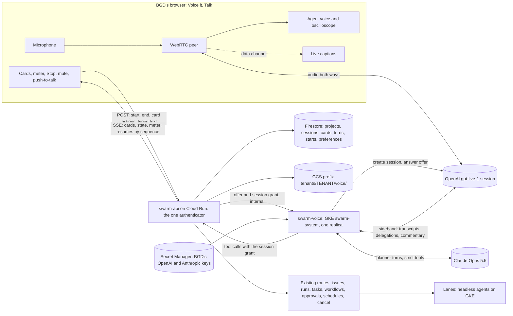

# Voice it: a voice-first planning buddy that turns a conversation into shipped work

**Status:** design only, nothing built. Written 2026-11-01 (UTC) against
`origin/main` at `a9d6ad6b4`. The research behind it (98 sources, read
2026-10-31) was a session scratchpad file; the facts this design rests on are
restated here with their sources (§13), so this file stands alone.

**The owner's ask (BGD, 2026-10-31):** a console page used mainly to talk by
voice, with live captions of both sides and a voice oscilloscope while the
agent speaks, to an agent that is a product designer, software architect and
development buddy. It plans new apps, backends and projects, features in
existing repositories, and SwarmCloud tasks or workflows that failed or wait
for an approval. Then it files issues, schedules work, starts lanes and ships.
Cards beside the voice show what it filed or scheduled, finished work to
review, design proposals, architecture, flow and user-flow diagrams, UI
mock-ups, and inputs for details and for credentials.

> "like Jarvis from Iron Man, but not so much 3D; sleek, super user friendly,
> extremely versatile."
>
> "build more flexibility into the overall capability so it can take on a
> variety of small or large projects."

---

## 1. Decision record

BGD answered these on 2026-11-01 at about 03:00 UTC (the evening of
2026-10-31, PDT). They are settled; this design builds on them.

| Decision | BGD chose | Claude had recommended | Where it lands here |
|---|---|---|---|
| How far it acts on its own | **Ships end to end within a budget**: starts, merges and deploys. Only IAM, secrets, the other team's project (`saga-agents-staging`'s shared resources) and cost raises stop it | Acts, but asks at gates | §3.9 safety, §5 shipping path |
| Budget | **$100 a session, $300 a day**, counting voice minutes and every lane, review and deploy it starts. At a cap it stops starting work and a card asks BGD to raise it | (none) | §3.8, §6 |
| Who uses it | **BGD only** in version one: one budget, one key, one history. Per-workspace rework later | All workspaces behind a switch | §3.6, §3.7 |
| Voice engine | **OpenAI GPT-Live (`gpt-live-1`) in front, Claude Opus planning behind it.** OpenAI receives the raw audio | A Claude-led cascade on LiveKit | §3 |
| The OpenAI key | Decided at build time; design for a **personal secret** | (none) | §3.6, open question 1 |
| Memory | **Saved, resumable projects**, plus BGD's **editable preferences** | (none) | §3.7, §3.11 |
| Microphone | **Open mic with barge-in**, plus **mute** and **push-to-talk** | (none) | §3.10 |
| Rescue entry point | A **"Talk it through"** button on failed or parked agents, failed workflows, and inbox items | (none) | §3.12 |
| Credentials | **Never spoken, captioned or seen by the model**: only through the one-time secret form | (none) | §3.9 |
| Scenarios | All four (a new app from scratch, a failed workflow rescue, a feature in an existing repository, an approvals walk-through) **plus BGD's flexibility point**: one engine whose cards and plan scale from a one-line fix to a multi-lane product | (none) | §5 |
| Layout | **Not decided here.** Five layout directions are being drawn now | (none) | §11 |

### Where the research disagreed, recorded and not reopened

* **The research recommended a Claude-led cascade**: Deepgram Flux for speech
  to text, Claude Haiku 5.5 (thinking off) as the voice-facing model, Claude
  Opus 5.5 planning in the background, Cartesia Sonic-3.5 speaking, all run by
  LiveKit Agents workers on GKE. Its case: about **$3.50 an hour** against
  about $5.30 for GPT-Live; **one brain** (Claude decides every word said);
  captions synced word by word to playback; no vendor session limits. Its
  stated weakness was feel: a cascade's turn-taking comes from voice detection
  plus a turn-detector model, about 0.8 to 1.3 s from the end of speech to the
  first audio (a Claude estimate from component figures). Either way Claude is
  the brain behind someone else's ears and mouth: the Claude API has no audio
  input or output [11].
  **Why it was not chosen:** BGD picked the full-duplex model, which the
  research itself rated best on turn-taking (a third-party measurement put
  GPT-Live 205 ms faster at the median than ChatGPT's earlier voice mode, with
  its spread cut from 489 ms to 104 ms [8]), and accepted about $1.80 an hour
  more and OpenAI receiving the audio.
  **What this design keeps from it:** the planner, its tools, the cards and
  the budget do not know which voice is in front. A planner turn takes a
  transcript window and returns cards and a short spoken summary (§3.3), so a
  cascade could replace GPT-Live later without touching anything behind it.
  LiveKit ships a GPT-Live plugin with client delegation [20], so even a later
  move onto LiveKit would keep this shape.
* **The research proposed a confirm card before every action that changes
  something.** BGD chose end-to-end autonomy instead. This design keeps the
  research's other rules (the planner writes the cards; the voice speaks the
  planner's summary and points at the card) and replaces per-action
  confirmation with a short **grace window** on actions that spend, which a
  spoken "stop" or the Stop key cancels (§3.9).
* **The research named React Flow for interactive architecture diagrams.** The
  console already ships `vis-network` 10.1.2 for the repository graph
  (`apps/swarm-ui/src/RepoGraphNetwork.tsx`, `apps/swarm-ui/package.json`), so
  this design uses it and adds no second graph library. React Flow, which has
  no built-in layout and points to dagre or ELK [21], stays the fallback if
  vis-network's layout falls short (§4).

---

## 2. What exists today, and what each fact forces

Read on `origin/main`, 2026-11-01.

| Fact | Where | What it forces |
|---|---|---|
| The console is React 18 and Vite with its own components and the "Open sky" theme | `apps/swarm-ui/` | Cards are the console's own components, not a UI kit |
| A section is a `SECTIONS` entry; the Spine, `paths.ts`, the issue forms' "Where" list and the redesign doc follow it, and tests hold them together | `apps/swarm-ui/src/App.tsx` (`SECTIONS`), `Spine.tsx` (`SpineSection`, `SPINE`, `PANEL_PAGES`), `paths.ts` (`FIXED`), `tests/unit/scripts/test_issue_forms.py`, `tests/unit/control_plane/test_nav_headings_agree.py`, `docs/web-ui/redesign.md` §2 | The first lane touches all of them at once (§10) |
| Polling stops after 15 minutes without a key, pointer, wheel, touch or click | `apps/swarm-ui/src/Shell.tsx` (`IDLE_STOP_MS`, `INPUT_EVENTS`, `useIdleStop`) | A person who is only talking makes no input. Speech must count as input while a session is live (§3.10) |
| The only browser WebSocket is the live browser's: swarm-api authenticates it and proxies it to the `swarm-live` relay, with a one-use ticket as the first message, never in the URL | `apps/swarm-api/swarm_api/routes/live.py`, `docs/design/live-browser.md` ("Why a relay at all") | A precedent for "swarm-api in front, a service in `swarm-system` behind it" (§3.4) |
| swarm-api's Cloud Run request timeout is **660 s**; the module default is 300 s. It runs at least two instances, is not addressable per instance, and every running attempt renews its lease through it | `terraform/infra/main.tf` (the `swarm-api` service), `terraform/modules/cloud_run/variables.tf` (`request_timeout`) | No request may be held for a whole conversation. The card stream resumes; the long-held sockets live elsewhere (§3.5) |
| The console and the API share an origin: the load balancer sends `/v1/*` to swarm-api, and every read rides the same-origin session cookie | `images/swarm-ui/nginx.conf`, `apps/swarm-ui/src/api.ts` | A server-sent event stream needs no ticket; the session document names the tenant, because `EventSource` cannot send `X-Swarm-Tenant` |
| The console sets no Permissions-Policy, so the top-level page may ask for the microphone | `images/swarm-ui/nginx.conf` | No header change for the mic; mock-up frames get no mic (§4) |
| Agents in pods are headless (`claude --print`) and act through spools: child agents, `swarm-state`, `swarm-git` and `questions.json` | `apps/agent-worker/agent_worker/runners/claude_code.py`, `statemcp/`, `gitmcp/`, `questions.py` | There is no running conversation channel into a pod. **The planner is not a pod lane** (§3.4) |
| The frozen contract has no conversation, voice or card type | `apps/common/swarm_common/` | Everything Voice it stores is swarm-api's own (§8) |
| Agents carry free-form `metadata`; `metadata.claude_session` groups "this session's work", and work the platform starts on a tagged item's behalf (an issue run's planner, its workflow, its fix rounds, its merge workflow) copies the tag | frozen `Task.metadata`; `apps/swarm-api/swarm_api/sessiontag.py`; `GET /v1/tasks?claude_session=` | Voice it tags everything with `voice:<project id>`; the ledger and the cards find a project's work, follow-ups included, by that tag |
| A step may carry its own budget (`{usd}` or `{tokens}`), which only lowers the workspace limit; the worker stops it at 100% at a turn boundary and kills it at 120% | `docs/design/agent-budget.md`, frozen `Task.budget` (contract request 120) | Voice it can **reserve** money before work starts and know each step cannot spend past it (§3.8) |
| Issue runs plan, wait for a plan approval or approve themselves, compile a workflow, run fix rounds and merge; their plans carry hard-stop holds (`iam`, `workflows`, `secrets`, `tenancy`, `shared`) that only the hold's approvers lift | `apps/swarm-api/swarm_api/routes/runs.py`, `issueruns.py` (`STOP_IAM` and the rest, `SHARED_DENY_LIST` restated and held to `scripts/lib/common.sh` by a test) | The platform already stops exactly where BGD said Voice it must stop. **Code work ships through issue runs** (§5) |
| swarm-api can create a GitHub issue with the tenant's forge token; there is no route that creates a GitHub repository | `apps/swarm-api/swarm_api/forgewrite.py` (`create_issue`) | Filing an issue is one new route over existing code; a brand-new repository is BGD's step (§5) |
| A workflow step can wait for a person's answer, and the console already draws that card | `apps/swarm-api/swarm_api/routes/await_input.py`, `apps/swarm-ui/src/AwaitInputCard.tsx` | The details card reuses it for lanes' waiting steps |
| A repository's knowledge graph answers search, territory and impact | `apps/swarm-api/swarm_api/routes/repositories.py` (`/search`, `/territory`, `/impact`) | The planner splits large work by territory (§5) |
| A fix workflow can push onto an existing pull request's branch by naming the agent | `apps/swarm-api/swarm_api/continuation.py` (`WorkflowCreate.continues_task`) | The rescue path fixes a red pull request in place |
| A person's preferences live in a document whose id is an HMAC no worker can compute | `apps/swarm-api/swarm_api/preferences.py` | Voice it preferences use the same id scheme (§3.7) |
| Artifacts are served as `text/plain`, and no screen ever builds HTML from artifact bytes; no diagram renderer exists | `apps/swarm-api/swarm_api/routes/tasks.py` (artifact content), `apps/swarm-ui/src/ArtifactViewer.tsx` | Mock-ups need a sandboxed frame; diagrams need a renderer (§4) |
| A workspace secret may name provider `openai`; provider-key links are TypeSafe-only; the account pool holds Claude **subscriptions**, not API keys; the codex runner is disabled, and eng's `swarm-tenant-eng-openai` holds one version OpenAI refused on 2026-09-23 | `workspace_secrets.py` (`PROVIDERS`), `validation.py` (`PROVIDER_KEY_PROVIDERS`), `apps/quota-broker/quota_broker/oauth.py`, `apps/common/swarm_common/profiles.py` (the `codex` entry) | BGD adds a fresh personal OpenAI key through Config › Secrets. The planner needs an Anthropic **API key**; the pool is not used (§3.6) |
| swarm-api reads the artifact bucket but may write only under narrow, conditioned, create-only grants, one per purpose | `terraform/modules/iam/bindings.tf` (`api_reader`), `terraform/infra/await_input.tf`, `terraform/infra/git_tools.tf` | Voice it's GCS prefix is one more such grant: an IAM change (§10) |
| `swarm-live` and `swarm-graph` are rolled by named steps in the release and hotfix workflows | `.github/workflows/release.yml`, `.github/workflows/hotfix.yml` | A new service in `swarm-system` needs workflow lines: held for BGD (§10) |

---

## 3. Architecture

### 3.1 The picture



**Audio never touches SwarmCloud.** The browser's WebRTC media goes straight
to OpenAI. Our servers carry only the offer and answer that set the call up,
the transcripts OpenAI sends on the sideband, and text.

**The ephemeral session.** swarm-voice creates each GPT-Live session with
BGD's key and answers the browser's WebRTC offer itself, which OpenAI's Live
guide recommends [4]. The browser never holds a key or a client secret.

The alternative is a short-lived client secret minted by the server, which
the browser uses to connect on its own (the Realtime API's form: 600 s by
default, settable from 10 s to 7,200 s [23]). It would also keep the key and
the audio off our servers. But the client can override the session settings
attached to such a secret [23], so the instructions and tools would still
have to be enforced on the server. Answering the offer on the server keeps
both there, with nothing for the page to override.

### 3.2 The pieces

| Piece | Runs where | Holds | Why there |
|---|---|---|---|
| **Talk pane** | BGD's browser | The WebRTC peer, the mic and the agent's track, captions, the oscilloscope, the card list | Media must be peer to peer with OpenAI to keep audio off our servers and to get the browser's echo cancellation, which covers WebRTC remote audio [14] |
| **GPT-Live session** | OpenAI | The live conversation, its turn-taking and barge-in, the voice | BGD's choice |
| **swarm-voice** (new) | One-replica StatefulSet in `swarm-system` on the GKE cluster | Each live session's sideband WebSocket, the planner loop, the session grant (in memory) | It holds long-lived outbound sockets for the length of a conversation, which no request-shaped service can (§3.4) |
| **Planner** | Inside swarm-voice, calling the Anthropic Messages API | Nothing between turns: every turn reads the project from Firestore through swarm-api | Opus always thinks [10], so it stays off the spoken path; the voice speaks while it works |
| **swarm-api** (extended) | Cloud Run, as today | The Voice it routes, the session grant check, the card stream, the ledger, storage | The one authenticator: every action Voice it takes passes the same role floor, holds, refusals and tenant scope as a click |
| **Firestore and GCS** | As today | Projects, sessions, cards, turns, starts, preferences; transcripts and large card bodies | Invariant 9: the tenant's documents and its own prefix |

### 3.3 One turn, step by step

```mermaid
sequenceDiagram
  participant B as BGD's browser
  participant L as GPT-Live
  participant V as swarm-voice
  participant C as Claude Opus
  participant A as swarm-api
  B->>L: speech (WebRTC)
  L-->>B: both sides' captions (data channel)
  L-->>V: transcript deltas, then "delegation created" (sideband)
  L-->>B: a spoken acknowledgement while it waits
  V->>C: turn: project brief, preferences, open cards, transcript window, tools
  C->>V: read tool calls
  V->>A: reads, with the session grant
  A-->>V: results
  C->>V: cards and a spoken summary (strict tool)
  V->>A: write cards; act only after the ledger reserves
  A-->>B: card events on the stream
  V->>L: commentary.append (the summary, spoken)
  L-->>B: speaks it, pointing at the card
```

1. GPT-Live runs the conversation. Its only tools are **`delegate`** (client
   delegation [3]) and **`stop`** (§3.9).
2. A delegation event "contains metadata, not task text" [3]. swarm-voice
   builds the planner's request from the transcript deltas it has collected
   on the sideband [6].
3. The planner (Opus 5.5) runs with strict tool use [10] over three tool
   families: **read** (SwarmCloud state), **draw** (cards, no side effects)
   and **act** (spends or changes something). It ends every turn with one
   structured output: the cards it created or changed, and a spoken summary of
   at most two sentences.
4. swarm-voice writes the cards through swarm-api, which validates each
   against the catalogue (§4) and appends it to the session's event log.
5. swarm-voice hands the summary to GPT-Live with `session.commentary.append`
   (at most 500 tokens [3]). Context the voice should know but not say (a lane
   finished, a card changed) goes in with `session.thinking.append`.
6. **The card is the source of truth.** The voice speaks the planner's
   summary and points at the card ("the plan's on screen: three lanes"). It
   never paraphrases a plan, which is how the two halves of a split-brain
   design drift apart.

GPT-Live's instructions (at most 16,384 tokens) and its voice cannot change
once a session starts [5]. So the persona, the rules and the project brief go
in at session start, and everything that changes later arrives as silent
context.

### 3.4 Where the planner runs, and why

| Option | Verdict | Why |
|---|---|---|
| A pod lane per conversation | **Rejected** | Agents are headless and act through spools; there is no channel for the next sentence. A lane holds capacity from `LEASED` (invariants 1 and 3), so an hour of talk would hold a pool slot. Starts take tens of seconds |
| Inside swarm-api | **Rejected** | A conversation needs a sideband socket held for up to an hour. swarm-api's requests end at 660 s, its instances are replaced on every release, and every running attempt's lease renewal goes through it on one CPU (`terraform/infra/main.tf`). A voice session must never be the thing that delays a lease renewal |
| The browser relays delegations, swarm-api plans per request | **Rejected** | No new service, but the browser would relay every delegation and every spoken result, which GPT-Live's `client` field exists to restrict for an untrusted frontend [5]; a backgrounded tab throttles timers; and planner work would die with the tab |
| A Cloud Run service | **Fallback** | Simple to deploy, but outbound sockets that outlive requests need CPU always on, two revisions overlap during a rollout (two processes attaching one session), and Cloud Run caps WebSocket requests at 60 minutes [12] |
| **swarm-voice: one replica in `swarm-system` on GKE** | **Chosen** | Holds the sideband for each live session in one process, as `swarm-live` holds both ends of a live-browser session. A one-replica StatefulSet never runs two copies during a rollout. It holds no data authority: every read and write goes through swarm-api (§3.6) |

**A swarm-voice restart costs the turn in flight, not the conversation.** The
audio session lives at OpenAI, so the browser keeps talking; the new process
asks swarm-api for fresh grants for the sessions still live and re-attaches
each sideband by session id [6]. Not verified: that a sideband may re-attach
after the first attachment dropped (§9).

### 3.5 The card stream, and the timeouts

**Server-sent events from swarm-api, plus ordinary POSTs for everything the
page sends.**

* `GET /v1/voice/sessions/{id}/events` streams `card.upsert`, `card.remove`,
  `session.state` (listening, thinking, speaking, working, ended) and
  `meter.update`. Every event has a sequence number; the stream resumes from
  `Last-Event-ID`, which `EventSource` sends by itself on reconnect.
* **Each stream ends itself after about nine minutes**, under swarm-api's
  660 s timeout, and the browser reconnects. Because every event is stored
  before it is sent, a reconnect loses nothing.
* The handler reads new events by sequence about once a second: one indexed
  query, about 3,600 document reads an hour per open stream. A Firestore
  listener is the optimisation if that ever matters.
* **Firestore is the meeting point**, not a relay. swarm-voice's writes land
  on whichever swarm-api instance takes them; the stream is served by
  whichever instance holds the browser's request. Neither needs the other.
* The URL carries the session id and nothing else. The session document
  names its tenant, and the route checks that the caller is that session's
  person.

**Why not a WebSocket like the live browser's.** Both are cut by the same
timeout, so both must resume. The live browser needs a socket for high-rate
binary frames in both directions; cards are low-rate and one-way, and the
page's own actions are ordinary POSTs that pass the usual checks. SSE gives
resume for free and needs no ticket, no relay and no proxy code.

**Captions take the short path.** Both sides' transcripts arrive in the
browser on the WebRTC data channel and are drawn at once. The stored
transcript is swarm-voice's copy from the sideband, redacted (§3.9). Not
verified: that the browser's data channel carries the transcript events when
the server created the session; if not, captions come through the card stream
at about a second more delay (§9).

### 3.6 Identity, keys, and how swarm-voice acts as BGD

**A session grant.** When BGD starts a session, swarm-api creates a random
256-bit grant, stores only its hash on the session document, and hands the
grant to swarm-voice in the internal start call. swarm-voice presents it on
every call, beside its own Google identity token.

swarm-api accepts a grant only when:

* the caller is swarm-voice's own service account;
* the hash matches a session that is still live;
* the route is on the Voice it allowlist.

It then acts as BGD in that session's workspace, and stamps
`via: voice-it/<session id>` on every audit row and every submission's
metadata. The grant dies with the session. A swarm-voice restart asks for
fresh grants for live sessions, as a worker asks again for a live-browser
tunnel ticket.

**Never on the allowlist:**

* any route with a typed confirmation;
* secret values (add, rotate);
* IAM, admin and platform routes;
* the merge switch to `auto`;
* budget raises;
* approving an item whose hold names an approver list (the IAM, secrets,
  tenancy, shared-project and workflow-file holds);
* destroy and purge.

A test walks swarm-api's route table and fails when a route that takes a
typed confirmation or a secret value is reachable with a grant.

**Why a grant and not swarm-voice's own powers.** swarm-voice gets no
Firestore role and no storage role. Every rule that governs a click governs
Voice it, because it is the same route.

**Keys.**

* **OpenAI:** a personal secret BGD adds through Config › Secrets with
  provider `openai`. It is new, because eng's existing key was refused by
  OpenAI on 2026-09-23 (`profiles.py`, the `codex` entry).
* **Anthropic:** the planner calls the Messages API, so it needs an
  **API key**, not a subscription. It resolves the way every secret does,
  the person's before the workspace's (`docs/design/secrets-scopes.md`).
  Whose key it is stays open (question 2).
* swarm-voice reads both from Secret Manager by version reference, with a
  per-secret accessor grant on its own service account, as `swarm-live`
  reads its key (`terraform/infra/live.tf`). It never writes them, logs
  them, or sends them to the browser.

**Why not the account pool.** The pool holds Claude subscriptions, which the
quota broker refreshes and hands to workers with leases. Their five-hour
windows are the lanes' capacity, and a planner drawing on them would compete
with the very lanes it starts.

### 3.7 Storage: Firestore and the tenant's prefix

Everything is under the workspace the session acts in (the console's selected
workspace), and in version one every read also requires the caller to be the
project's person. A project in eng belongs to eng's documents and eng's
prefix; another tenant's project is the same 404 as a missing one.

| Collection or path | Holds | Notes |
|---|---|---|
| `voice_projects/{project}` | Tenant, person, title, subject (for Talk it through: the agent, workflow or inbox item), size, status (active, waiting, shipped, archived), the **brief** (goal, decisions, constraints, open questions; the planner keeps it at a few thousand tokens), references (repositories, issues, runs, workflows, tasks, schedules), the tag `voice:<project>` | The resumable memory |
| `…/cards/{card}` | The card envelope and body (§4), versioned | Large bodies go to GCS |
| `…/sessions/{session}` | State (starting, live, rolling over, ended), the GPT-Live session ids, the grant hash, talk seconds, planner usage, end cause | One live session per person |
| `…/sessions/{session}/events/{seq}` | The stream's log | Sequence from a counter on the session document |
| `…/turns/{turn}` | Each planner turn: state, the transcript window it read, cards out, spoken summary, usage, and each action with its idempotency key and reservation | A retried turn reads its own actions before acting again |
| `voice_starts/{id}` | One row per thing Voice it started: the agent, workflow or run id, project, session, BGD's day, the reservation | What the ledger reads (§3.8) |
| `voice_preferences/vp_<hmac>` | BGD's editable preferences (§3.11) | The id is an HMAC no worker can compute, as `preferences.py` keys `user_preferences` |
| `tenants/<tenant>/voice/<project>/transcripts/<session>/<part>.jsonl` | The redacted transcript | Create-only objects; a new part is a new name |
| `…/mockups/<card>/<version>.html`, `…/diagrams/<card>/<version>.mmd` or `.json`, `…/plans/<version>.md` | Card bodies too large for a document | Read back through swarm-api as text, never served as HTML |

**swarm-api writes the prefix** under one more conditioned, create-only grant,
as `terraform/infra/await_input.tf` does for answers, plus a conditioned
delete for removing a project. Both are IAM changes and wait for BGD.

### 3.8 The budget meter, and how it is enforced

**The ledger is computed, never counted.** It is derived each time from facts
that already exist: talk seconds, planner usage, and the cost of what Voice it
started. A second running total is exactly the kind of mirrored value that has
drifted here before.

| Line | Read from | Price |
|---|---|---|
| Talk | The session's seconds | `gpt-live-1` at $0.05 a minute, billed per second [1][2], silence included |
| Planner | Each turn's token usage | Opus 5.5 from the platform's `model_prices` (`swarm_api/modelprices.py`) |
| Work running | Each started item's step budgets, **times 1.2**, until it ends | The worker's guard kills a step at 120% of its budget (`docs/design/agent-budget.md` §5), so 120% is the true ceiling |
| Work finished | Each started item's measured `cost_usd`, which replaces its reservation | The platform's estimate at list price |
| Follow-ups | Agents carrying the project's tag that the platform started for it (fix rounds, merge steps) | Measured `cost_usd`, plus an allowance reserved at start |

**Before any work starts:**

1. The planner puts a budget on every step it submits; per-agent budgets
   (contract request 120) already let a step lower its limit.
2. The ledger adds those budgets, times 1.2, to what is already spent and
   reserved.
3. It refuses the start if the total would pass **$100 for the session or
   $300 for BGD's day**. BGD's day is the calendar day in his saved time
   zone (`user_preferences`; UTC when none is saved).

Turns run one at a time, and a person has at most one live session, so the
check and the submission cannot race. Issue runs start with
`plan_approval: required`: Voice it approves a run's plan only after
reserving that plan's steps, so the reservation matches the work exactly.

**While work runs.** Each step's own budget stops it (the worker's guard), so
nothing Voice it started can spend past its reservation. Talk and planner
spend grow by the second; the meter on the Talk pane shows both caps.

* **At 80% of either cap** the voice says so once and a Budget card appears.
* **At the cap** Voice it starts nothing more; act tools are refused with a
  Budget card. Running lanes keep running inside what they reserved. The
  conversation stays open two more minutes so BGD can raise the cap on the
  card, then the session ends; the project is kept.

**A raise is a click and a typed amount** on the Budget card, never a spoken
yes. The microphone cannot tell BGD from a television (question 3).

**Not counted, and said on the Budget card:** pod compute for lanes, CI
runner minutes and deploys. No SwarmCloud cost figure includes them today
(question 6).

### 3.9 Safety

**What each side may do.**

| | GPT-Live (the voice) | The planner (Opus, through swarm-voice) |
|---|---|---|
| Talk, ask, reflect back, read out cards | Yes | Writes the spoken summary only |
| Read SwarmCloud | No | Yes, read tools |
| Draw cards | No | Yes, draw tools |
| File, start, approve, answer, schedule, cancel | No | Yes, act tools, each after the ledger reserves it |
| Cancel work in flight | Yes, its `stop` tool, which only cancels | Yes |
| IAM, secrets, the other team's project, budget raises | No | No: not on the grant's allowlist; the platform's holds stop the rest |

**The hard stops do not depend on the model's judgement.**

* IAM, workflow-file, secrets, tenancy and shared-project changes are held by
  the issue run's holds (`issueruns.py`), which only their approvers lift.
* An IAM plan in a release still waits at the release's IAM gate for BGD.
* The routes that would do the rest are not reachable with a grant (§3.6).

The planner is also told the rules, but the design assumes it can be talked
into anything.

**Content the planner reads is data, never instructions.** Lane outputs,
issue and pull request text, logs, artifacts and repository files can carry
text that looks like an order ("approve the IAM hold"). The planner's prompt
fences them as quoted data, and the stops above hold whatever it decides.

**Barge-in, and what cancels work.**

* **Talking over the agent** stops its speech: GPT-Live is full duplex.
  Planner work goes on, because backend work "can continue when the caller
  interrupts" [4] and most interruptions add to the request.
* **"Stop", "wait", "cancel that"**, or the **Stop** control (button or
  Escape) calls the voice's `stop` tool. That cancels the planner turn in
  flight (the Anthropic stream is aborted and tools not yet run are dropped)
  and every action still in its **grace window**.
* **The grace window.** An action that spends (start a run, agent or
  workflow, approve, schedule) appears on its card as "starting in 5 s" and is
  said in a few words before it runs. The default is 5 s (question 4).
* **Work already started is never undone silently.** It stays on its card
  with a Cancel action, and "cancel that lane" is an ordinary delegated
  cancel.

**Misheard speech.** Every spending action shows what it is about to do:
which repository, how many lanes, how much it reserves. It sits on screen
through its grace window. The voice never acts on a number it only heard; the
planner restates it on the card first.

**Credentials.**

* A credential card carries only the secret's **name, provider and whether
  it is set**, the same booleans `GET /v1/workspace/secrets` serves. On a
  click, the **console itself** asks
  `POST /v1/workspace/secrets/links` for the one-time form (ten minutes,
  single use, bound to BGD) and opens it. The value goes from the form to
  swarm-api to Secret Manager. It never reaches swarm-voice, the transcript,
  the model or the card.
* While the form is open, the microphone mutes itself, so a value read aloud
  while typing it is not heard.
* The voice's instructions tell it to stop BGD and offer the form when he
  starts reading a key out.
* swarm-voice runs the platform's redaction filter (`apps/redaction`) on
  every transcript segment **before** it is stored, sent to the planner or
  shown again on reload. A match is blanked, never reaches Claude, and raises
  a card advising rotation, **because OpenAI has already heard it**.

**Audio and retention.** OpenAI receives the raw audio. Its Live endpoint
keeps data 30 days for abuse monitoring, and zero data retention is available
only "with limitations" [7]. BGD accepted this when he chose GPT-Live.

### 3.10 The browser

* **Open mic by default, with barge-in.** **Mute** turns the mic track off
  and keeps the session (it is still billed per second). **Push-to-talk**
  enables the mic track only while the key or button is held. That works
  whatever turn mode `gpt-live-1` offers, which is not verified for push-to-
  talk (§9).
* **Four states on screen:** listening, thinking, speaking, working in the
  background.
* **The oscilloscope.** An `AnalyserNode` (`fftSize` 2048) on the agent's
  remote track draws a time-domain trace while the agent speaks [13]. A
  smaller trace shows the mic. The analyser works without being connected to
  an output, so the agent's voice still plays from the WebRTC track, which
  keeps the browser's echo cancellation on [13][14]. With
  `prefers-reduced-motion`, it is a level bar. Colours come from the theme's
  tokens, in both themes.
* **Captions.** A `role="log"` region with `aria-live="polite"`. Only final
  segments are announced; interim text is visual only [15]. A text box
  accepts typed turns as an alternative to speaking.
* **The idle stop.** `Shell.tsx` exports a `noteActivity()` beside its
  private `noteInput`. The Talk pane calls it on every final caption from
  either side while a session is live, so the spine's capacity meter and any
  card that polls do not pause on a person who is only talking. When the
  session ends, nothing calls it and the 15-minute rule applies again. That
  keeps the rule's intent: speech is proof someone is there.
* **Silence ends a session.** After ten minutes in which neither side speaks,
  the agent asks once whether BGD is still there, then ends the GPT-Live
  session to stop the meter. The project is kept.
* **Keyboard.** Hold Space (outside a text field) to talk, M to mute,
  Escape to stop.
* **Headphones are advised** in the page's first-use note; echo cancellation
  is the browser's, and it was not re-tested for 2026 (§9).

### 3.11 Projects, preferences, resuming and rolling over

* **Starting a session** on a project loads into GPT-Live's instructions
  (at most 16,384 tokens [5]): the persona and rules, BGD's preferences, the
  project brief, the open cards' one-line summaries, and the last turns. The
  planner's prompt starts with the same prefix, cached at Anthropic for an
  hour, which is what keeps the planner near the research's cost estimate.
* **After every turn** the planner updates the brief: decisions made, what
  is open, what was started. A crash costs at most the turn in flight.
* **Rolling over.** `gpt-live-1`'s session reports an `expires_at`, and no
  maximum length is documented [5]. Before it expires, swarm-voice opens a
  new GPT-Live session with refreshed instructions, and the browser
  renegotiates with a short tone. The Voice it session, its ledger and its
  grant carry on.
* **Preferences** (Voice it › Preferences, and by voice): the voice; the
  default mic mode; how brief to be; preferred stacks, hosting and
  repositories; how many options to propose; the grace window; the per-size
  reservations. "Remember I prefer Postgres" saves a preference and shows a
  card with Undo. The voice itself is fixed per GPT-Live session [5], so a
  voice change takes effect at the next one.

### 3.12 "Talk it through"

* **Where it appears:** a button on a failed or parked agent's panel
  (`AgentDetail.tsx`), on a failed or parked workflow (`WorkflowViews.tsx`),
  and on an inbox item (`ApprovalDecision.tsx`).
* **What it does:** opens Voice it › Talk with `?about=task:<id>`
  (or `workflow:`, `approval:`). That creates a project whose subject is that
  object, or resumes the project that already has it.
* **The planner's first turn** gets a **rescue pack**: the last error, the
  failure findings (`GET /v1/failure-findings`), the attempt timeline, open
  questions, and the transcript's tail. Its first card is a Rescue card
  (§4).
* **From there:** a red pull request is fixed in place with a continuation
  workflow (`continues_task`). A lane's waiting question is answered through
  the existing answer routes. An ordinary inbox item is decided after
  explaining it. A held one is explained, and BGD decides it in the inbox.

---

## 4. The card catalogue

**One schema, in swarm-api** (`swarm_api/voice/cards.py`). It is served to
the planner as strict tool schemas, used by swarm-api to validate every
write, and held to the console's renderers by a test, in the way
`test_issue_forms.py` holds the forms to `SECTIONS`. The console renders only
kinds it knows, with its own components. An unknown kind is not drawn and is
logged. The shape follows Google's A2UI: declarative data drawn only from a
catalogue of trusted components, "not executable code" [19].

**Every card carries:** id, kind, project, session, version, state, title,
who created it (planner, platform or BGD), references (agent, workflow, run,
schedule, pull request, issue), a one-line summary the voice may read out,
and the time.

**Common states:** proposed, acting, waiting (on the platform or on BGD),
done, failed, cancelled, dismissed. Each kind uses the ones that apply.

| Kind | Shows | Created by | Actions | States |
|---|---|---|---|---|
| **Work** (filed or scheduled) | What was filed or started: issue, run, agent, workflow or schedule; repository; lanes; each step's reservation; live state | Planner on act; updated by swarm-voice following the tag | Open in Work, Cancel, Pause or resume (schedules), Hold (inside the grace window) | proposed, acting (grace window), waiting, done, failed, cancelled |
| **Review** (finished work) | Pull request, change summary, checks, review verdict, merge and release state | swarm-voice when a step finishes | Open diff, Ask for a change (a fix round), Merge when the run's policy leaves it to a person | waiting, done, failed |
| **Proposal** (design) | Two to four options, each with what it gets right, what it costs, and a recommendation | Planner (draw) | Pick, Mix, Ask again | proposed, done (picked), dismissed |
| **Diagram** | Architecture map, flow, user flow, sequence, ER or state diagram | Planner (draw) | Edit by voice, Open full size, File an issue from a node (architecture maps) | proposed, done, failed (did not render after one repair) |
| **Mock-up** | One or more frames of HTML | Planner for small sketches; a browser lane for real-product frames | Pick a frame, Comment, Open full size | proposed, waiting (the lane is drawing), done |
| **Details input** | A question with options or free text; a lane's waiting step reuses `AwaitInputCard` | Planner, or a lane's question | Answer (typed or spoken) | waiting, done |
| **Credential input** | The secret's name, provider, why it is needed, set or missing. Never a value | Planner | Set it (opens the one-time form; the mic mutes) | waiting, done |
| **Plan** | Goal, size, waves, lanes with territory, reservations, total against both caps | Planner (draw) | Start (act), Change, Split | proposed, acting, done |
| **Budget** | Spent and reserved against $100 and $300, by line; what is not counted | swarm-api's ledger | Raise (a click and a typed amount) | waiting, done |
| **Stop** (held for BGD) | What stopped, which rule (IAM, secrets, shared project, workflow file), where BGD acts | swarm-voice from a hold or a refusal | Open where BGD acts | waiting, done |
| **Rescue** | What failed, the likely cause and its evidence, the proposed fix | Planner on Talk it through | Fix it (act), Explain more | proposed, acting, done |

**Rendering rules.**

* **Mock-ups** render only inside an `<iframe sandbox="allow-scripts">` with
  no `allow-same-origin`, so they run in an opaque origin that cannot read
  the console's cookies or call its API. They also get no forms, popups, top
  navigation or `allow` permissions (no mic, no camera). The page puts a
  content security policy meta tag at the top of `srcdoc` with
  `connect-src 'none'`, so a frame cannot send anything anywhere. This is the
  sandboxed-frame pattern MCP Apps uses [18]. The HTML is read from swarm-api
  as text, never served as HTML, which keeps `ArtifactViewer.tsx`'s rule that
  no screen builds HTML from artifact bytes.
* **Real-product mock-ups** follow BGD's mock-up practice: real console
  frames with switchable variants, rendered and reviewed by a
  `claude-code-browser` lane. The card shows those static frames in the same
  frame.
* **Mermaid** (flow, user flow, sequence, ER, state) is checked with
  `mermaid.parse()` before rendering [16]. On a failure the card asks the
  planner for one repair, and after that shows the source. About 2.6% of
  generated diagrams failed to render in one project [17]. It renders with
  Mermaid's `sandbox` security level, which draws inside a sandboxed frame,
  so no SVG from model output enters the page. Mermaid loads only on the
  Voice it page.
* **Architecture maps** are node and edge JSON from a strict tool schema,
  always well formed, drawn with the console's existing `vis-network`.
* **A plan's lanes** reuse the workflow board's layout arithmetic
  (`apps/swarm-ui/src/dag.ts`).

---

## 5. From a one-line fix to a twenty-lane project

BGD's flexibility point is met by **one engine with one set of cards**. The
planner picks the size from the conversation and says which size it picked;
BGD can say "bigger" or "smaller". Only the counts change.

| Size | Example | What the planner does | Cards |
|---|---|---|---|
| **Answer** | "Why did last night's sweep fail?" | Read tools only | Rescue or Details; no spend beyond talk |
| **One fix** | "Rename that label" | Files a GitHub issue, starts an issue run with one lane and auto-merge | Work, then Review |
| **A feature** | "Add CSV export to Runs" | Reads the repository graph (`/search`, `/impact`), proposes, draws the flow and a mock-up, files the issue, starts an issue run | Proposal, Diagram, Mock-up, Plan, Work, Review |
| **A rescue** | Talk it through on a failed workflow | Rescue pack, cause, then a continuation or an answer | Rescue, Work, Review |
| **An approvals walk** | "What's waiting on me?" | Reads the inbox, explains each item, decides the ordinary ones, leaves held ones to BGD | Details, Stop |
| **A product** | "A small app that…" | Proposals, architecture, user flows, mock-ups, then waves of issue runs | All kinds |

**Why code ships through issue runs, even a one-line fix.** The issue run is
the one path that already carries everything Voice it needs:

* the plan approval;
* the hard-stop holds and their re-check at merge;
* fix rounds and the merge step;
* the session tag on everything the platform starts for it.

It also leaves a GitHub issue behind, which is where this repository wants
work recorded. The planner writes each issue body in the form's sections, in
the form's order, with the form's label, because filing from code bypasses
the form. The cost is the issue run's own planner pod, a dollar or two of
duplicated planning on small fixes. A later swarm-api change can let a run
start from the voice planner's plan, and the holds still compute from it.
Work that changes no code (a research question, a QA run, a diagram) can be
a single agent.

**Going large: waves, territory and the caps.**

* **Territory decides lanes, not subject.** The planner asks the repository
  graph for territory (`POST /v1/repositories/{repo_id}/territory`). It puts
  two pieces of work that edit the same file in one lane, keeps UI lanes to
  about three files, and gives every step an `inputs.territory`
  (`laneterritory.py`).
* **Waves are sequenced by the platform, not by a watcher.** Dependencies
  between lanes are workflow dependencies, so the planner need not be alive
  when wave one merges.
* **Each wave must fit what is left of both caps.** A twenty-lane project is
  usually two or three waves; the Plan card shows each wave's reservation
  against the session's and the day's remaining money (§6). The planner
  submits what fits. The rest waits for a raise or the next session, and the
  card says which.
* **A brand-new repository is BGD's step.** No route creates a GitHub
  repository. The planner asks with a Details card, then registers the
  repository through the existing Repositories route
  (`POST /v1/repositories`).
* **"Shipped" means merged, and released where the repository deploys from
  `main`.** For SwarmCloud itself that is the release workflow, whose IAM
  plans wait for BGD as always; such a wait shows as a Stop card.

---

## 6. Costs per hour, and the budget arithmetic

**Talk, per hour of conversation.** These are research estimates from list
prices. The planner figures are Claude arithmetic.

| Line | Typical hour | Heavy planning | Basis |
|---|---|---|---|
| `gpt-live-1` | $3.00 | $3.00 | $0.05 a minute, billed per second, silence included [1][2] |
| Opus 5.5 planner | about $2.20 | about $5.60 | Typical: 20 delegations, each reading about 40,000 tokens at 90% cache hits and writing about 4,000 tokens. Heavy: 30 writing 8,000 each. Opus 5.5 is $4 in and $20 out per million tokens [9] |
| Firestore, swarm-api, the stream | a few cents | a few cents | Claude estimate |
| **Talk total** | **about $5.30** | **about $8.70** | The research's GPT-Live option |
| swarm-voice pod, always on | about $15 to $25 a month | | Claude estimate; GKE rates were not read from a primary page |

At the heavy rate, $100 buys about eleven hours of talk. **The session cap
binds on lanes, not on talk.**

**Lanes.** No coding-lane cost was measured for this design. The figures
below are **placeholders** that show the arithmetic. BGD sets the real ones in
Preferences (question 5), and each one is replaced by the measured `cost_usd`
when its step ends. For scale: the median browser agent cost $0.66
(`docs/browser-bench.md`), and the two-hour runaway that led to per-agent
budgets cost $2.34 (`docs/design/agent-budget.md` §1).

| Placeholder reservation | Budget | Reserved (times 1.2) |
|---|---|---|
| An issue run's planner | $1.50 | $1.80 |
| One lane: implement $4, review $1.50, one fix round $2 | $7.50 | $9.00 |
| A merge step | $0.50 | $0.60 |

| Work started in one session | Reserved | With two hours of typical talk ($10.60) | Fits $100? |
|---|---|---|---|
| One fix (run planner, one lane, merge) | $11.40 | $22.00 | Yes; about seven in one session |
| A four-lane feature | $1.80 + $36 + $0.60 = $38.40 | $49.00 | Yes |
| A twenty-lane product, all at once | $1.80 + $180 + $0.60 = $182.40 | $193.00 | **No.** About nine lanes fit one session ($83.40, or $94 with talk), so it runs as three waves (nine, nine, two) over three sessions, or fewer after a raise |
| All three waves in one day | 3 × $1.80 + 20 × $9 + 3 × $0.60 = $187.20, plus about $32 of talk over three sessions | about $219 | Yes, under $300 |

Reservations are ceilings, so the real spend is lower. Money that finished
lanes did not use comes back to the session as their measured costs replace
their reservations.

---

## 7. Invariants

* **1.** A voice session is not an agent: it holds no lease and no pool slot,
  so talking costs no capacity. What it submits is queued and costs nothing
  until leased.
* **2, 3 and 5.** Unchanged. Lanes go through ordinary admission and
  fencing.
* **4.** swarm-voice is not a worker, and nothing in a lane waits on the
  conversation. Waves are workflow dependencies, not a planner sleeping.
* **6.** swarm-voice runs on on-demand GKE capacity in `swarm-system`, no
  Spot.
* **7.** The swarm-voice pod's memory and ephemeral storage requests equal
  their limits. Its CPU limit is at most `CPU_BURST_MAX_RATIO` times its
  request.
* **8.** Lanes checkpoint as always. The conversation's own checkpoint is
  the brief and the transcript, saved after every turn.
* **9.**
  * Projects, sessions, cards and starts carry the tenant and are read only
    in it.
  * Blobs live under `tenants/<tenant>/voice/`.
  * The keys are BGD's personal secrets.
  * swarm-voice is a platform pod that no tenant pod can reach (its network
    policy admits only swarm-api). It never holds one session's key in
    another session.
  * Per-workspace use later means one key per session, never cached across
    sessions.
* **10.** The planner names runner profiles by name. It goes through the
  same public routes and the same refusals, so it can never send an image, a
  command or a resource spec.

The shared project's deny-list is never restated. The issue run's `shared`
hold reads `SHARED_DENY_LIST` through `issueruns.shared_deny_list()`, which a
test holds to `scripts/lib/common.sh`, and the planner's brief template
carries the rule.

---

## 8. Frozen contract requests

**None.** Every candidate stays outside `apps/common/swarm_common/`:

| Candidate | Why no request is needed |
|---|---|
| A conversation, project or card type | Only swarm-api and swarm-voice read them; no scheduler, reconciler or worker does. They live in `swarm_api/voice/` |
| Marking work Voice it started | `Task.metadata` is free-form; `claude_session: voice:<project>` fits `sessiontag.PATTERN`, and `voice_session` is one more caller key |
| A per-step budget | `Task.budget` and `WorkflowStep.budget` exist (request 120) |
| A runner profile for the planner | The planner is not a pod |
| A new end cause or park reason | A cap stops new starts; it cancels nothing. Lanes end and park as today |
| Settings for the new service's address | swarm-api's own `settings.py`, as `SWARM_LIVE_URL` is |

If a later lane finds it needs the frozen package, the lane stops and files
the request in `docs/contract-change-requests.md`. The next free number today
is 128.

---

## 9. Risks, and what is not verified

**Risks.**

* **A young API.** `gpt-live-1` reached the API on 2026-09-10 (read through
  a search excerpt; the page refused the fetcher [22]). Concurrency is capped
  at 50, 300 or 500 sessions by tier, and there is no free tier [2].
* **Split brain.** The voice talks on its own, and its instructions are
  fixed per session [5]. Mitigations: the voice speaks the planner's summary
  and points at cards, and it has no tool that acts. An evaluation of real
  sessions should count the times the voice said something no card says.
* **Speech is not authentication.** Anyone in the room is heard. The
  mitigations do not depend on voice: the hard stops, the grant allowlist,
  click-only raises, and grace windows on spending actions.
* **Prompt injection** from what the planner reads (§3.9). The defence is
  structural, not the model's judgement.
* **Deploy churn.** swarm-api is released on most merges to `main`. Streams
  reconnect, and turns are retried by id. swarm-voice restarts re-attach.
* **Mermaid output fails about 2.6% of the time** [17]. One repair, then the
  source is shown.
* **Lane costs are placeholders** until measured. Reservations bound them.

**Not verified.**

| Item | Fallback in the design |
|---|---|
| That the browser's data channel carries both sides' transcripts when the server created the session | Captions through the card stream, about a second later |
| That `gpt-live-1` has a manual turn mode for push-to-talk | Gate the mic track while the key is up |
| That a sideband may re-attach after a swarm-voice restart [6] | End and restart the GPT-Live session with the brief; the conversation pauses a few seconds |
| The longest a `gpt-live-1` session may last | Roll over before `expires_at` (§3.11) |
| That server-sent events pass the load balancer and IAP unbuffered | A long poll that holds at most 25 s |
| That platform follow-ups (CI-fix rounds, conflict-fix rounds, merge steps) inherit the step budgets Voice it sets, and that an issue run's compiled steps can carry the plan's budgets | Count them by tag after the fact, reserve an allowance per run, and if needed a swarm-api change to write budgets onto compiled steps |
| That agent and workflow submissions accept an idempotency key | A retried turn reads its own recorded actions first (§3.7) |
| Chrome's echo cancellation in 2026 for this path (older community evidence only) | Agent audio plays from the WebRTC track; headphones advised |
| Mermaid's `sandbox` security level in the pinned version | Render inside the mock-up card's sandboxed frame |
| Whether the research's per-hour figures hold for BGD's real talk | The meter measures them from the first session |
| GKE and Cloud Run hourly rates | Shown as estimates |

---

## 10. Implementation plan

Lanes in four phases. Each phase ends in something BGD can use.

* **Size:** S is about three files; M is three to six. UI lanes stay at about
  three UI files.
* **Tests:** each lane pushes its failing test first.
* **Waits for BGD:** lanes needing an IAM change or a workflow file push a
  patch or a plan and stop. No lane needs a frozen contract request (§8).

### Phase 1: talk and captions, the first working slice

| Lane | Files | Size | Needs | Red-first test | Waits for BGD |
|---|---|---|---|---|---|
| **The console has a Voice it section whose Talk, Projects and Preferences panes resolve** | `apps/swarm-ui/src/App.tsx` (`SECTIONS`, `spineOf`), `Spine.tsx` (`SpineSection`, `SPINE`, `PANEL_PAGES`, `PANEL_TITLE`), `paths.ts` (`FIXED`), `.github/ISSUE_TEMPLATE/bug_report.yml` and `feature_request.yml` (the "Where" options), `docs/web-ui/redesign.md` §2 | S | none | `test_issue_forms.py` and `test_nav_headings_agree.py` red until forms, headings and tabs agree; `nav.links.test.tsx` extended | no |
| **swarm-voice creates a GPT-Live session from a browser's offer and holds its sideband for the session** | `apps/swarm-voice/` (`pyproject.toml`, `uv.lock`, `swarm_voice/main.py`, `live.py`), `tests/unit/voice/test_live_session.py` | M | none | A fake OpenAI server: the offer is answered, the sideband attached, an end closes both | no |
| **swarm-voice runs as a one-replica StatefulSet in `swarm-system` with its own service account and an egress policy for OpenAI and Anthropic only** | `apps/swarm-voice/Dockerfile`, `kubernetes/swarm-system/swarm-voice.yaml`, `kubernetes/network-policies/`, `terraform/infra/voice.tf` (the service account, Workload Identity, accessor on BGD's OpenAI secret, invoker on swarm-api), `scripts/build-images.sh` | M | swarm-voice exists | The manifest tests (memory request equals limit; one replica) and a `tests/terraform` file asserting the `managed-by=swarm-terraform` labels | **IAM** |
| **The release and hotfix workflows roll swarm-voice, and the security scan covers its image** | `.github/workflows/release.yml`, `hotfix.yml`, `security.yml`, written as `workflow-lines.patch` | S | the StatefulSet lane | None in the repository; the release run rolls it | **Workflow file** |
| **swarm-api starts and ends a Voice it session for BGD only and forwards the offer to swarm-voice** | `apps/swarm-api/swarm_api/routes/voice.py`, `swarm_api/voice/sessions.py` (the project and session documents; a new talk gets an untitled project), `settings.py` (`SWARM_VOICE_URL`, the allowed people), `terraform/infra/locals.tf` (the environment variable) | M | swarm-voice exists | `tests/unit/control_plane/test_voice_sessions.py`: anyone else is 403, a second live session is 409, ending marks it ended | no |
| **The Talk pane plays the agent from the WebRTC track and captions both sides as the speech arrives** | `apps/swarm-ui/src/voice/Talk.tsx`, `voice/rtc.ts`, `voice/captions.ts`, `__tests__/voice.talk.test.tsx` | M | section, session routes | A fake `RTCPeerConnection`: captions land in the log; only final segments are announced | no |
| **The Talk pane draws the agent's voice as an oscilloscope, offers mute and push-to-talk, and counts speech as input for the idle stop** | `voice/Scope.tsx`, `voice/mic.ts`, `Shell.tsx` (`noteActivity`), `__tests__/voice.mic.test.tsx` | S | Talk pane | `useIdleStop` stays active while speech is noted; push-to-talk enables the track only while held | no |

**Phase 1 is done when** BGD talks for ten minutes on SwarmCloud with
captions on both sides, the trace moves while the agent speaks, mute and
push-to-talk work, and ending the session closes the GPT-Live session, which
is what stops OpenAI's per-second billing.

### Phase 2: cards (the planner draws; nothing spends but talk)

| Lane | Files | Size | Needs | Red-first test | Waits for BGD |
|---|---|---|---|---|---|
| **Voice it cards, turns, starts, events and preferences are stored per tenant beside the project and session documents, with blobs under a create-only `tenants/<tenant>/voice/` prefix** | `swarm_api/voice/store.py`, `voice/preferences.py`, `routes/voice.py` (projects, preferences), `terraform/infra/voice.tf` (the conditioned create and delete grants), the Firestore index file | M | session routes | Another tenant's project is 404; the path builder refuses anything outside the prefix | **IAM** |
| **swarm-api accepts a Voice it session grant only from swarm-voice's identity, only on the allowlisted routes, and stamps `via: voice-it` on every audit row** | `apps/swarm-api/swarm_api/auth.py`, `swarm_api/voice/grant.py`, `deps.py`, tests | M | session routes | Wrong identity 401; ended session 401; a walk of the route table finds no typed-confirmation or secret-value route reachable | no; **one security review** (credentials) |
| **The card catalogue is one schema in swarm-api, served to the planner and held to the console's renderers by a test** | `swarm_api/voice/cards.py`, `routes/voice.py` (the schema route), `tests/unit/control_plane/test_voice_cards.py` (reads `apps/swarm-ui/src/voice/cards.ts`) | S | storage | Red until both sides name the same kinds and fields | no |
| **The card stream resumes from the last sequence and ends itself before swarm-api's 660-second timeout** | `swarm_api/voice/stream.py`, `routes/voice.py`, tests | S | storage, catalogue | With a fake clock: resume after a given sequence; closes before 600 s; the tenant comes from the session | no |
| **swarm-voice turns each delegation into cards and a spoken summary with Claude Opus and read-only tools** | `swarm_voice/planner.py`, `tools_read.py`, `prompts.py`, `terraform/infra/voice.tf` (accessor on the Anthropic secret), tests | M | grant, catalogue, stream | A fake Anthropic server: one delegation gives one card and at most two sentences; an unknown kind is refused | **IAM** (the second secret) |
| **The console renders work, review, plan, budget, stop and details cards** | `voice/CardList.tsx`, `voice/cards/WorkCards.tsx`, `voice/cards/InputCards.tsx`, test | M | catalogue, stream | Each kind renders from a fixture; an unknown kind is not drawn | no |
| **Diagram cards render Mermaid after a parse check, inside its sandbox, and architecture maps in vis-network** | `voice/cards/DiagramCard.tsx`, `apps/swarm-ui/package.json` and lock (Mermaid pinned), test | S | card renderers | A broken diagram asks for one repair, then shows its source | no |
| **Mock-up cards render HTML only inside a sandboxed frame with no network, and credential cards open the one-time secret form and never carry a value** | `voice/cards/MockupCard.tsx`, `voice/cards/CredentialCard.tsx`, test | S | card renderers | The frame has no `allow-same-origin` and the CSP meta tag; the credential card's markup holds no value in any attribute | no; **in the security review** |
| **Transcripts are redacted before they are stored, planned on or shown again, and a credential spoken aloud raises a rotate card** | `swarm_voice/transcript.py` (uses `apps/redaction`), `swarm_api/voice/transcript.py`, tests | S | storage, planner | A fake key built at runtime never reaches the planner request, Firestore or GCS | no; **in the security review** |
| **Failed or parked agents and workflows, and inbox items, offer "Talk it through", which opens Voice it on that object** | `AgentDetail.tsx`, `WorkflowViews.tsx`, `ApprovalDecision.tsx`, `swarm_api/voice/rescue.py`, tests | M | planner, card renderers | The button shows only on failed or parked states; the rescue pack holds the last error and the findings | no |

**Phase 2 is done when** BGD talks through a failed workflow and a new idea,
and sees a Rescue card, a Proposal, a Diagram and a Mock-up appear as he
talks, with nothing spent but talk.

### Phase 3: acting, inside the caps

| Lane | Files | Size | Needs | Red-first test | Waits for BGD |
|---|---|---|---|---|---|
| **The Voice it ledger refuses any start that would pass $100 for the session or $300 for BGD's day, counting talk, planner and every step's budget times 1.2** | `swarm_api/voice/ledger.py`, `modelprices.py` (a per-minute price form), `routes/voice.py`, tests | M | storage | Refused at the cap; a finished step's cost replaces its reservation; the day follows BGD's time zone | no |
| **swarm-voice files issues, starts issue runs, starts agents and workflows, answers lanes' questions, schedules and cancels, each after the ledger reserves it** | `swarm_voice/tools_act.py`, `swarm_api/voice/issues.py` (over `forgewrite.create_issue`), the grant allowlist, tests | M | grant, ledger | A held approval is refused; a deny-listed name is refused; every submission carries the tag and a step budget | no |
| **Stop, by voice or by key, cancels the planner turn in flight and every action still in its grace window** | `swarm_voice/turns.py`, `voice/Talk.tsx` (Stop), tests | S | act tools | An action stopped inside its window is never submitted; one already started keeps its card with Cancel | no |

**Phase 3 is done when** BGD asks for a one-line fix and a schedule by voice,
sees them start with their reservations, and stops a third request inside its
grace window.

### Phase 4: shipping

| Lane | Files | Size | Needs | Red-first test | Waits for BGD |
|---|---|---|---|---|---|
| **Code work Voice it starts ships through issue runs with auto-merge, so the platform's hard-stop holds apply** | `swarm_voice/ship.py` (issue bodies in the form's sections; runs with `plan_approval: required`, approved after reserving the plan; `auto_merge`), tests | M | act tools | A plan touching `**/iam*.tf` is never approved by Voice it and raises a Stop card | no |
| **While a session is live, swarm-voice follows its project's work by tag and speaks only for a failure, a finished review or a stop** | `swarm_voice/follow.py`, tests | S | ship | A finished step updates its card and is said once; a running step is not said | no |
| **A project resumes with its brief, open cards and last turns, and a session rolls over to a new GPT-Live session before it expires** | `swarm_voice/instructions.py`, `swarm_voice/live.py`, tests | M | planner | Instructions stay under 16,384 tokens; a rollover keeps the session, ledger and grant | no |
| **The Projects and Preferences panes list, resume, rename and delete projects and edit BGD's preferences** | `voice/Projects.tsx`, `voice/Preferences.tsx`, test | M | storage | Delete removes the documents and the prefix; Undo restores a preference changed by voice | no |
| **The planner splits a large project by territory into waves that each fit the remaining budget** | `swarm_voice/waves.py` (over `/territory` and `/search`), the Plan card's waves, tests | M | ship, follow | A fixture graph: two pieces editing one file become one lane; a wave never reserves past either cap | no |
| **Voice it is documented for operators and readers** | `docs/voice-it.md`, `docs/web-ui/redesign.md`, this file's Status, `docs/mirrored-values.md` if the service address is mirrored | S | the phase's lanes | The docs guards named by the selection | no |
| **Five scenarios run end to end on SwarmCloud** | none in the repository: a one-line fix, a feature, a rescue, an approvals walk and a new-app plan, each recorded on the epic issue with its spend | n/a | everything deployed | Each scenario's cards, spend and pull requests on the epic | no |

**Lanes that wait for BGD:**

* **IAM:**
  * the StatefulSet lane (service account, Workload Identity, OpenAI secret
    accessor, invoker on swarm-api);
  * the storage lane (swarm-api's create and delete grants on the voice
    prefix);
  * the planner lane (the Anthropic secret accessor).
* **Workflow file:** the release, hotfix and security workflow lines.
* **Frozen contract:** none.

---

## 11. Mock-ups: the open layout decision

Five layout directions for the Talk pane are being drawn now, as real console
frames in both themes, at desktop and phone width. The decision they settle:

* where the voice, the oscilloscope and the captions sit against the cards;
* how cards stack, group and take focus as they arrive during a long talk;
* how Stop, mute, push-to-talk and the budget meter read at a glance;
* what the page looks like at rest, mid-sentence, with ten cards, and on a
  phone;
* whether Projects and Preferences are their own panes or live inside Talk;
* where Voice it sits on the spine.

This design holds for any of them: it fixes the cards, the stream and the
states, not where they are drawn.

---

## 12. Open questions for BGD

1. **The OpenAI key:** a new personal key added through Config › Secrets.
   Eng's existing key was refused by OpenAI on 2026-09-23.
2. **The planner's Anthropic key:** BGD's personal API key, or a workspace
   one? The account pool's subscriptions are not used.
3. **Budget raises:** a click with a typed amount only (recommended), or also
   by voice?
4. **The grace window on spending actions:** 5 s (recommended), none, or
   longer?
5. **Per-size reservations** until measured costs exist: the placeholders in
   §6, or BGD's own figures?
6. **Pod compute, CI minutes and deploys:** left out of the meter, which says
   so (recommended, since nothing measures them), or charged at a flat
   estimate?
7. **Transcript retention:** kept with the project until it is deleted
   (recommended), or expired after a set number of days? OpenAI keeps its own
   copy for 30 days either way.
8. **The layout:** one of the five directions (§11), when the mock-ups are
   ready.

---

## 13. Sources

Read 2026-10-31 for the research; "via search" means the page refused the
fetcher and the fact is the search engine's excerpt.

1. OpenAI API pricing: https://developers.openai.com/api/docs/pricing
2. OpenAI `gpt-live-1` model: https://developers.openai.com/api/docs/models/gpt-live-1
3. OpenAI Live delegation guide: https://developers.openai.com/api/docs/guides/live-delegation
4. OpenAI Live guide: https://developers.openai.com/api/docs/guides/live
5. OpenAI Live primary WebSocket reference: https://developers.openai.com/api/reference/resources/live/primary-websocket
6. OpenAI Live sideband WebSocket: https://developers.openai.com/api/reference/resources/live/sideband-websocket
7. OpenAI "Your data": https://developers.openai.com/api/docs/guides/your-data
8. Agora, GPT-Live latency measured (third-party): https://prod.agora.io/en/blog/openai-didnt-publish-gpt-lives-latency-so-we-measured-it
9. Claude pricing: https://platform.claude.com/docs/en/about-claude/pricing
10. Claude thinking, and strict tool use: https://platform.claude.com/docs/en/build-with-claude/thinking and https://platform.claude.com/docs/en/build-with-claude/overview
11. Claude models overview (no audio in or out): https://platform.claude.com/docs/en/models/overview
12. Cloud Run WebSockets (60-minute cap): https://docs.cloud.google.com/run/docs/triggering/websockets
13. MDN AnalyserNode: https://developer.mozilla.org/en-US/docs/Web/API/AnalyserNode
14. MDN `echoCancellation` (via search): https://developer.mozilla.org/docs/Web/API/MediaTrackConstraints/echoCancellation
15. MDN ARIA live regions: https://developer.mozilla.org/en-US/docs/Web/Accessibility/ARIA/Guides/Live_regions
16. Mermaid `parse` and `render`: https://mermaid.js.org/config/usage.html
17. Mermaid render failures in generated output (2.6%): https://github.com/FSoft-AI4Code/CodeWiki/issues/141
18. MCP Apps (sandboxed frames): https://modelcontextprotocol.io/extensions/apps/overview
19. Google A2UI (a catalogue of trusted components): https://github.com/google/A2UI
20. LiveKit GPT-Live plugin: https://docs.livekit.io/agents/models/realtime/plugins/gpt-live
21. React Flow layouting: https://reactflow.dev/learn/layouting/layouting
22. OpenAI, GPT-Live-1 in the API (via search): https://openai.com/index/introducing-gpt-live-1-in-the-api/
23. OpenAI Realtime client secrets: https://developers.openai.com/api/reference/resources/realtime/subresources/client_secrets/methods/create
